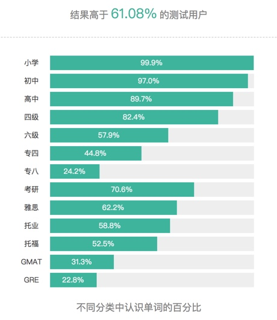

**Day111（2018年4月28日，周六）**

背了四个月的单词，自我感觉效果不佳，或许真的是年纪大了，记忆力衰退。哪怕是刚查过的单词，过一会儿又想不起来它的意思……

上周用墨墨背单词测试了自己的词汇量，答了300道选择题，得出的结果是5731个——距高中毕业生应掌握的英语词汇量还差10%。详见下图：

为确定自己的词汇量较四个月前是否有增加，我又跑到之前用过的一个网站testyourvocab.com再做一次词汇量测试，成绩是4560个，出国前的成绩是3000个。也就是说四个月增加了1500个，这让我感觉到些许安慰，照这个速度，今年年底应该可以拿下7000个核心词汇，虽然会落后于我的原定计划。

出于好奇，我又找了五个网站测试词汇量。其中小数据研究所的测试方法非常独特，它是让你选择一个单词的反义词或者近义词（四选一），缺点也显而易见，被测试者有25%的概率蒙对，如果它能多提供一个“我不知道”的选项，那样就更加科学。

扇贝背单词　3200

新东方 4720

轻松背单词 4713

百词斩 4470

小数据研究所 5250

欲知后事如何，且等 学择新西兰（Choose NewZeaLand）Day112
