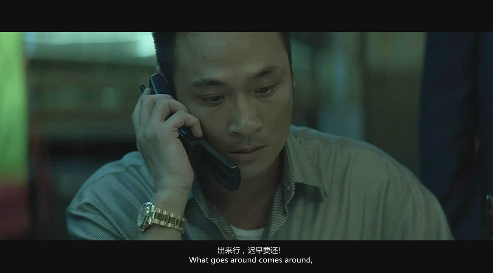

**Day220-221（2018年8月29日-8月30日，周三、周四）**

出来混，迟早要还的。一言不合就拿刀砍人结果反被杀的昆山龙哥做梦也没想到死后竟然可以如此风光，刷遍全国朋友圈。

这让我想起2016年的辱母杀人案，被告于欢因母亲受辱愤然反击杀死讨债人。

或许有人说以暴抗暴不对，应该报警云云。问题是，不法侵害进行中，报警有用吗？最新的滴滴顺风车杀人事件中，待女孩的朋友成功报警后，黄花菜都凉了。

再则，警察是召之即来、能够从天而降的超人或者钢铁侠吗？对受害者来说，拔腿就逃或者自卫反击才是第一选择。至于什么情况下应该拔腿就逃，什么情况下应该自卫反击，事后判断全都是事后诸葛亮。受害者根据自己的主观感受做出选择，就是对的，即便这种选择是肾上腺素飚升后产生的（事后看来不是最优的）选择。讲白了，除非受过特种训练（特种兵、间谍），常人在这种状况下，保持100%理智是不可能的。

况且，你凭什么判断受害者一定逃得掉，万一他/她本来跑步就跑得慢呢？要是他逃了，对方开车追，两条腿跑得过四个轮子吗？受害者被撞死了，又怎么说？他活该被撞死？

当受害者面临人身安全威胁，作出什么样的反应都不过度。特别是在大街上，他怎么知道对方没有同伙随时会窜出来给他一刀？他若不表现得比对方更狠，又如何保命？

所以，昆山龙哥之死，完全是他咎由自取，反杀者属于正当防卫。

我知道中国的法律会再一次给出“防卫过当”的荒唐判决，但是正义在民间，没有人会认为这位反杀者是罪犯。也有好心人担心反杀者将来会不会被龙哥的家人或“兄弟”骚扰，我觉得这属于杞人忧天了：谁敢去招惹一个杀过人的老实人，那真是不想活了——龙哥在天上等他们呢！

此事以英语记之如下：　　

Death of a hooligan

This is a funny news happened in China yesterday.
When a drunk hooligan was attacking an innocent passerby with a watermelon knife, the knife fell onto the ground. The passerby picked up it and killed the hooligan. Everyone on the scene was shocked.
I don't think the hooligan ever thought that he would die in this way. 
However, the world is fair, everything that has a beginning has an end.
