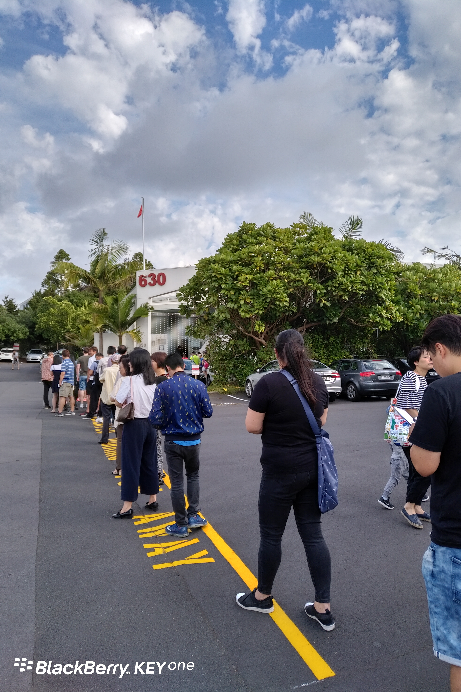
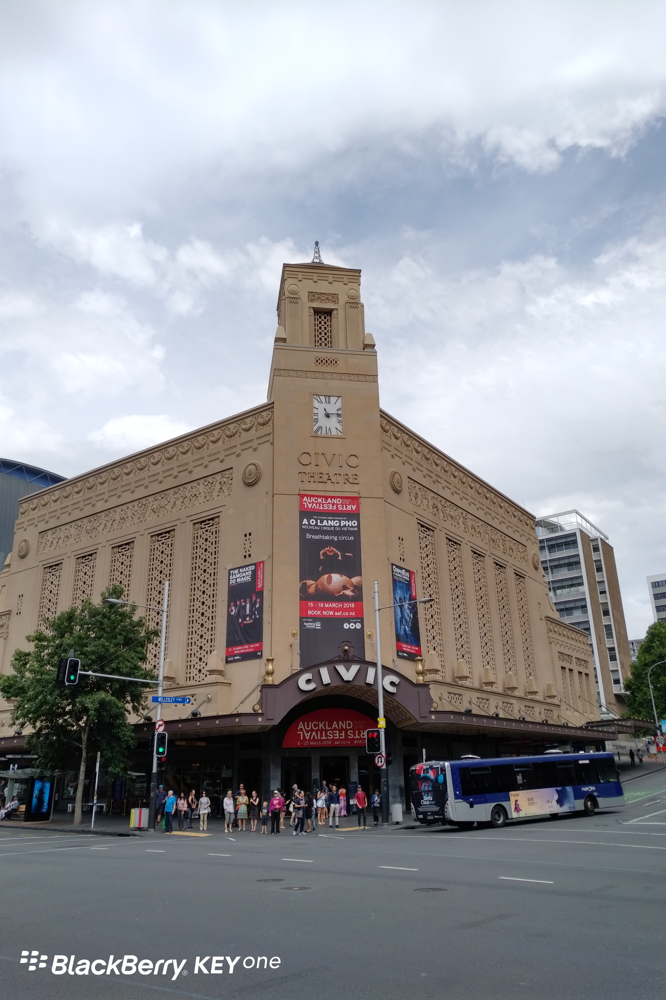

**Day5 (2018年1月12日，周五）**

像昨天一样早上4：30醒了，不晓得是什么原因。
醒了一阵，又迷糊睡去直到被闹钟吵醒。

上午陪儿子去中国驻奥克兰总领馆办理护照更新。
到达的时候，总领馆尚未开门，大家排在门外。

别看人多，开门后，办事窗口的工作效率很高，两三分钟换一个人。
这就是网上预约，提前准备好所有材料的好处。

回家路上，走过CIVIC，这算是奥克兰市中心的一个标志性建筑。
我对标志性建筑的定义只有一个：出租车司机全知道的建筑物。

关键词：安定
