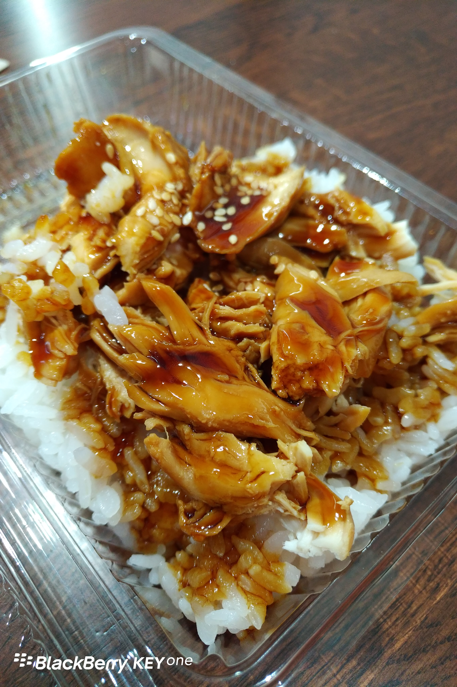
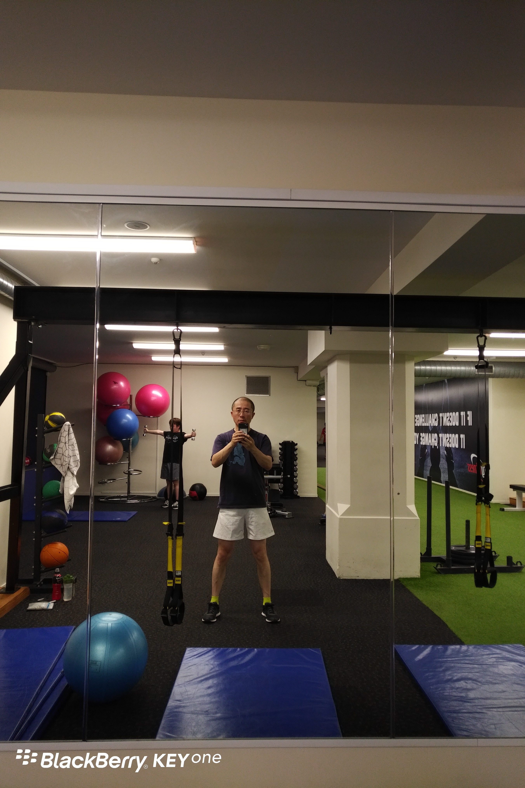
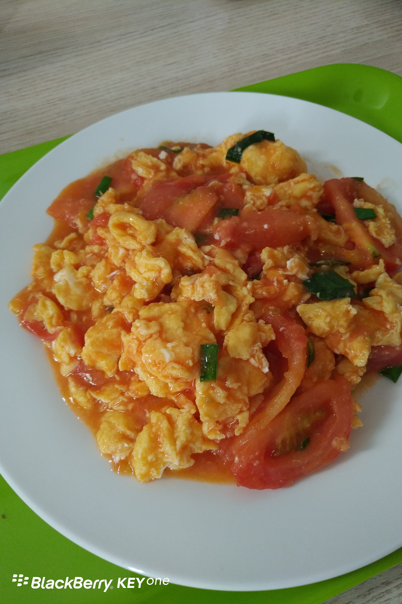

**Day7 (2018年1月14日，周日）**

在上海，你很难想象一个商店每逢周日会休息。咱们的商店春节都不打烊呢！可是在新西兰，随处可见周日关门的商店。本想去吃烧腊，结果吃了闭门羹，只好临时找了一个连锁寿司店解决午餐问题。

我这份饭，纽币8.70，折合人民币40元多一点，味道很赞。

人民币40元，好象不便宜。但是帐不能这么算。我们来看，上海一个钟点工，工作一个小时赚25元人民币。25元，金拱门的双层巨无霸套餐都吃不上。

而在新西兰，工作一小时就可以有16.5元纽币（法律规定）。去年11月，我和儿子吃了金拱门的两个4层巨无霸套餐，还单点了其他东西，总共花了不到40元纽币。

儿子心血来潮要去健身，于是一起去cityfitness办了一张黑卡，支持亲友分享。

入会费是49元纽币，送了一个健身包包。每周的费用大约13元纽币，按周支付，绑定银行卡自动扣款。提前通知可取消。

我觉得这个收费方案比较人性化，对于不能坚持健身的人来说，不会浪费钱。对于真的坚持下来的人来说，这一年的投入和收获的“健康”相比，怎么算都不亏啊！

以下这盘蕃茄炒蛋上镜的惟一理由，就是教授我自己烧的。本人生平第一次，照着菜谱自学后独立完成的作品。儿子说咸了点……我怀疑我用了一本假的菜谱。

关键词：美食 健身

欲知后事如何，且等 学择新西兰（Choose NewZeaLand）Day8
