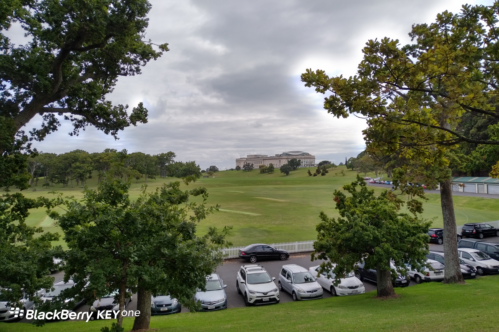
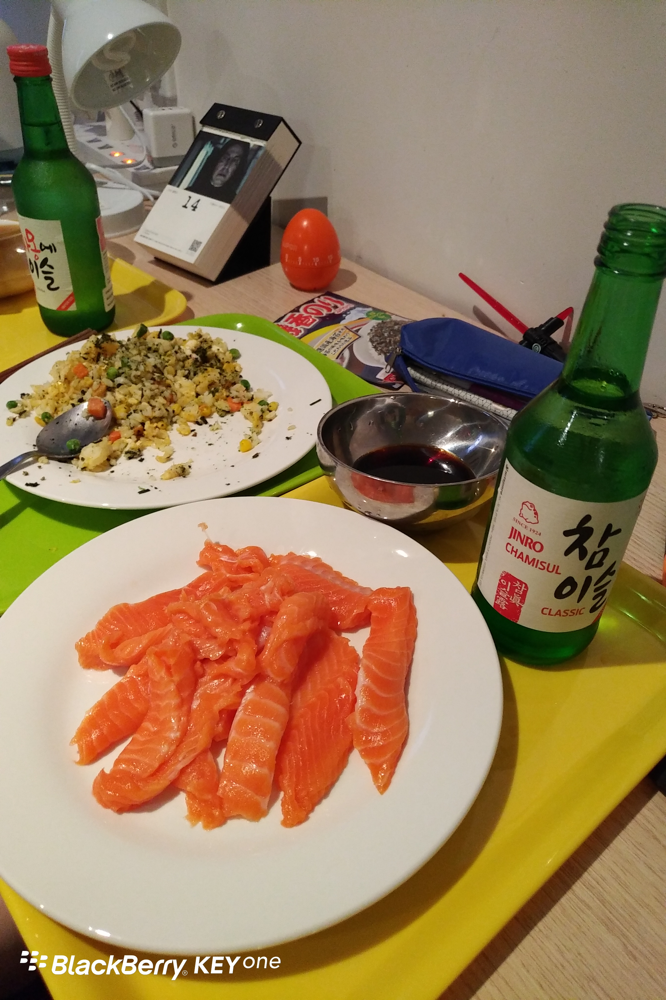

**Day8 (2018年1月15日，周一）**

路过Auckland Domain，好大一个公园（照片所示可能只占其十分之一），竟然可以随便进出玩耍。要是在天朝，岂不要圈起来收个门票钱？　

这个iPhone，解锁起来有些难度。

晚餐，自己在超市买了三文鱼，10.26纽币，胡乱切了。两瓶韩国烧酒，15.98纽币。写文章的时候，忽然发现那么高大上的电影日历竟然没撕，停留在昨天14日，赶紧跑进去撕了。

关键词：乐趣

欲知后事如何，且等 学择新西兰（Choose NewZeaLand）Day9
