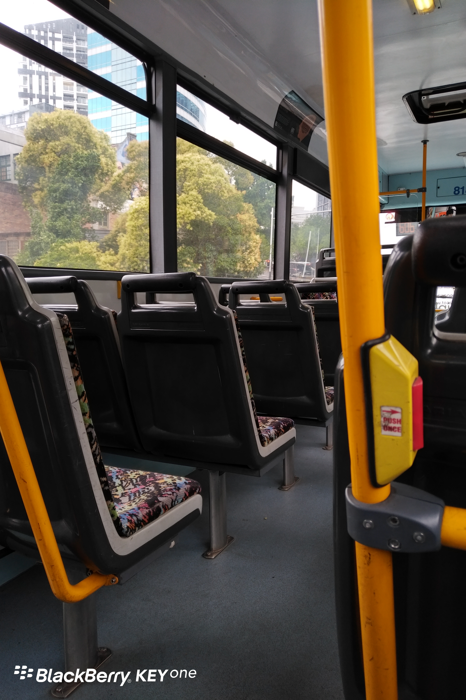
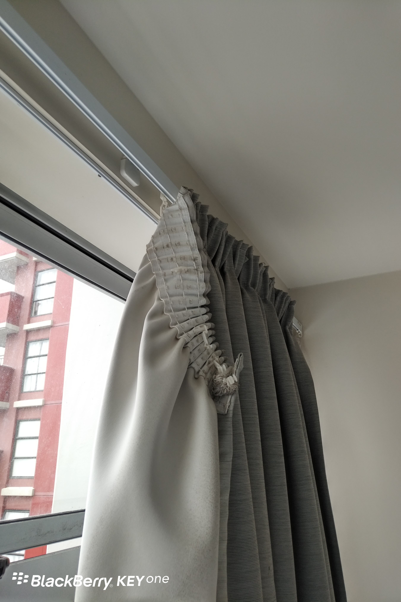
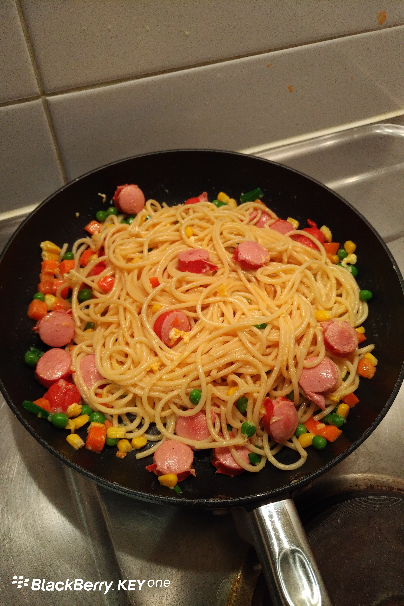

**Day10 (2018年1月17日，周三）**

根据新西兰移民局的要求，办学生签证必须拍X光。早上我先去了415 Queen St. 去了才知道这里只是办登记拿号码，拍X光在280 Queen St.

我冒着小雨连蹦带跳到了280 Queen St.　咦？怎么是个商场。围着转了一圈，搞不清楚啥情况，只好硬起头皮问路，被告知移民局在四楼。

坐商场电梯到三层（老外叫二楼），出现写字楼的电梯，进去按4，按了没反应。边上的黑人阿姨告知……BE CLOSED，我一脸茫然地走出电梯：移民局关门了，不可能啊！Google了一下，并综合周边等待人群特征分析后得出结论：移民局10点营业。

待10点钟上楼，排了三分钟的队，我忽然意识到不对劲，遂拿着表格走出队伍问保安大爷。保安大爷说的话我80%都没听懂，但我听懂了最核心的20%：拍X光在2楼，出电梯后绕一绕啥的。

回到二楼，仔细找了圈，果然发现了拍X光的地方。

此时，我才感觉到第一回上二楼时，发现的那家诊所挺有意思。它的市口好，大家很容易误认它那里可以拍X光。所以它在门口写着“X Ray not here”（拍X光不在这里）。

可是，你一样打印一张纸，为啥就不学个雷锋，多写一句拍X光在哪里呢？同行相忌？

说个花絮：拍X光的医生是个金发碧眼的美女，还会一点点中文。她要求我脱掉POLO衫，赤膊照X光！我的POLO衫没有金属钮扣啊……新西兰的X光机穿透力不够？再说老子又没有八块腹肌，丢不起人哪！我略微犹豫了一下，不知道说啥，即使知道说啥不知道怎么说，只好乖乖服从了医生的要求。

10:30在奥克兰市中心上了公交车，去朋友的公司交表格。公交车上连我只有4名乘客。红色的按钮是招呼司机“下一站”停车，如果你不招呼，下一站站台上没人，司机就直接开过站了。因此在奥克兰坐公交车，我丝毫不敢懈怠，时不时盯着谷歌地图看一眼，盘算着在什么时候按一下，生怕坐过站。

下午呆在公寓，配合房东做了一些修缮工作（修窗帘、换花洒、修吸尘器）。窗帘都这样的了，前一个房客居然还能将就着使用。我肯定不能忍，还是要让房东履行一下责任的嘛，天下哪有只收房租不维护房屋的好事？

房东在我们这个楼里有多套公寓在出租，他的职业是会计师，可此时摇身一变就是专业修理工。拿房东的话来说，这里人工贵。像这种小活，人家出工，价格开高了，你心里不爽；收低了，工人不乐意。想想也是，在国内，沐浴房的导轨滑轮坏了，我妈妈打了很多次电话，工人都不愿意来修。

晚餐是我拍脑袋发明的新西兰炒面，将蛋炒饭技术灵活运用到意大利面上，米其林大厨桂冠指日可待。

关键词：DIY

欲知后事如何，且等 学择新西兰（Choose NewZeaLand）Day11
