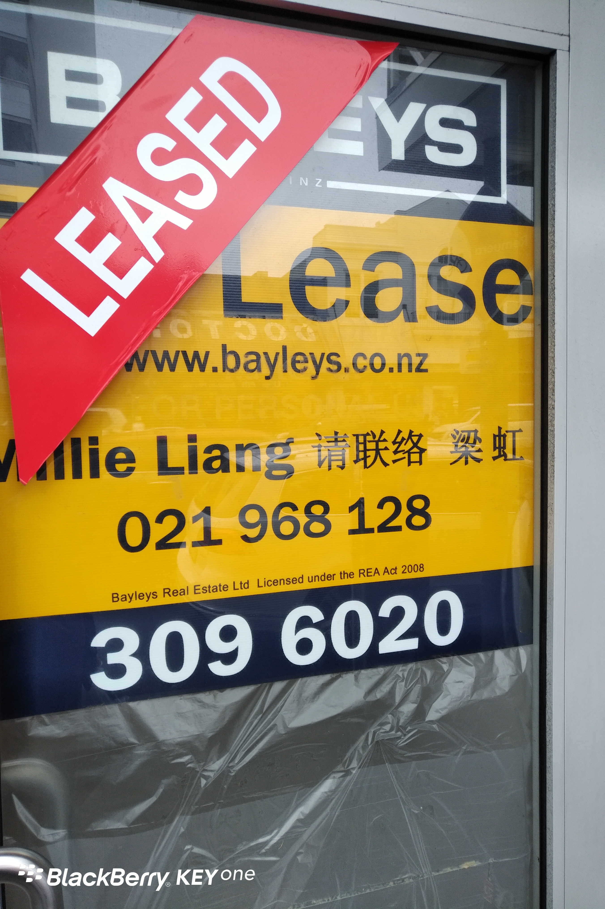
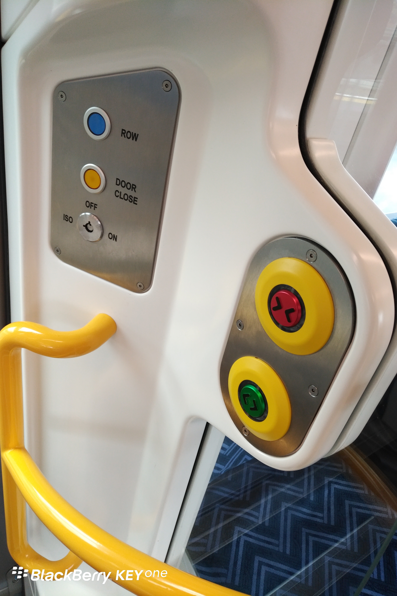
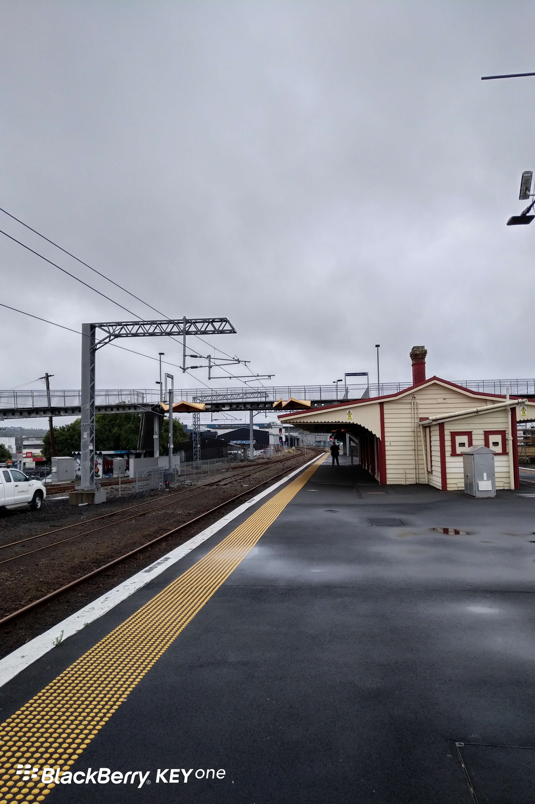

**Day11 (2018年1月19日，周四）**

到现在为止，我叫不出新西兰总理的名字，但我可以叫出某个素未谋面的新西兰房产中介的名字：梁虹。我印象中，凡是空着的商铺，多数都贴着她（/他）的名字。如此高的曝光率和知名度，要是不去竞选议员，可惜了。

吃过午饭和儿子一起坐轨交去领事馆。到站后，车厢的门竟然不自动打开。等了会儿，我感觉苗头不对，看右侧有个绿色按钮闪烁着，按了没反应（实际是按迟了）。又过几秒，列车缓缓启动……我们只好在下一站反方向换乘。

这个设计背后的原理跟公交车差不多，有些站点上下客少，你不按钮，它就不开门。我们反方向换乘上车时，车门也没自动打开，门上有个绿色按钮在闪烁。吃一堑长一智，我赶紧按下去，车门方才打开。

反方向换乘时，我拍下了空荡荡的站台，此时候车的人连我们一共3个。

关键词：尴尬

欲知后事如何，且等 学择新西兰（Choose NewZeaLand）Day12
