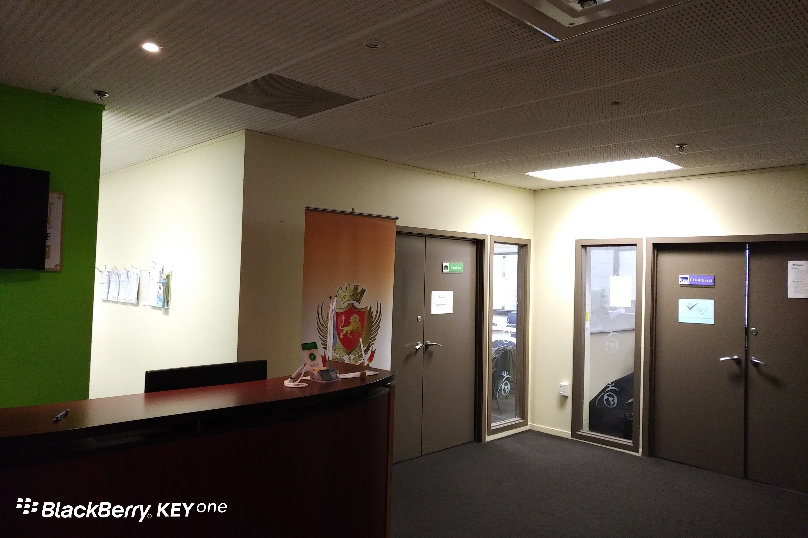

**Day15 (2018年1月22日，周一）**

开学第一天，背起书包上学堂。这个语言学校的名字很有意思，叫Kingston，对于我来说，这就是内存条的名字。

上午做了个测试，我被定为Level 2。不管有多少级，我知道这肯定是倒数第2个级别。

插班进去，老师是个女的，叫M啥的，我都记不住发音……明天一定要搞清楚。

学的是啥呢，请听题： You and I ___ sister and brother. 划线处填are还是填am？

我在网上搜索了下，还是犯迷糊，麻烦知道的同学留言告诉我一声。

欲知后事如何，且等 学择新西兰（Choose NewZeaLand）Day16
