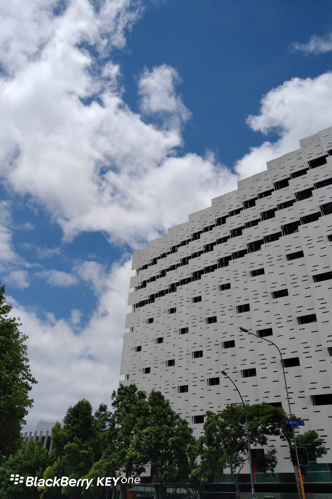
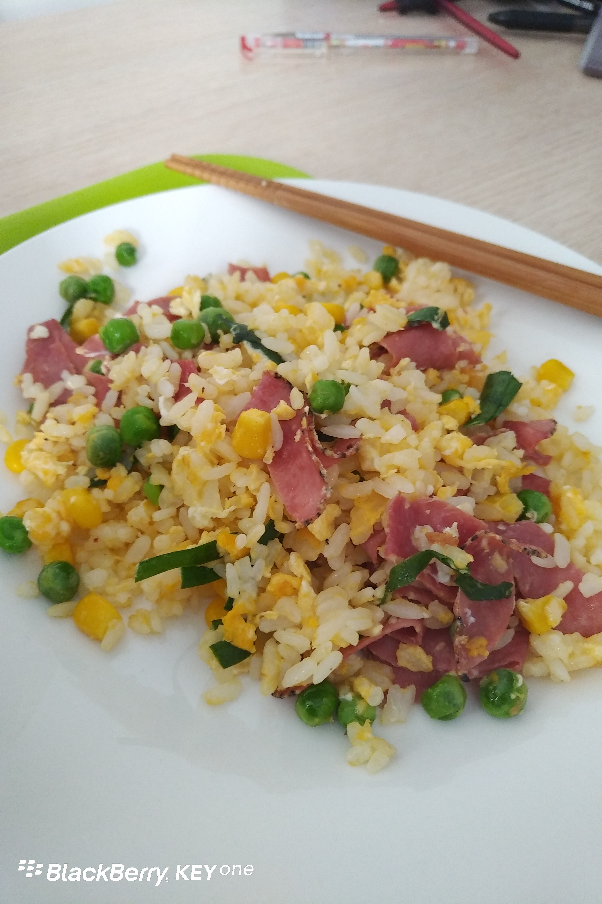

**Day18 (2018年1月25日，周四）**

上次拍过AUT这栋楼，觉得那个角度不如这个角度好。

语言班的同学个个都是有故事的人。

我的同桌，姑且称他路人甲吧。他自称是来读研究生的。我莫名惊诧：靠，你大学都毕业了，那咱们这个班对你来说是不是太浅了？

他谦虚地说自己视力特别好，高考的时候“借鉴”了边上同学的考卷，借了近100分。哦，原来如此，这家伙绝对是当飞行员的好材料啊！

今天我和路人甲交换“批改”答题的时候，我发现他连“现在进行时”都能弄错，我忍不住又问：你大学英语四级怎么过的？

他说是他学艺术的，不用考英语。他去年七八月份就来了，从LEVEL 1开始念，今年升到 了LEVEL 2. 哦，原来如此。可问题是，考研究生雅思至少得5.5啊，这要上到啥时候？

不过，无论如何，我赞同在游泳池里学游泳这个做法。像现在这个老师，我要问她什么问题，I have to speak English. She has to listen my bad English.

话说，本尊的蛋炒饭技术已臻化境。

欲知后事如何，且等 学择新西兰（Choose NewZeaLand）Day19
