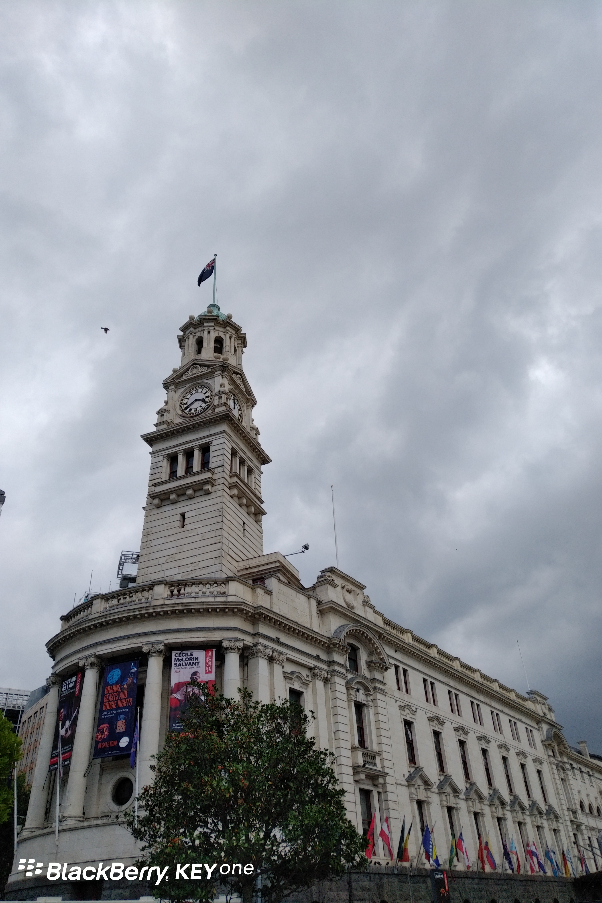

**Day20 (2018年1月27日，周六）**

今天多云。

我的儿子到新西兰留学，纯粹是一个偶然的决定。

原先我儿子中考后的学习路径是“3+2”，即三年中专，两年大专，中间不需要参加高考。　在他读到中专二年级下半学期时，我说今年暑假我们家不出去旅游了，我让你一个人去新西兰游学一个月，开开眼界。

我的老同学David在新西兰做“留学中介”，把儿子的行程交给他安排，自然是一百个放心。当然，我每次称David为“留学中介”，他总会认真地纠正我这个说法：他说他是为新西兰的学校在亚洲地区做市场推广。

游学结束归来，我儿子想继续到新西兰留学。孩子有留学的愿望，只要家庭经济条件允许，父母一定是全力支持。我支持他留学决定的另一个原因是，我认为留学生活有助于培养他的独立性和生活自理能力——后来的事实证明，（我的）理想很丰满，现实很骨感。

于是，2015年年末，他再次孤身一人前往新西兰。David为他制定的学习计划是：先上6个月的语言班，再上18个月的大学预科。

欲知后事如何，且等 学择新西兰（Choose NewZeaLand）Day21
