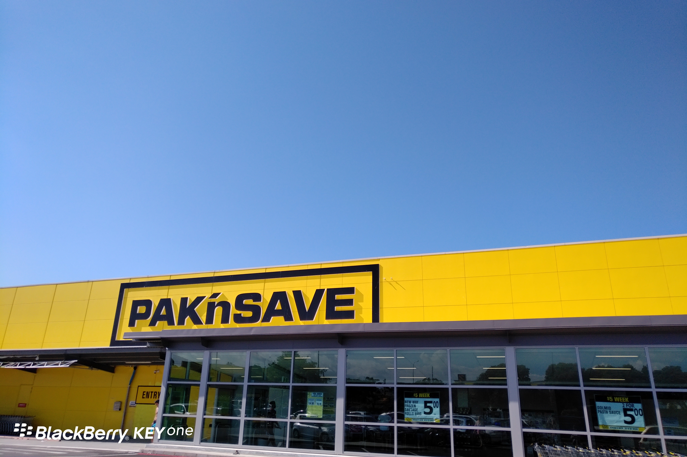
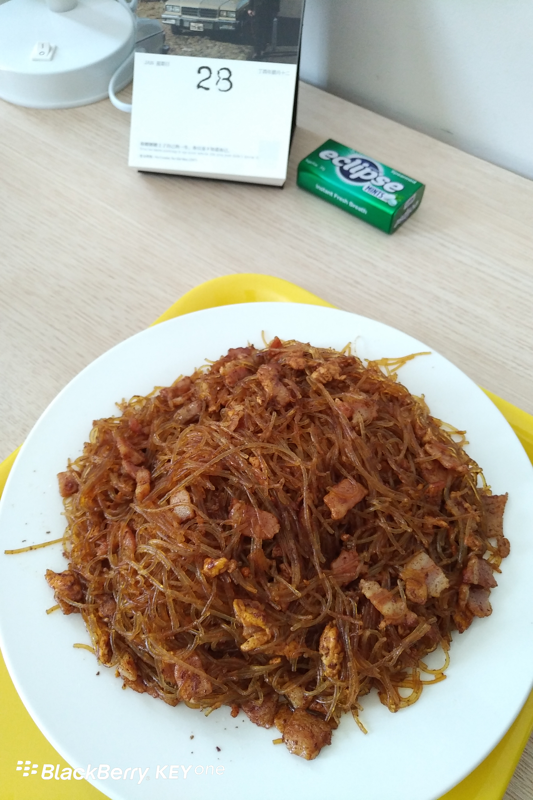

**Day21 (2018年1月28日，周日）**

下午，来自中国的留学生和家属在新西兰“留学中介”巨头David及其夫人的陪同下，参观了新西兰著名的Pak'n Save（超市）。

我儿子曾经向我表示出对David的些许不信任，认为他所处的位置导致他说出的话可能有利益导向。

确实，中国历来有“无商不奸”的说法，整个社会对商人都抱有多多少少的敌意。你们看到的对某些商人的敬意，实际只是对金钱（或其背后势力）的崇拜。

而我认为，商人不赚钱，是最大的不道德，逐利是商人的天性，一个商人对钱不敏感那就不是一个合格的商人。——某人赚了很多钱，却自称犯了人生最大的错误，后悔不迭，夜夜难眠……绝对超级大奸商！

一个商人，一将其产品和服务明码标价，二不乱拍胸脯（不向客户承诺自己做不到的事情，一旦承诺就一定要做到），那他就不是个奸商。

在我看来，一个留学中介，要是敢向我儿子承诺考试包过，那他就是个奸商。不过，他如果承认自己是专门办假文凭的，那他就不是奸商。（此处暂不讨论造假的法律问题）

撇开我与David的交情不谈，综合我的审视标准和实际情况来判断，David肯定不是个奸商。前段时间，我甚至嘲笑他的经商道德底线比我还高，连操纵消费者心理的标价小技巧都不会（或是不屑？），比如在价格牌上标个市场价（划掉），底下写上促销价（注个日期）。

留学中介好比媒人，了解清楚男女双方背景，确保“门当户对”，给男女双方牵个线搭个桥，就完事了。男女朋友谈得成谈不成，关媒人屁事，难道还要媒人承诺包结婚包养儿子啊？！

下厨之后，我发现洋葱是个好东西，紧急时可以替代生姜；培根也是个好东西，紧急时可以替代肉末。　

欲知后事如何，且等 学择新西兰（Choose NewZeaLand）Day22
