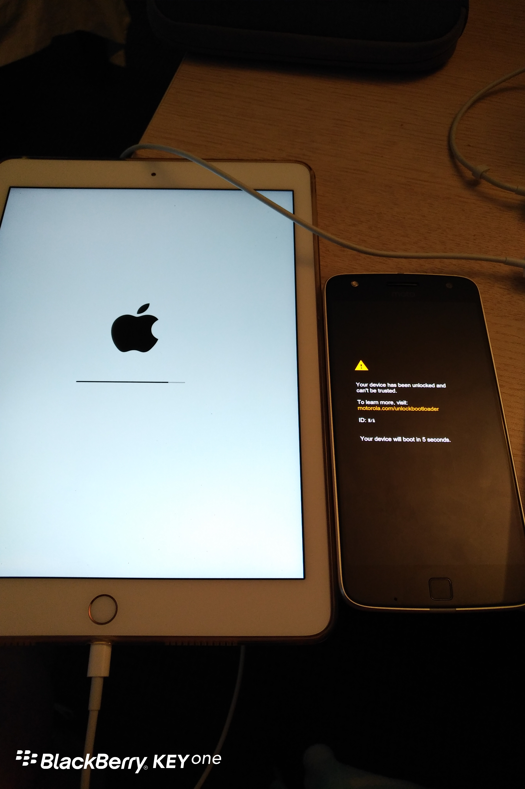

**Day25 (2018年2月1日，周四）**

电脑老军医遇到治不好的病，就会变成自己的心病，不解决总是如芒在背。

早上起床，我鬼使神差般地拿出iPad Pro，下载了一个工具软件，尝试还原系统。还原系统先要进入DFU模式。DFU模式，你可以理解成让iPad接受一种可以被刷机的模式。我按照这个工具软件操作，没什么反应。再打开苹果自家的iTunes，居然成功还原了系统，救活了iPad Pro。

十分诡异的是，在还原系统的同时，我发现电风扇打不开，MOTO Z PLAY手机也突然卡死……正所谓有得必有失啊。

儿子留学第二年

4. 大学预科第2个半年：等我拿到学校成绩报告单的时候，他已经进入了第3个半年。我只能说学校的工作效率令人发指，和中国的学校不能比。报告单显示的成绩比第1个半年要差，出勤率也在降低。此时，我除了继续敲黑板提醒他，还能做什么呢？惟一的希望就是他能开窍，我永远叫不醒一个装睡的人。末了，他搬出了大学生公寓，以省房租为理由，和几个同学（或校友）合租了一套公寓。David当即就向我表示了担忧，建议安排一个HOMESTAY，我跟儿子商量，他不接受。
5. 大学预科第3个半年：这个时间点我记得非常清楚，2017年8月初，会计学考试，他临时抱佛脚找David夫人恶补，David夫人发现他的书本是崭新的，觉得问题严重。我授权David帮我去学校调儿子的出勤记录，结果令人触目惊心。仅看6月、7月两个月，他就没怎么去上过课，即使有出勤，也是迟到。我向我儿子发出了最严厉的警告，学期结束考不上大学就回国。

David建议我立即到新西兰。我说我的工作不允许我说走就走。再说我并没有签证，签证也需要一个过程。最终，我把赴新西兰的日期定在2017年11月12日。

David鼓励我儿子拼搏三个月，根据以往的经验，最后三个月是关键，拼搏成功未必没有可能。同时帮他安排了一个学霸，督促他每天起床去上课，必要时在学业上给予指导。

临时补救计划看起来还挺靠谱。计划执行的前两周，我儿子的出勤记录完美无缺——2017年11月16日，我坐在大学预科学校的办公室里，拿到了他整个学期的出勤记录。

……

下图不是我做的菜，是某个餐厅的，哈哈。有朋友自远方来，不亦悦乎。

欲知后事如何，且等 学择新西兰（Choose NewZeaLand）Day26
