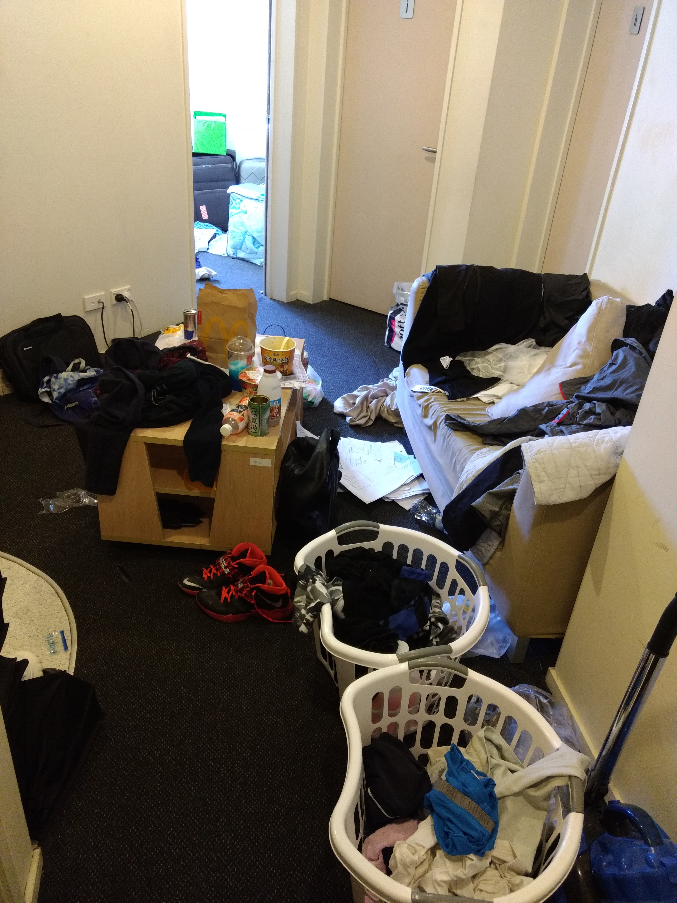
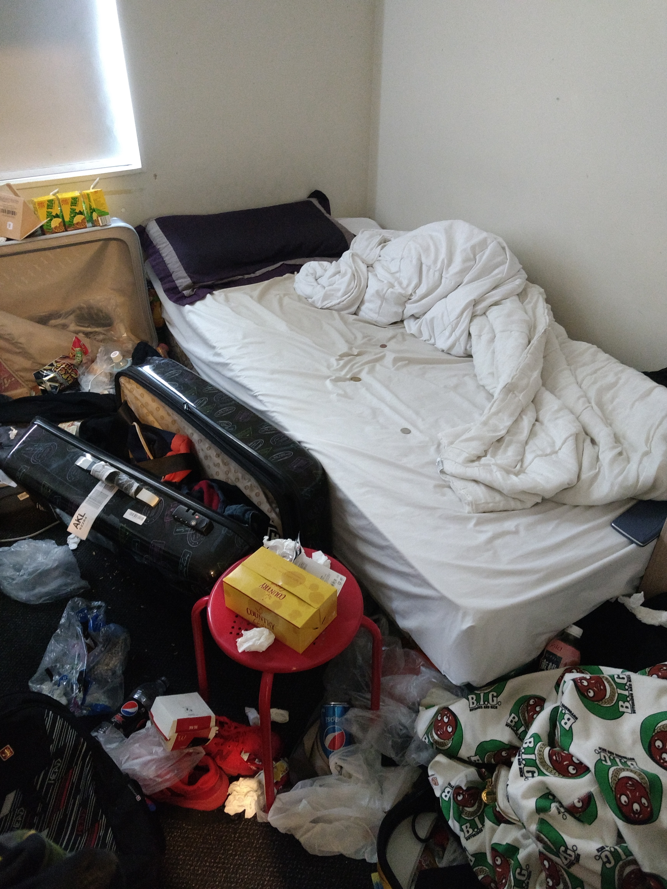
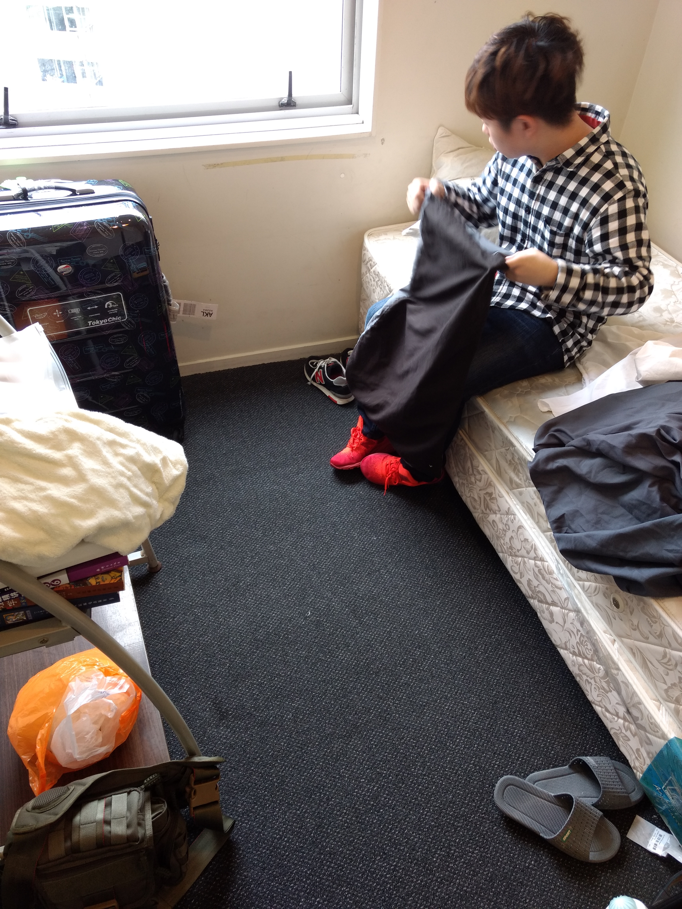

**Day26 (2018年2月2日，周五）**

天抹微云，大抵就是如此了。

2017年11月16日，我和David坐在大学预科学校的办公室里，拿到了我儿子整个学期的出勤记录。

我翻看出勤记录，很明显地看到，我向他提出严厉警告并开始执行临时补救计划时，那两周他的出勤记录完美无缺。之后，又是断断续续。对于这点，我心理有准备，因为他曾给我吹过风，说为了赶进度没去学校，改去图书馆补习。

我跟老师说我儿子今天上午有考试，约好了考完试与我会合。老师很吃惊说：“他们昨天就考完了。”她特地查询了系统记录，确认她的记忆无误。

我一下子就懞了，连续了打几个电话给儿子，无人接听。过了十来分钟，儿子回电过来，说马上从公寓出来，十分钟后到。

这时，我手头掌握的信息只有出勤记录，惟一能做的事，就是当着老师的面将他劈头盖脸训斥一通。

David建议我到他住的公寓去看看，看看他的生活状态。儿子一开始不肯，我执意要去：我说我也住宿过，可以想象得到男生寝室的乱象。等我儿子打开房门，我发现我远远高估了我自己的想象能力。

下图是4个学生共享的客厅。我进去的时候，沙发上居然还坐着一个人。

下图是我儿子的房间。注意，这是他先进去清理出4袋垃圾之后，同意我进门参观时的状态。我直接跟他说：走吧，这两天你别住这儿了，跟我去住民宿。

下图是11月18日，我们一起收拾完之后的状态。

欲知后事如何，且等 学择新西兰（Choose NewZeaLand）Day27
