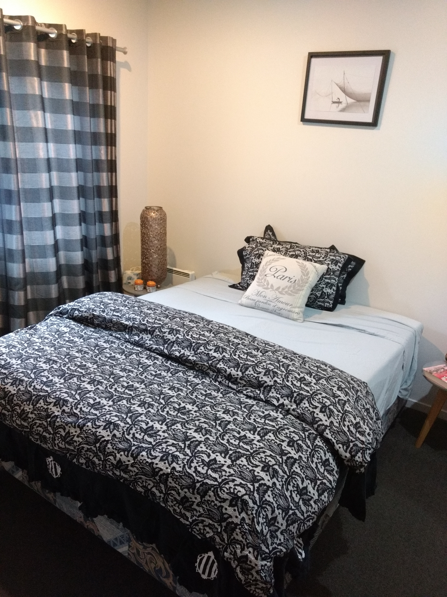

**Day27 (2018年2月3日，周六）**

先发个老段子：

养育一个小孩就像发射卫星，花费数年的心血精心确保每个细节和数据的正确，时刻警醒不让卫星有任何偏离轨道的可能。

最后一朝发射成功，考上大学，然后卫星就消失在茫茫的外太空，只剩下定期不定期的发回来一些微弱的信号……生活费……生活费……生活费……

把生活费发给了卫星，叮嘱卫星吃好穿暖。卫星又发回来微弱的信号……别唠叨……别唠叨……别唠叨……

2017年11月16日，儿子跟我住进了民宿。第二天，他坚持要住回自己的窝。跟我形影不离，他浑身不自在。

下图是我当时住的民宿。

一开始我不同意，那样的环境还能住人？这不又要重陷泥潭么？David做了和事佬。条件是：儿子每天上午9:30必须出现在David的公司，白天就呆在那里自学英语，直到下午4点钟。

16日当天，尽管我们没有拿到他的成绩单，但是我们心里十分清楚，他毕不了业。过去，他一直像鸵鸟一样把头埋进地里躲避现实，直到最后一刻。问题是现实，就在那里，怎么躲避得了，该来的总会来。

2017年11月20日（周一），学校陆续有坏消息传来，直到11月23日（周四）上午，消息出尽：毕业一共考四门，我儿子缺考2门（无成绩），有成绩的2门，成绩亦惨不忍睹。学校十分干脆地拒绝了我们提出的重读一年的请求，表现太差，成绩太烂，要申请重读必须再考一回英语——完全当作新生来处理。

面对我们的批评，儿子竟然起身拂袖而去，顺手还发了个朋友圈：要被逼疯，就算我三观不正好了。

当天下午，我和儿子在会议室爆发了激烈的冲突——当然不是打起来，而是嗓门越来越大。

我的谈话思路（以下三点），放到成年人的世界里看，肯定无懈可击。可是我的谈话对象心智尚未成年，当时又非常情绪化，开局没多久便反弹。

我自然针锋相对。擦，老子已经放任你两年，今天你混成这个鸟样，老子不远万里跑来给你擦屁股，你有什么资格跟我发脾气？我甚至想，算了，带这小免崽子回国去拉倒。

1. 你三观肯定是不正的，要是三观正，今天我也没有必要来到新西兰，去面对学校的老师，看他们对你的表现和成绩摇头。
2. 正因为以前我不逼你，所以你才会发展到今天。现在面对这么一点批评，就要疯？那我是不是应该先被你气疯才对？是男人，要有担当，做了就不要怕别人说，怕别人说那当初就不要做。这个尊重强者的世界，不会因为你强烈的自尊心而改变其规则。父母家人可以照顾你的感受，外部世界则不会。另外，考虑你自己的感受之前，多想想“因”，自作理当自受。
3. OK，关于对未来的信心，既然你到现在还不确定，那么就不确定好了。不确定也是一种人生状态。既然你不为自己做出选择，我作为你的父亲，我就得替你做出选择，帮你制定信心恢复计划。因为我知道，我给你制定的信心恢复计划，你只要照做，就一定能取得一个更好的结果。这个和健身私教的原理是一样的。过一段时间后，你就能自主选择人生道路。

我们的嗓门实在太大，David不得不进来做和事佬。千万不要小看David的和事佬角色，没有他，我们父子谈话的结局就是一拍两散。同样的话，换成中间人讲述，听者的接受度更高。

欲知后事如何，且等 学择新西兰（Choose NewZeaLand）Day28
