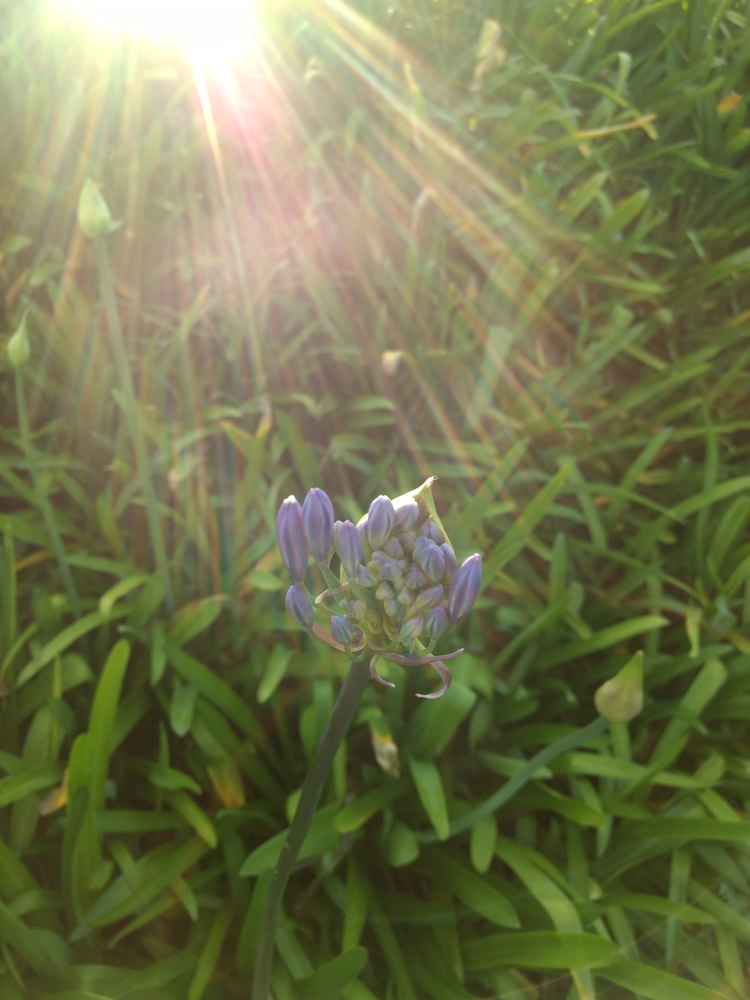

**Day28 (2018年2月4日，周日）**

2017年11月23日，残酷的形势已经完整地展现在我面前。

1. 4门功课，2门挂科，2门弃考；
2. 学校拒绝直接重读一年；
3. 即使学校接受重读，2018年移民官是否会继续给予签证，还是未知数

当下，我不认为我的儿子有着健康的心理状况，我甚至怀疑他有轻度的抑郁，否则就无法解释他这一年的浑浑噩噩。

可能你会好奇，他不去上课，到底在干什么？

答案是不干什么。他并没有告诉我，但我完全可以脑补出他的一天：一觉睡到自然醒，醒了也不起床，因为那个屋子里没有其他能坐着的地方。躺着刷刷手机，聊聊天，看看视频，困了再睡。（曾经玩电脑游戏，后期不玩了）。最多跑出去吃点东西，要是新西兰外卖像上海这样便宜，估计他可以足不出户。

另一个“宅”的证据是，他一年生活费总开销约为2万纽币，这是一个留学生的正常开销。

放弃继续留学，回国，是最先考虑也是被最先否定的一个选择。否定的理由有两点：

1. 回国之后，儿子需要更长的时间走出心理阴影。他在同学面前，一直带着留学生的光环，如今光环破碎，他能若无其事？
2. 他没有高中学历，要继续完成学历教育更加困难。未来社会，一个没有正规全日制大学文凭的人，“实现中国梦”的可能性微乎其微。

不退则进，**哪里跌倒，就从哪里爬起来!!!**

晚上，我把我拍的一张照片，配上这段英文“And God said, Let there be light, and there was light.”发在朋友圈，AT了我的儿子。我想他未必会读懂我要表达的寓意：你向前走的路，取决于你所抱持的态度。你若是阳光的、积极的，路会越走越宽；你若是黯淡的、消极的，路会越走越窄。

欲知后事如何，且等 学择新西兰（Choose NewZeaLand）Day29
