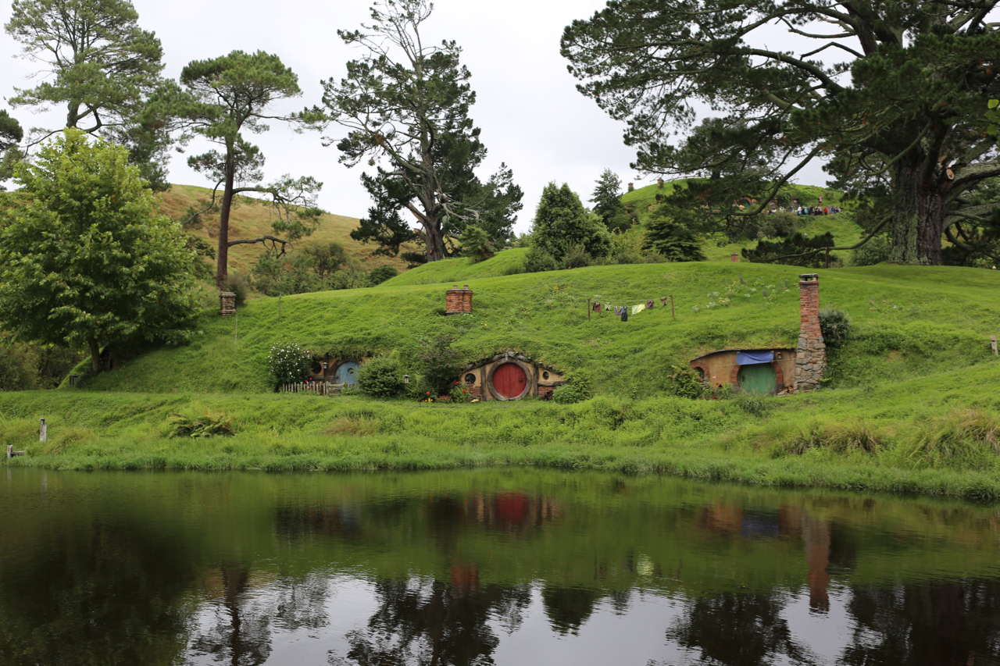
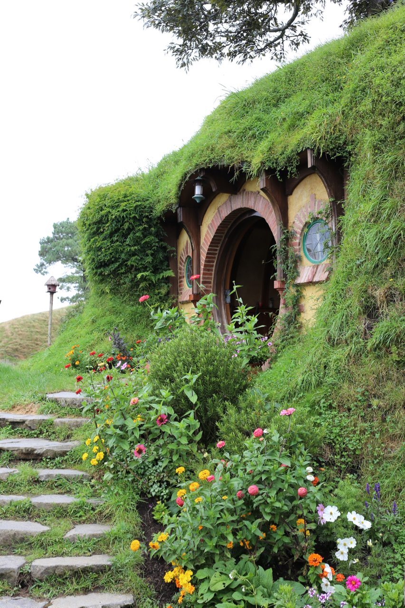
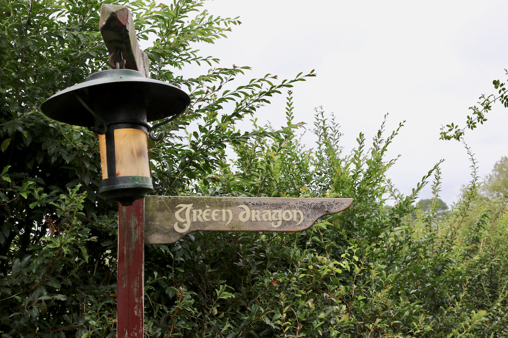
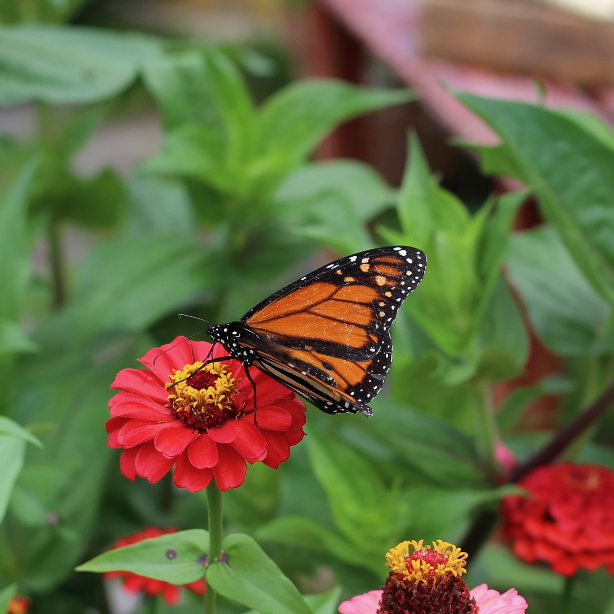
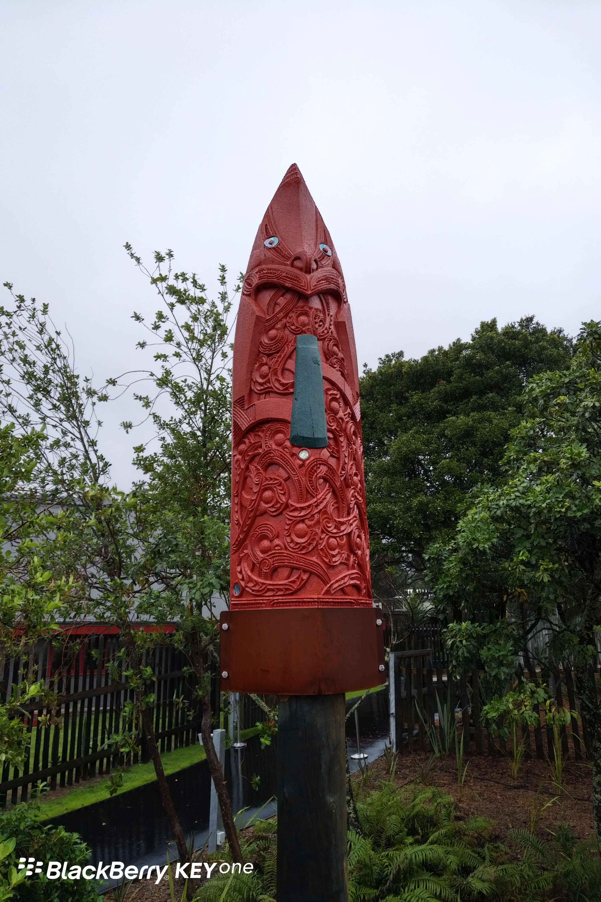
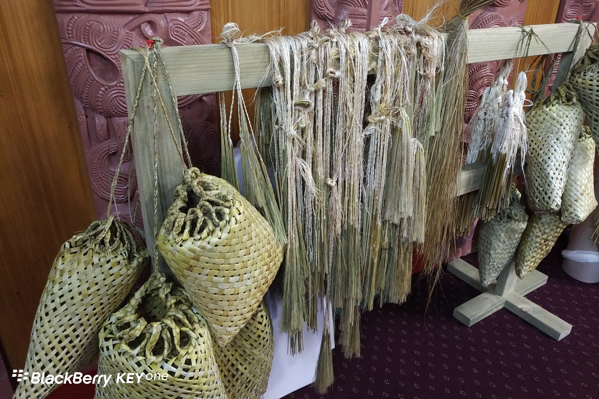
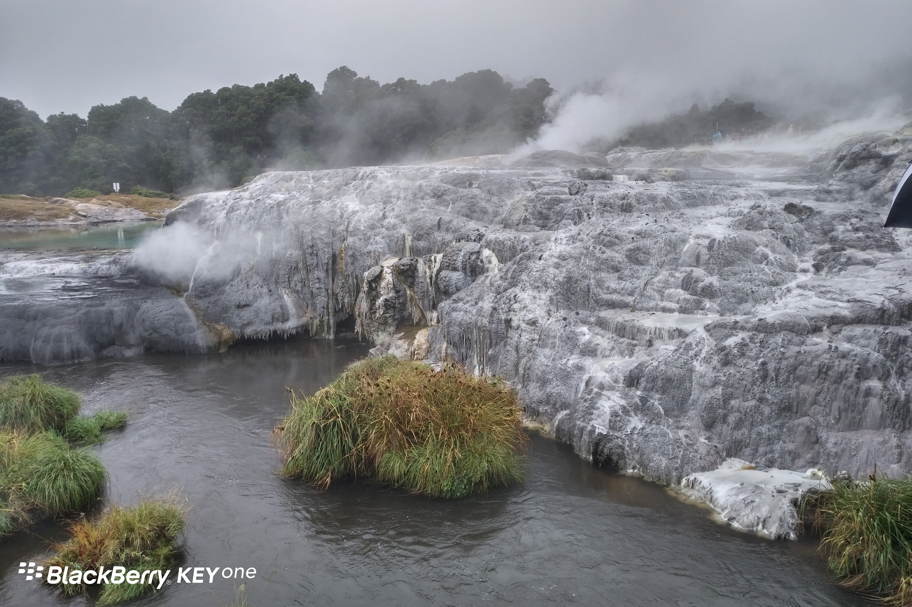
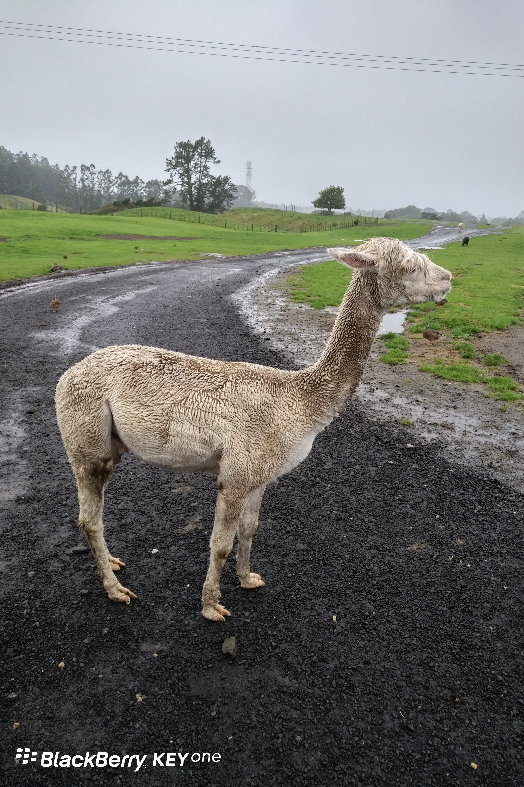

累积两天未更新，照片稍多了些，敬请谅解。

**Day34(2018年2月10日，周六）**

上午11点多到达怀托摩(WAITOMO)洞穴（萤火虫洞），此处不准拍照，所以没有照片。前半段行程是钟乳石，没什么看头，国内不缺少这种景观。

而后半段行程，俺作打油诗一首以记之：暗黑潜行舟，举头望星辰。不敢出声语，恐惊天上人。

下午，转战霍比特人村。假如你没有看过电影《魔戒》《霍比特人》，那么来这儿纯粹是打酱油的，除非你愿意回去补课。

打个比方，桃花岛，这三个字，一般人听着就是个普通不过的岛名，而对金庸武侠小说迷来说，意义完全不同。

晚上抵达罗托鲁瓦（ROTORUA),这个小镇空气中弥漫着硫的味道，他们说边上就是火山湖。

**Day35(2018年2月11日，周日）**

早上，我们乘坐观光船在罗托鲁瓦湖上转了一圈。下雨天，白茫茫一片，没有什么景色可看。

接着，到毛利人的文化中心参观，同时观看了HAKA（哈卡）舞表演。

对了，现在科学研究已经证明，毛利人源自中国台湾高山族。

> 哈卡舞有仪式性的，也有战争式的。战争式哈卡，在开战之前所演示，祈求战争之神庇护，显示己方之力量和无畏，恫吓敌方；两方相遇，还可以对哈卡。
> 更神的是，二战时一次登陆作战，一支新西兰的部队因为第一轮攻击过于仓促，没有跳舞，未能攻下敌方阵地。他们在第二轮攻击前重新跳起战舞，结果一举攻下敌方阵地，之后一路顺风顺水，直接打到了罗马。

> 新西兰橄榄球队表演的HAKA最为著名。由于他们每次比赛的时候都一袭黑衣亮相，所以又被称为All Blacks。橄榄球队员各个身材魁梧，表演起来很有气势，相当爷们。
> 2005年之前的HAKA版本名叫“Ka Mate”。2005年8月28日对HAKA爱好者来说是具有划时代意义的一天。在传统的橄榄球三国赛新西兰对南非的比赛中，新西兰队表演了新版HAKA：“Kapa O Pango”。
> 新旧版本之间有两处比较显著的区别：在新版在台词中提到了新西兰的国草银蕨；而且在新版的最后部分，队员们做了一个割喉的手势。这个手势引起了一些争议。赛后，新西兰橄榄球协会开始商讨这个动作的必要性。在2006年终于给出最终结论：这个动作在毛利族是“运动和能量”的意思，所以没有任何问题。

> 翻译一段新版HAKA的台词：
> Kapa o Pango kia whakawhenua au i ahau!-- All Blacks，让我们与这片土地合而为一！
> Hī aue, hī!
> Ko Aotearoa e ngunguru nei!--这是我的家园！
> Au, au, aue hā!--这是我的时刻！
> Ko Kapa O Pango e ngunguru nei!--All Blacks，该挺身而出了！
> Au, au, aue hā!--这是我的时刻！
> I āhahā!
> Ka tū te ihiihi--我们的实力
> Ka tū te wanawana--胜利就在前方
> Ki runga ki te rangi e tū iho nei, tū iho nei, hī!--我们将得到尊严！
> Ponga rā!--银蕨！
> Kapa o Pango, aue hī! --All Blacks！
> Ponga rā! --银蕨！
> Kapa o Pango, aue hī! --All Blacks！

> 领舞者是他们的队长乌马加（Umaga）。他是萨摩亚后裔，在国家队比赛中屡立战功。2003年对威尔士的比赛中，他现场紧急救治了威尔士队被撞昏的队长查韦斯，帮其脱离生命危险，因而得到了多项大奖。这也是体育运动的魅力所在：更高更快更强之余，还有友谊与关爱。

不知道这是个什么图腾，像火箭一样。

这些编织物品让我想起了老家，上海嘉定的黄草编织，和毛利人有得一拼。

一副末日来临的景象

传说中的草泥马，头发像特朗普。

**Day36(2018年2月12日，周一）**

忽然发现，班上除了韩国大妈和我，其他人都是来混签证的（不管是有意还是无意）。改天再表。

欲知后事如何，且等 学择新西兰（Choose NewZeaLand）Day37
