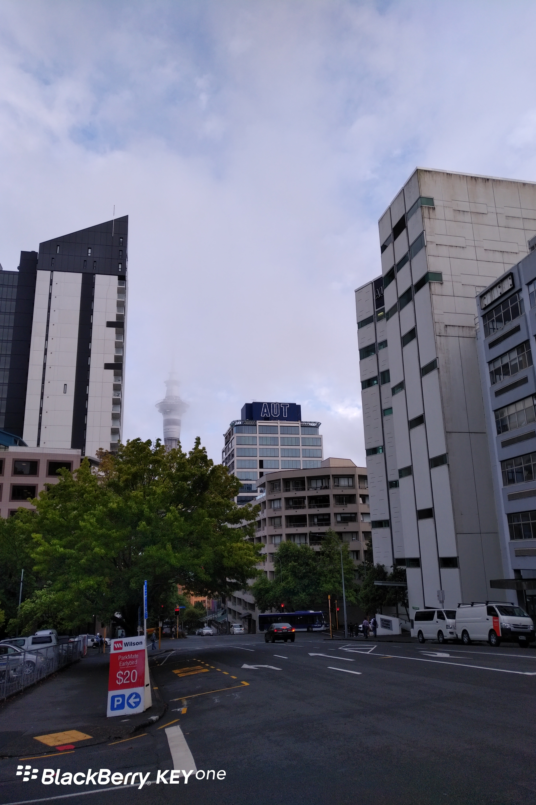

**Day37(2018年2月13日，周二）**

早上到教室，发现新来一个女生，中国人，把我的座位坐了。

路人甲破天荒地准时出现在课堂，我朝他笑笑：太阳从西边出来了啊。

课间休息，我出门晃荡，看见迟到的路人乙在门口沙发上坐着。我忽然想起来上周出了个新规定，迟到的必须关在门外，课间休息时才能进来。

我跟路人乙说：哎，你来干啥呢？你不如找父母谈谈，休学一年，拿笔钱好好去玩，玩够了再学习。

同学们纷纷点头称是。

路人乙摇头：一年玩不够怎么办？我想周游世界，好多地方都没去呢。

我说：你先玩，玩到你不想再玩，像现在这样窝着，纯粹是在浪费你玩的时间呀！

一个人呱呱坠地，就一直在“被关怀成长”，而且是不停地“被关怀成长”，所有的节奏都由不得自己掌握。那为什么就不能慢下来一会儿呢？慢慢走，慢慢欣赏，慢慢思考。

欲知后事如何，且等 学择新西兰（Choose NewZeaLand）Day38
