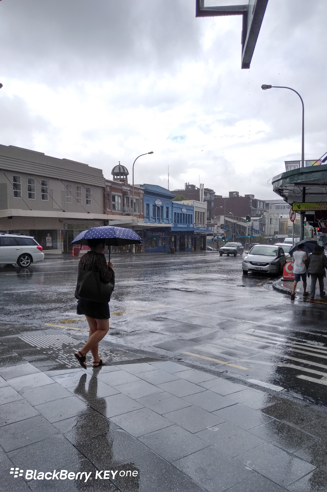

**Day38(2018年2月14日，周三）**

上周的单元测试，拿了98分。时隔四十年，终于重新体会学霸的滋味。不知道应该笑，还是应该哭呢？

今天是一个大测试。听说读写，全考了一遍，貌似是校长要检查老师的教学质量和学生的学习情况。

做阅读题时，路人乙偷偷问我：这文章到底是啥意思啊？

我硬着头皮帮他划出了要点和答案——其实全在文章里。他挠头挠半天，感觉无处下笔，索性直接交卷……

结果第一次遭到老师的拒收：你确定啥都不写了？

考试结束，我去新西兰银行开个人帐户，这是上周预约好的日程。听说以前凭护照和旅游签证就能开户，但现在不可以，至少得有学生签证。这次开户还多了一张表格，向我索取了中国的身份证号码，银行员工说这是反洗钱的要求。

嗯，随便吧，查祖宗十八代都行，反正我也没钱可洗。

1. 借记卡有两种，一种是免费的纯磁条卡，另一种带有VISA标识和IC芯片的磁条卡，年费NZ$10。
2. 借记卡的卡号不是帐号，登录网银即可查到帐号。
3. 帐号有2个，1个仅用于平时的刷卡小额支付，另1个是收付款帐号。我记得国内有的银行也有类似的设计。
4. 登录网银用的是客户号，不是卡号也不是帐号。

欲知后事如何，且等 学择新西兰（Choose NewZeaLand）Day39
