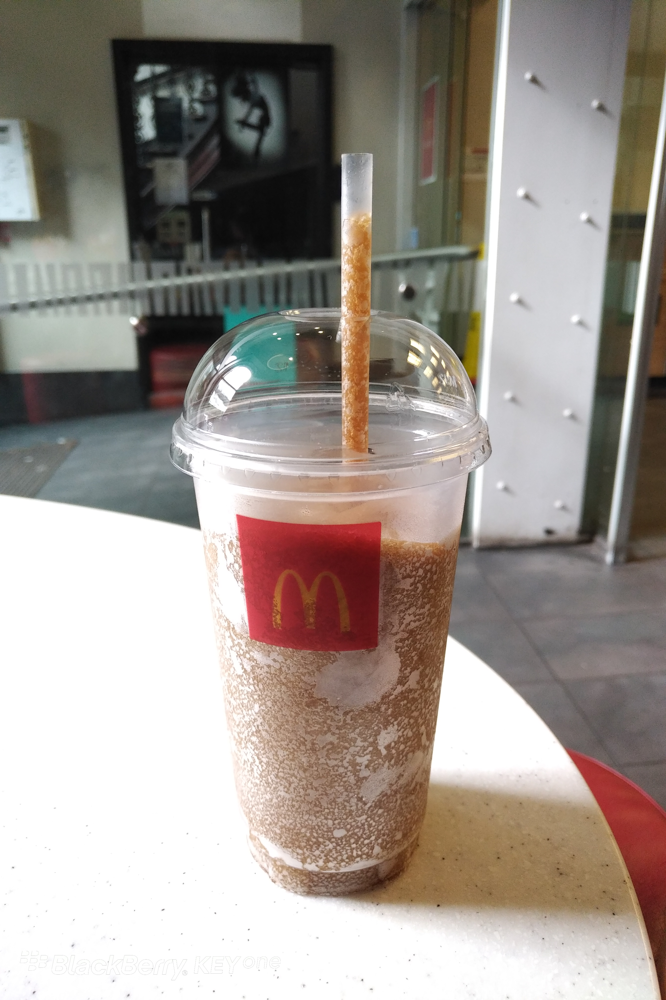

**Day42(2018年2月18日，周日）**

中午准备煮饭，千里迢迢人肉背来的“美的”电饭锅一开就跳闸，试了几次，最后确认电饭锅坏了，估计是哪里渗水短路了。情急之下，临时学习微波炉煮饭技能，一次成功。

今天读到一篇文章：《中国孩子已经变了，老师和家长却还没跟上》，深有感触。推荐给我儿子读，他在没读之前，还是一副不以为然的样子，读完之后哑口无言。

这篇文章解答了我的几点疑惑：

1. 孩子为什么会发呆？孤独。
2. 孩子的疲惫不堪来自何处？学校，（６个）家长。
3. 孩子究竟被“圈养”在何处？第三只笼子。（以前我一直说是学校）

我不想简单粗暴地把“孩子变了“或者”老师和家长跟不上”的原因归咎于中国的教育体制。

孩子天生孤独和计划生育有关系；

物质的丰富跟改革开放有关系；

老师跟不上，和老师个人的责任心、教学方法没有关系？

家长跟不上，和家长自己刷手机多、读书少没有关系？

……

还是那句话：雪崩时没有一片雪花是无辜的！

文章比较长，我摘录了一部分。点击末尾【阅读原文】可阅读全文。

> **现在的孩子带着天生的孤独感来到这个世界。**那么孤独会有哪些麻烦？
> 一，人一孤独，无端伤感，莫名其妙流眼泪；
> 二，人一孤独，思考力就变得非常强，所以麻烦就来了，既不思考吃，又不思考穿，他就过早地思考了一个终极问题，最高哲学问题：“我存在有什么意义？”
> 我们现在的孩子，连四岁的孩子就会在那里发呆了，你不知道他小脑袋里想什么。
> 一旦人有这种问题，痛苦就伴随着他了。

> ……
> 上海这样的城市里，一个孩子来到这个世界上，就有六个人围着他，这六个人会把最好的付出给他。
> 我们能看到现在的孩子有空前的学业压力，这只是显性的，而隐性的东西是孩子们整天跟焦虑高危人群在一起，这些人是孩子的父母、老师。
> **你想想看，如果孩子在学校、在家里都要面对一群焦虑的人，人人对孩子拉橡皮筋，老师在学校里不停强调考试、学习；孩子回到家，家长也在强调考试、学习，那孩子可能就完了。**
> 跟焦虑的人在一起，会疲惫不堪，我们孩子所遇到的压力是全世界没有的。
> 美国的学校不应试吗？也应试的，人家的学习任务也很重，可是人家的老师和家长不是我们这样的内心世界，我们（父母）自己太脆弱、不够强大。

> ……
> 最后我想总结的是，现在的孩子是活在“第三只笼子”里的。

> 假设，我们有这样一个笼子，让一个老鼠在笼子里，笼子外面装一个门，如果老鼠不小心踩了一下这个门，门打开以后有一个食物会进来，这个老鼠踩一下，食物就进来，踩一下，食物就进来，老鼠会怎么做呢？会一直踩。
> 如果第二只笼子是这样的，老鼠踩一下，电击一下，踩一下，电击一下，以老鼠的智力会怎么做呢？不踩了。
> 如果“第三只笼子”我们是这样设计的，它踩一下是食物，再踩一下是电击，老鼠就不知道应该踩还是不踩，这个老鼠会在里面纠结死。

> **孩子来到这个世界上，家长对他太好了，就像食物；但同时给他压力，就像电击，孩子们如同老鼠在第三个笼子。**
> 每个家庭都渴望自己的孩子是成功者，嘴巴不说，心里是这样想的。

> 各行各业，凡是能成功的都有一个共性的特质，这些人一定是输得起的人，输了再来，最后就赢了。
> 而我们现在的教育，你只让他成功，不让他输，家长们见到孩子回家第一句话问的是：“宝宝，你今天得几个五角星啊？”“一个。”“小明得了几个啊？”“两个。”“你明天要超过他，要得三个。”
> 我想问在场的幼儿园家长们，你跟儿子下棋他会输吗？他肯输吗？十个有九个孩子是不肯输的，有的孩子还会拿象棋砸妈妈的头，他输了就急。
> 怎么会这样呢？你想要让他成功，却不让他有的成功的品质，你一开始就不培养这种品质，他不就是第三只笼子里的老鼠吗？

> 还有，我们每家都渴望自己的孩子在看到数学难题、物理难题能够迎战，锲而不舍。

> 学奥数的时候再难的题目也能克服，我们希望孩子意志力、控制力很强，可是你知道意志力、控制力是从哪里来的吗？

> **在上海，家长们从小学开始给孩子找最好的学校，初中、高中一直是好学校，等高考完了以后，再帮孩子找什么样的专业读大学以便运用关系找得到工作，等到找了一份工作以后，觉得差不多了，就买一套房子给孩子，发动亲朋好友给孩子介绍女朋友，然后再拿钱出来给孩子办婚事，婚事办好了养孩子，最后自己帮孩子带孙子。**
> **你要控制他一生，还需要他有一种迎战困难的自控力，又是这个悖论。这个人不是在第三只笼子里是在哪里？**

> 其实他都知道自己应该成为什么样的人，非常明确，但有的家庭期望太高，这是不可以的。
> 特别是对独生子女，你不把一个很具体的目标告诉他，这个人要崩溃。
> 实际上高要求只有对自己，不能对别人。孩子非常清楚他的目标在哪里，可是心里也很清楚，自己是没有这个能力的。那么你想想看，他不是纠结死吗？
> 这就是老鼠在第三只笼子里的感受。

麦当劳的可乐冰沙只要NZ$1元，巨划算。

欲知后事如何，且等 学择新西兰（Choose NewZeaLand）Day43
