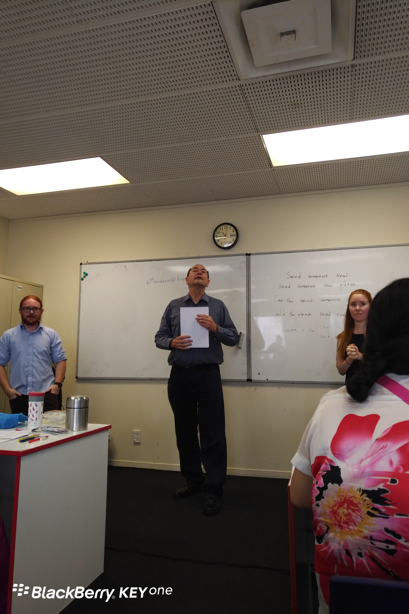

**Day47（2018年2月23日，周五）**

路人甲迟到好久，他跟老师解释说自己早上5点才睡觉，因为Study English，引来一阵哄堂大笑。

午休过后，他被老师提问，回答时口齿不清，一听就知道在吃东西。问题是，昨天同一时刻，他也被老师提问，同样在吃东西。显然老师是故意的，老师临走送了他一个外号：cute boy。

虽然她只是个代课的，但我感觉她还是挺认真负责的。今天课堂上她有点生气，因为大多数人在需要跟读的时候不跟读，所以她又BALABALA讲了一通道理。

我挺认同这个老太太。很多人没想明白，不管你是等工签还是混什么学生签证，既然来这个英语国家生活，多学点英语只有好处没有什么坏处。退一万步说，你多多少少是付了学费来这所语言学校，出勤不出力，在课堂上睡不舒服玩不爽，既来之，不妨学之。

下图中间是我们的校长Peter，发音标准，声音响亮，讲话老爱闭眼睛。右边是我们敬爱的Maynah老师。今天我又听到一个说法，是Maynah老师不愿意再教学生了。我在想，就冲大多数学生的学习态度和表现，老师不愿意再教也情有可原，如果她有不教的选择。

欲知后事如何，且等 学择新西兰（Choose NewZeaLand）Day48
