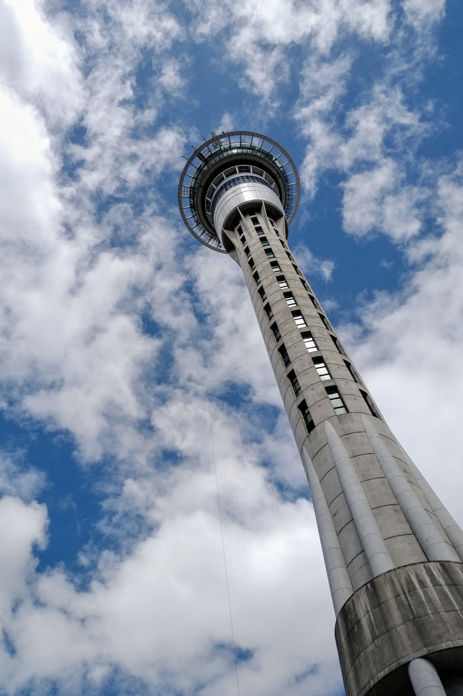

**Day48（2018年2月24日，周六）**

平生第一回看了一部没有任何字幕的英文电影《Black Panther》（黑豹），听懂10%-20%,看懂99%，可见其情节之平淡无奇。

2018年1月，新西兰一所叫做New Zealand National College（简称NZNC）的私立院校因教学质量达不到新西兰学历认证局（简称为NZQA）的要求被新西兰政府勒令关门。在校就读尚未毕业的学生彻底懵圈，详情可点击末尾【阅读原文】浏览天维网报道。

其中一个有意思的细节是，入学时学生缴纳的学费是1.4万纽币，然而NZQA所承诺的“全额退费”则是6000纽币，前后差额高达8000纽币。对此，NZQA方面给出的解释是“确实只有6000纽币，并且所有收费都是有学生签字的。”

在新西兰，所有私立院校收到的学费，实际上还不能作为收入，必须上缴到NZQA建立的资金池里。NZQA每个月会返一部分给私立院校，作为私立院校的运营费用。比如说1个学生一次性缴了全年12000纽币学费，那么私立院校每月可以拿到1000纽币，假如私立院校中途出现问题，学生还能从NZQA拿回剩余的学费。简单地说，这是一个防止私立院校卷钱跑路的机制——值得中国的教育管理机构借鉴。

学生多交的8000纽币到哪里去了呢？

我可以100%肯定：NZNC帐上绝对查不到这8000纽币。如果NZNC过帐这8000纽币，那么有关部门平时就应该能发现。

8000纽币，很有可能在**无良中介**的主导下，与NZNC的某些人一起瓜分了。部分案子，不排除学生本人参与瓜分的可能性。你可能会不太理解，学生本人为什么要参与瓜分？答案是：欺骗家长，变相多拿零用钱。

NZQA关掉劣质学校没错，但是只退费，协助学生转签证，不为学生安排（指明）出路（进行相关测试后转校），实在不够人道。对学生和背后的家庭来说，退费是次要的。

欲知后事如何，且等 学择新西兰（Choose NewZeaLand）Day49
