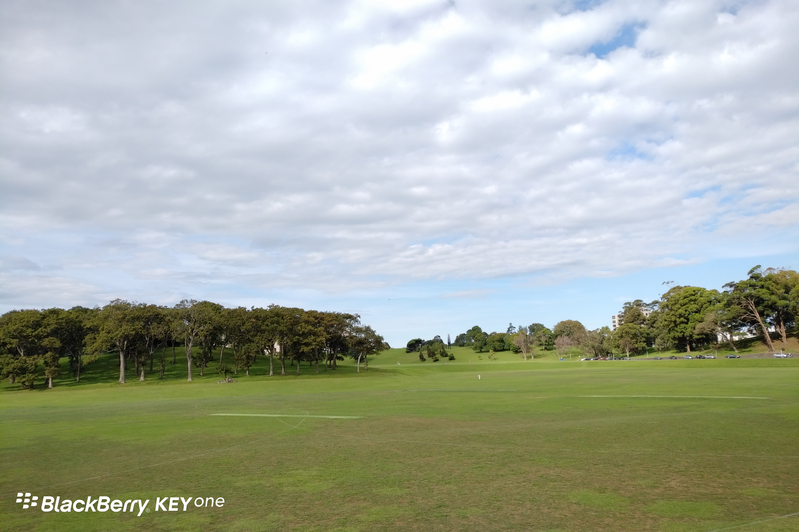

**Day58（2018年3月6日，周二）**

早上到教室，我的座位被新同学占了，于是我换了个座位。同桌说昨晚没睡好，带着她女儿去医院看急症，等到半夜才轮上，前面老有人“插队”，一开始她怀疑是不是种族歧视。后来弄明白急症医生只有一个，医生会优先照顾最需要急症的病人，她女儿只是崴了脚，所以被延后诊断。

在上个月下旬，我去看过一次医生。非急症状况，先要预约看家庭医生。所谓家庭医生，就是与你形成“绑定关系”的全科医生（用互联网的话来说就是成为这名医生的注册用户）。我压根不想通过看病来提高自己的英文水平，要病情描述不准确引起误诊，这不是给自己吃药嘛。因此朋友给我介绍了一名中国人医生Wong。

我特地跑了一次医院，为的是注册成为Wong医生的病人，不然没法预约看病。医院前台是老外，听我说明来意，给了我一张表，让我去休息处填写。表格收集的无非就是姓名、住址、邮箱等基本信息。前台还复印了我的护照，问我是什么签证，多长时间。我走的时候，前台给了我Wong医生的可预约时间表。

拿到这个时间表，我还纳闷，这个医生为什么每周只有三个半天开放接待病人，她其余的时间在干嘛？搞科研吗？我过几天见到医生的时候，我才明白Wong医生不是全职医生，她是在这个医院兼职的，每周只工作三个半天，平时在家带小孩……

这是我在中国医院里从未体验过的聊天式看病，医生和病人在一间屋子里非常轻松地沟通。凭着我提供的一张照片，以及症状描述，Wong医生没动用任何仪器，就下了诊断书：结膜炎。

诊断费纽币95元，药费纽币18.50元。事后，我向保险公司申请理赔，并将收据原件邮寄给保险公司。几天后，保险公司回复邮件说全额理赔。

我相信，倘若没有家庭医生的分流，那奥克兰的大医院绝对是人山人海，和中国没什么区别。这么简单易行的一套分流机制，中国到底是不想学，还是学不会呢？据说上海从2011年就开始试点，不过我看取得的效果都还停留在新闻报道中。

欲知后事如何，且等 学择新西兰（Choose NewZeaLand）Day59
