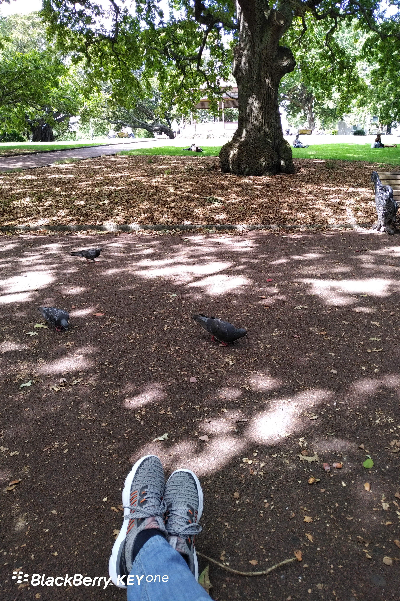

**Day59（2018年3月7日，周三）**

有人感叹两会提案尽是鸡毛蒜皮，而我觉得有个湖南代表李国武的提案就很好：要立法禁止7岁以下儿童使用智能手机、电脑等电子产品。

在日常的调研中，李国武也得知到一个惊人的数据，根据中国青少年研究中心2015年对全国10省市少年儿童的抽样调查显示，我国少年儿童使用过互联网的比例接近9成，手机拥有率竟超过6成。

同时，他也发现了这样一组数据，孩子连续玩20分钟iPhone，视力平均下降到43.8度近视状态;孩子连续玩20分钟iPad，视力平均下降到41.7度近视状态;孩子连续看20分钟液晶电视，视力平均下降到18.8度近视状态。

这些都是最直观、最表层的危害，其实手机对孩子的危害远不止这些，它潜在的危害比我们想象的更大、更可怕。”李国武越说越有点激动起来，甚至会危害少年儿童的身体健康，如长时间使用手机影响身体发育，此外还易增加儿童致癌风险。

为此，李国武果断地提出，要立法禁止7岁以下儿童使用智能手机、电脑等电子产品。“为何要立法呢?”在他看来，唯有通过立法，才能真正引起整个社会及广大家长的重视，“这样也就能把父母和其他监管人的责任进行固化。”

“易增加儿童致癌风险”这事太扯，没有科学依据。

“把父母和其他监管人的责任进行固化”，我深表赞同，儿童的健康成长需要父母积极陪伴，而不是交给一台智能设备来陪伴。

关于智能设备可以开发儿童智力云云，统统是商家的营销手段，不足采信。这么说吧，大家用得很欢乐的智能设备，全都是7岁前没有使用过智能设备的那些人发明的。你们看，即使没有智能设备，发明者们的智力也都被开发得好好的，乃至颠覆了整个世界。

欲知后事如何，且等 学择新西兰（Choose NewZeaLand）Day60
