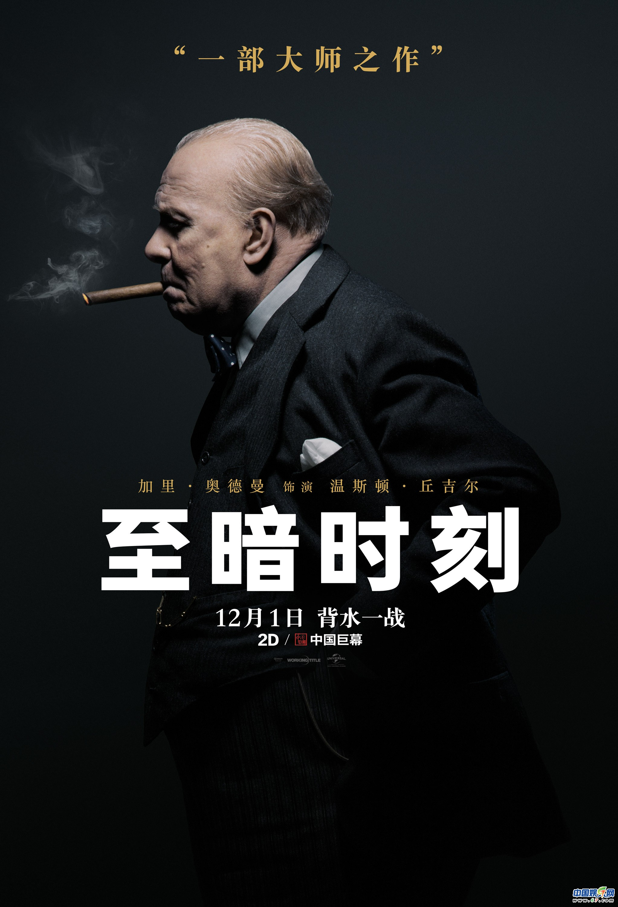

**Day63（2018年3月11日，周日）**

成功不是终点，失败并非末日，最重要的是继续前进的勇气。

电影《至暗时刻》让我重新认识了丘吉尔。我对政治家向来是没有好感的，因此我宁可看隆美尔的传记，也不会去读丘吉尔的传记。

加里奥德曼用影帝级别的演技，演活了丘吉尔。这位战时首相，临危受命，拒绝绥靖，鼓舞人民，保卫祖国。他不再是历史书上一个干巴巴的名字。他那慷慨激昂的演讲震憾人心：

我们将不惜一切牺牲保卫我国本土，我们要在滩头作战，在登陆地作战，在田野、在山上、在街头作战，我们在任何时候决不投降。即使整个英伦岛或大部分土地被占，我们饥寒交迫，我们所有由英国舰队武装和保护的海外帝国也将继续战斗。

不能不佩服他的语言功力，即使在今天的和平年代，听起来也很燃。难怪在二战后，1953年，他还摘得诺贝尔文学奖。没错，你没看错，他得的不是和平奖，是文学奖。

瑞典文学院给他的获奖评语用了大量动人的词汇：

“由于他精通历史和传记的艺术，以及他那捍卫崇高的人的价值的光辉演说。”

”丘吉尔成熟的演说，目的敏捷准确，内容壮观动人，犹如一股铸造历史环节的力量。“

瑞典文学院院士利列斯特兰德在颁奖仪式上对前来领奖的丘吉尔夫说：“在黑暗的年代里，他的言语以及与之相应的行动，唤起了世界各地千百万人们心中的信念和希望。”

最后强烈推荐你去看《至暗时刻》。

欲知后事如何，且等 学择新西兰（Choose NewZeaLand）Day64
