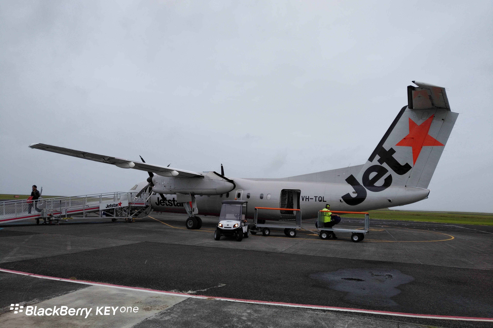
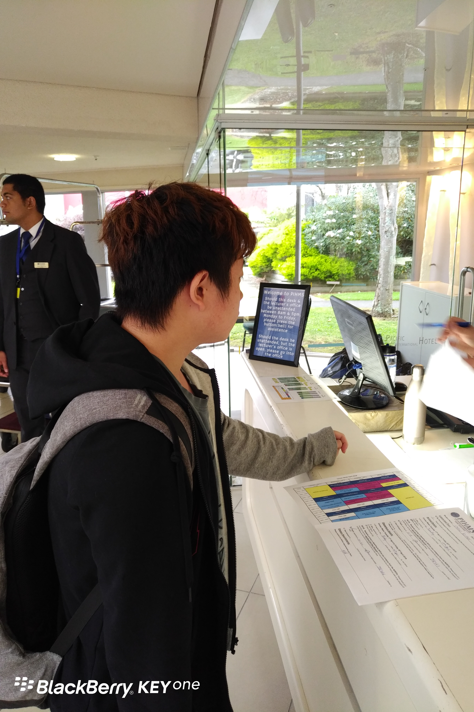
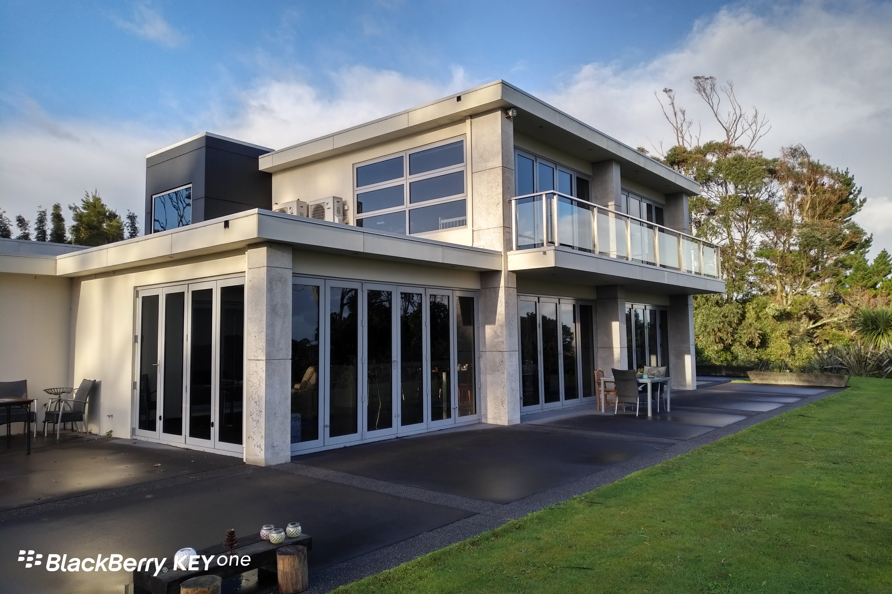
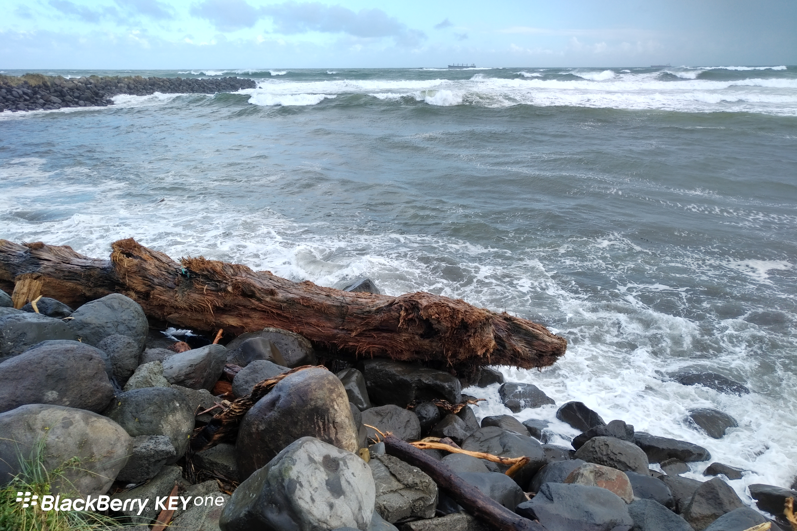
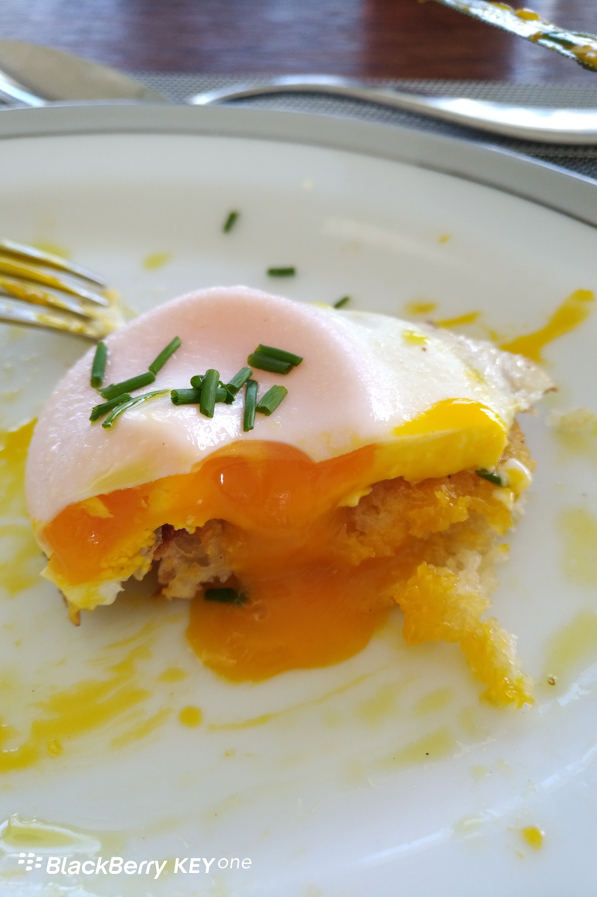
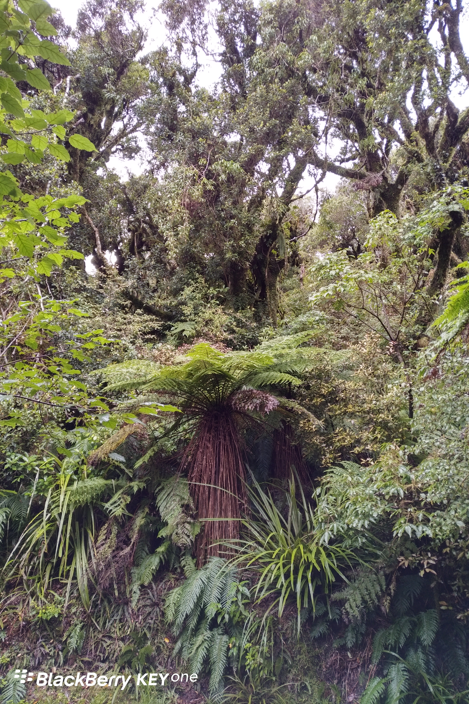
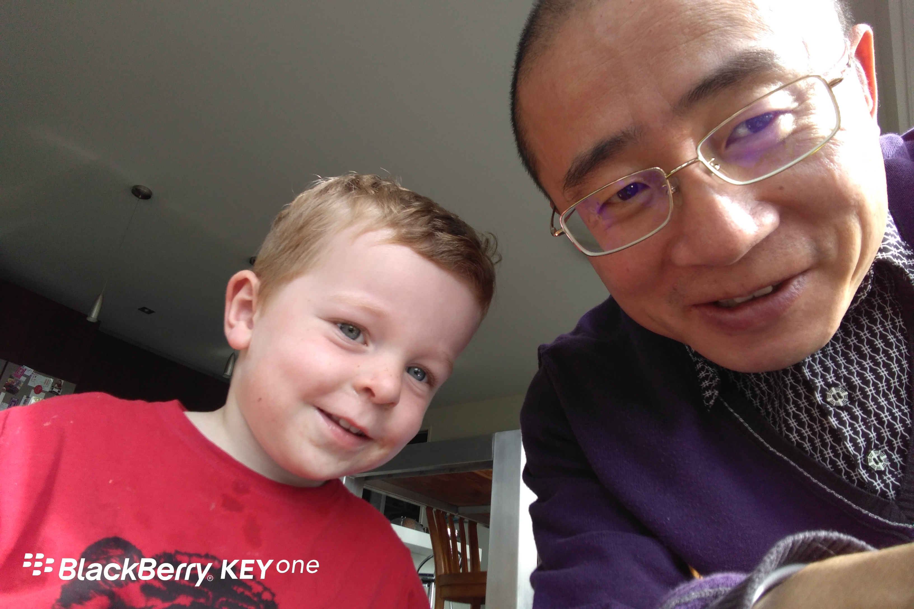

**Day100（2018年4月17日，周二）**

上午，我和儿子从奥克兰坐JETSTAR（捷星航空）的飞机，前往New Plymouth（新普利茅斯）。话说新西兰国内航空，竟然没有安检，我心里好不踏实。JETSTAR规定随身行李两件，一大一小加起来不得超过7公斤。其实现场没有工作人员来称重，全靠乘客自觉。不过，工作人员应该会凭经验目测行李体积，阻止超规格行李登机。像这种支线飞机，行李架容量比较小，太大的行李无法放上行李架。

New Plymouth有一所学校，全称是Pacific International Hotel Management School（太平洋国际酒店管理学校），简称为PIHMS。据说这是新西兰最好的酒店管理学校，毕业生受到各家酒店的欢迎，就业率超过90%。
人说，老王卖瓜，自吹自夸。瓜到底好不好，尝了才知道。PIHMS每过一段时间，都会组织一次开放日活动，让有意了解这所学校的学生入住体验，家长也可陪同参观（不可入住）。
入住体验是收费的，大约200纽币，这部分费用，如果学生未来报考PIHMS成功，可在学费中扣除。

机场穿梭巴士送我们到PIHMS的门口，刚下车，我还以为是到了一所宾馆的门口，趁着刷卡付车费的功夫，瞄到PIHMS的标识，才放下心来。

踏进大门，感觉就是进了一所宾馆，没错，前台是宾馆前台风格，工作人员（在校学生）身着制服，笑脸相迎。工作人员告诉我们，行李可以留下，会有专人送到客房（宿舍）。

接下来的午餐是在一个大宴会厅，厨房工作人员是在校学生（我不确定厨师是不是），侍者是在校学生……

可以想见，宿舍的床，自然也是在校学生铺的。整理客房，是这个专业的基本技能。

下午，老师带我们家长参观了学校，我是听不懂，但看得懂。整所学校就是一所“酒店”，学生需要“经营酒店”。这里流通一种虚拟货币（我猜测应该是用真实货币充值），用于日常结算，比如说午餐。“酒店管理层”还有真实的办公室，他们会任命学生担任总经理，财务，审计……

学生每在校学习一个学期，就要到外面的酒店去接地气——实习一个学期。讲白了，PIHMS是一个培养实用型人才的地方，毕业生到了酒店不需要培训就能上岗，难怪PIHMS的毕业生抢手。

我在距离学校2.5公里的地方，预订了一个民居。我本来已经离开学校，开始步行前往，主人Rhonda得知后，特地开车出来接我。这种地方，只有我一个人在走路，她很容易就识别出我。

Rhonda今年64岁，曾是一个文字工作者（记者）。她的丈夫NICK，是一名（油、煤气）管道工程师，曾在苏州工作过一段时间。他们买下了这所房子（中国人称为别墅），而他们的老房子就在附近，一个儿子住在那里。

他们养牛，养羊，养鸡，养蜜蜂……没错，蜜蜂，我看见蜂房。牛有五十头，我在房子前的草地上看到十来头，他们说其他牛在另一个农场。牛是肉牛，养到两岁就卖给肉厂。

**Day101（2018年4月18日，周三）**

上午Rhonda进城，捎我到海边。我沿着海边一路走到New Plymouth的中心，吃了一顿麦当劳。

New Plymouth说是市，充其量就是一个小镇（75000人）。中午还有餐厅不开门，马路上来往车辆不少，但是中心的氛围有一种说不出的怪异，反正我是不喜欢。

**Day102（2018年4月19日，周四）**

“走地鸡”的鸡蛋真心好吃，每天两只。

下午Rhonda把她的3岁孙子J接过来，貌似是J的妈妈生病了。看来，不光是中国老人要照顾孙辈的。一开始，J有点认生，我陪他玩了一会儿……他就开始疯了。

好吧，必须承认，是我挺想玩那个有超长轨道的小火车，咱们小时候没玩过啊，即使有得卖，家里哪有那么大的地方让你铺轨道。

**Day103（2018年4月20日，周五）**

上午我和儿子打车去了Mt. Taranaki。这座山在电影《最后的武士》中客串了一把日本的富士山，因此而闻名。

本想从北部游客中心出发走一小时山路再折返原地，权当一次户外锻炼。可惜的是天气不好道路泥泞，我们尝试走出一百米之后，不得不放弃。

下午陪Rhonda的孙子玩。小孩子有着无比旺盛的精力，跑东跑西，叽叽喳喳一刻不停，问他要不要上厕所，不要；要不要睡觉，不要。他爸来接走他后，忽然感觉全世界都安静了。

临走，我在Rhonda的客户留言本上涂了几行字：一次田园牧歌的体验。面朝大海，春暖花开。

岁月静好，现世安稳。

欲知后事如何，且等 学择新西兰（Choose NewZeaLand）Day104
