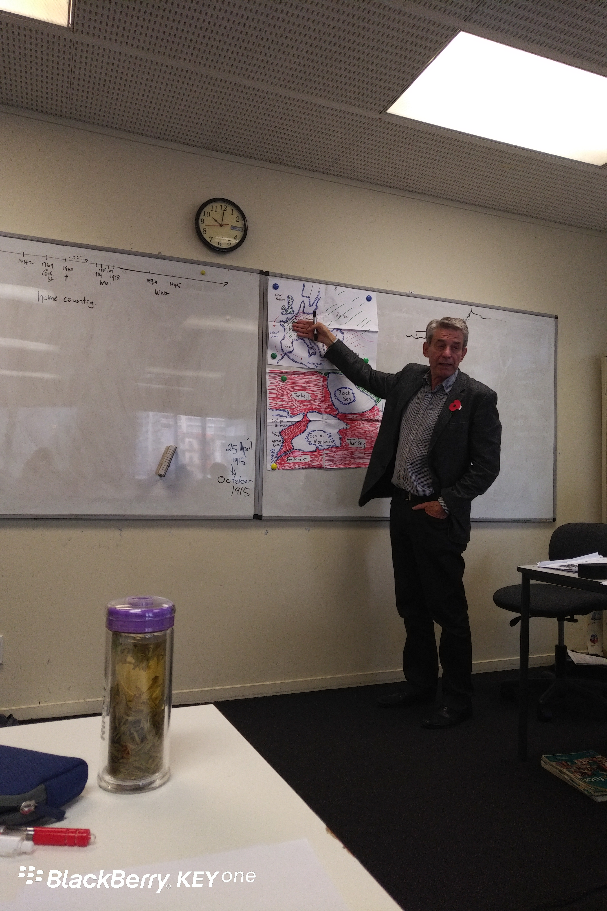

**Day107（2018年4月24日,周二）**

明天是ANZAC Day（澳新军团日），放假一天。上午Ewen老师用了一堂课的时间，介绍了澳新军团日的来龙去脉。重要的是，老人家认真备课，手绘地图！！！并且还在网上找了些资料，发给我们学习。看来大英帝国也从未放松过他们的爱国主义教育啊！

澳新军团日是纪念于第一次世界大战时期、于1915年4月25日在加里波利之战牺牲的澳大利亚和新西兰联合军团（简称澳新军团）军人的日子，在澳大利亚和新西兰均为公众假日。

1915年4月25日，澳新军团在土耳其爱尼泊尔加里波利登岸，由于导航错误致使军团在原定地点一英里以北登陆。军队本来预期的海滩和小坡，意外地变成陡崖之底，结果使得数量甚少的土耳其防军处于有利位置。澳新军团在尝试立足之际，发现进攻无可能性，在经历8个月的僵持后最终撤退，8,709名军人阵亡。

Ewen问我：你是不是觉得新西兰人疯了，竟然会纪念一次失败的战役。

我回答说：我们不是在纪念战争，我们是希望远离战争。

我可以想见那一场加里波利之战的残酷。一战是人类大规模杀伤战的开始，人类战争史从此揭开血腥的一页。

要知道真实的战争绝不是在横店影视城手撕鬼子，身中数枪不断气、还能从容发表革命遗言且交个党费啥的。

真实的战争就是人间地狱。如果你没看过战争片《拯救大兵瑞恩》，那么我强烈建议你去看看开头那场诺曼底登陆战，分分钟令你心惊肉跳：拿着自己断了的手、捂着自己流出的肠子、拿下头盔还在为刚才头盔救下自己一命而不可思议的时候、又一枪补上……但是据经历诺曼底登陆战的老兵说，现实远比这部电影还要残酷。请问，要是再来一次世界大战，你本人或者你的孩子，是否愿意身处其中？

幼年无知，我经常在本子上涂鸦一些军舰飞机大炮，还写个标语：“一定要解放台湾！”时至今日，我认为那些叫嚣武统台湾的，全TMD的是惟恐天下不乱的“爱国贼”。台湾从来就是中国领土，统与不统，都在那里。好比你家孩子被人贩子抱走，在别人家养育了几十年。孩子成人后不愿意认亲，又如何？血缘仍在。不生活在一起，又如何？你又不靠他赡养。而你非要打上门去讨个说法，血流成河只为一个虚无飘渺的名份，值当么？

欲知后事如何，且等 学择新西兰（Choose NewZeaLand）Day108
