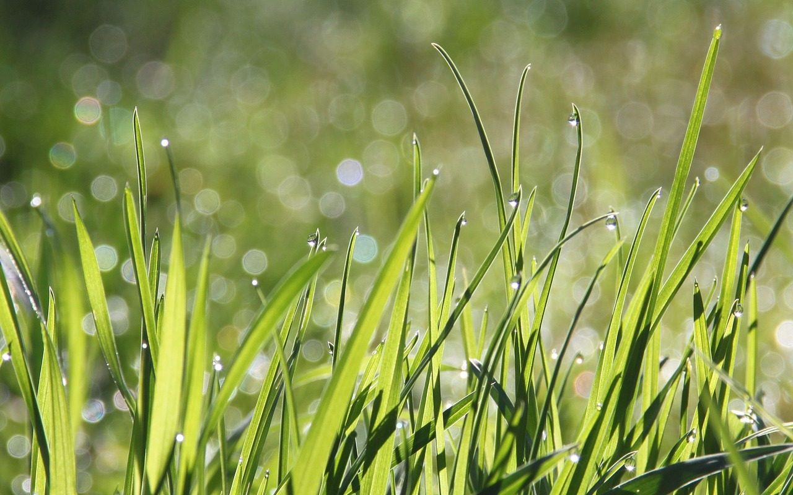

**Day116（2018年5月3日，周四）**

语言学校有同学说他的住所遭遇窃贼，被翻得一塌糊涂，他损失约一千刀纽币。房东更惨，奢侈品和古董全被卷走。依我看多半是熟人作案，专业的毛贼，通常只要现金。奢侈品和古董，首先得看得懂它们的价值，其次还得要销赃，销赃是有风险的。

我是个穷人，对奢侈品和古董一直没有什么感觉。换句话说，我可能缺乏“让我想要奢侈品和古董”的多巴胺。  

> 多巴胺（英语：dopamine）是一种脑内分泌物，属于神经递质，可影响一个人的情绪。
>
> 脑科学对于多巴胺的准确的本质描述，一个是多巴胺作用于我们的奖赏系统，让我们产生欲望；另外一个作用是，让大脑预期奖赏，从而指导相应的行为。简单的来说，多巴胺的作用，就是“让你想要”，和让你选择能得到更多奖励的行为。
>
> 多巴胺并不是媒体所渲染的，快乐分子，或者快乐的根源。多巴胺和快乐，其实关系并不大。就像高晓松说的：很多人分不清理想和欲望。理想就是当你想它时，你是快乐的；欲望就是当你想它时，你是痛苦的。这个欲望，就是多巴胺的分泌。

在网络世界中，“草”是多巴胺最形象的比喻，以下句子里的”草“显然不是其本义，它被理解为对某种东西的心心念念。  
“最近被某人种草了。”  
“我对这部手机长草很久了。”  
“最近长草了这家店，终于来拔草了。”  
“求大家来帮我拔草。”  
……

每个人总有自己的“草”。我对奢侈品和古董不长草，不代表我对数码产品不长草。  
不过我认为，对一件事物长草不一定要马上拔草，马上拔草会让你迅速地对这件事物失去兴趣。  
一般而言，长草的时间越长，你拔草后对这件事物保持兴趣的时间也会越长。得来不易才更珍惜。我对一款数码产品长草，起码让它长三个月，长则一年，甚至等到草都枯萎了。  
我知道数码产品不是生活必需品，更新迭代快，越晚买越好。而且我个人又有点环保意识，不愿意把数码产品直接扔到垃圾堆里，那即便当作收藏的话还得考虑家里是否有收纳空间。因此我有意识地克制拔草的冲动。  
但是我对电子游戏并不采取这样的态度，一旦决定投入时间玩一款游戏，（力所能及的前提下）能花钱提升购买装备或等级的，就不花时间。尽快拔草，让自己早点对这款游戏失去兴趣——电子游戏这东西，小玩怡情，大玩丧志。

人非草，人种草，任其杂草丛生，还是小草青青，全在你一念之间。
