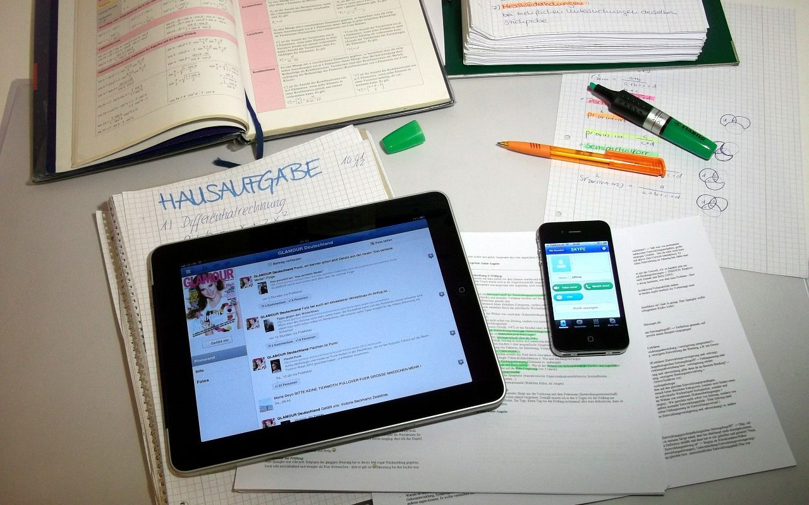

**Day145-146（2018年5月31日-6月1日，周五、周六）**

**一、语言学校**

我给胖妹子（老师）的教学总结了三个特点：

1. 照本宣科。没什么重点讲述的地方，因此教学进度很快。
2. 发资料。她会找一些知识点的资料，丢给我们自己去看。
3. 基本没有回家作业。因为她在课堂上都让我们做了！即使布置了，第二天也不检查。

本人作为对于中国教育流水线上的不合格产品，也对此表示不太适应。  
不过在新西兰，学校不布置或布置很少的家庭作业是一个常态，导致不少华人家长非常不安。

目前在OECD（国际经合组织）国家中，新西兰学生的总学习时间，略低于OECD国际平均水平，刚过40小时一周（包括课内学习和家庭作业时间）。  

在Northland地区Okaihau College教书、有20年教龄（其中8年在英国教书）的老师Graham Sharp就认为学生在老师没有监督的前提下做家庭作业，学生不知结果是否正确，因此对学生帮助不大，反而会“导致家庭焦虑”“夜晚不得安宁”，是“没有必要的”。

如果这位老师在中国，对家长这么说，那么他第二天就会被家长投诉至下岗。对于中国孩子来说，没有家庭作业才会导致家庭焦虑。  
我不同意这位老师的这种说法。学生没有老师的监督，一样可以完成家庭作业。做不做是态度问题，做得对不对是能力问题。对或不对，第二天老师可以在课堂上提供标准答案。对不理解的答案，学生课后还可以问老师。事实上，胖妹子之前的几位老师，都是这么做的，虽然他们并不检查你是否完成了家庭作业。这说明对待家庭作业，即使是西方的老师，也持有不同的看法，做法亦不相同。

惠灵顿Wellington College12年级的学生Liam Hewitson说，他的老师大约每天安排总共1小时晚间作业。不过，老师并不检查他是否完成了作业，只问问他们完成了没有，他们可以自己去检查答案。这“更像是一种复习，而不是家庭作业。”Hewitson说，“家庭作业可以让你的知识更牢固一点，很多东西不是一次就能记住。”

这边是总学习时间40小时一周恨不得还要减，另一边中国中小学生日均写作业时长2.82小时，该时长是日本的3.7倍，韩国的4.8倍，超过全球平均水平3倍，居全球第一。（2017年《中国中小学写作业压力报告》）  
据说很多家庭不生二胎的原因，是家长陪孩子写作业写怕了。所以，政府鼓励生二胎，应该从减少孩子的家庭作业开始。

**二、好文分享**

《孩子需要经历些什么, 才会明白学业的重要性？》

如果以后我生了个儿子说不想上学，我压根就不跟他讲道理，直接让他去体验一段他除了上学这条路以外他将可能要过的生活。

有的人没有条件也没有选择，只能干粗活，那没什么好说的；可有的人如果明明有好的条件和机会却任性地放弃错过了，将来可是要后悔莫及的。

当然，要是有人天赋异禀3岁识谱5岁编曲或者18岁就能打NBA那这些话不适用他。否则，好好读书永远不会让人吃亏。

[点击这里可阅读全文。  
](https://mp.weixin.qq.com/s/zm_x92HYza8A337FM6wGOw)
