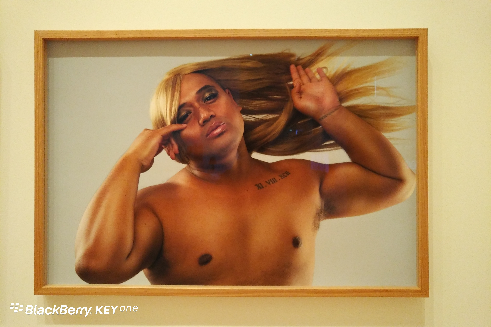
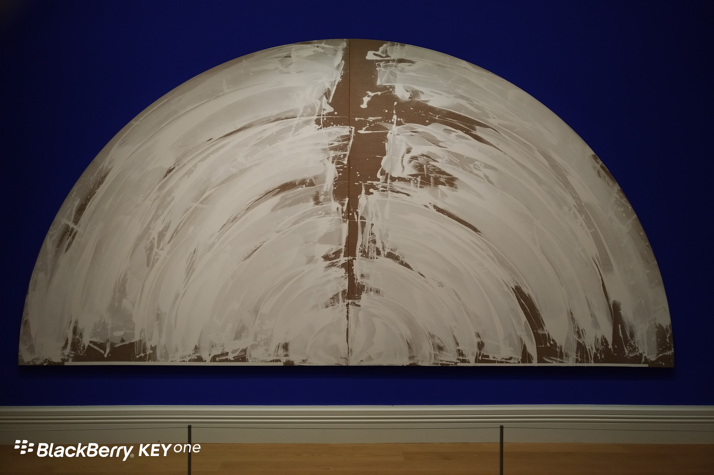
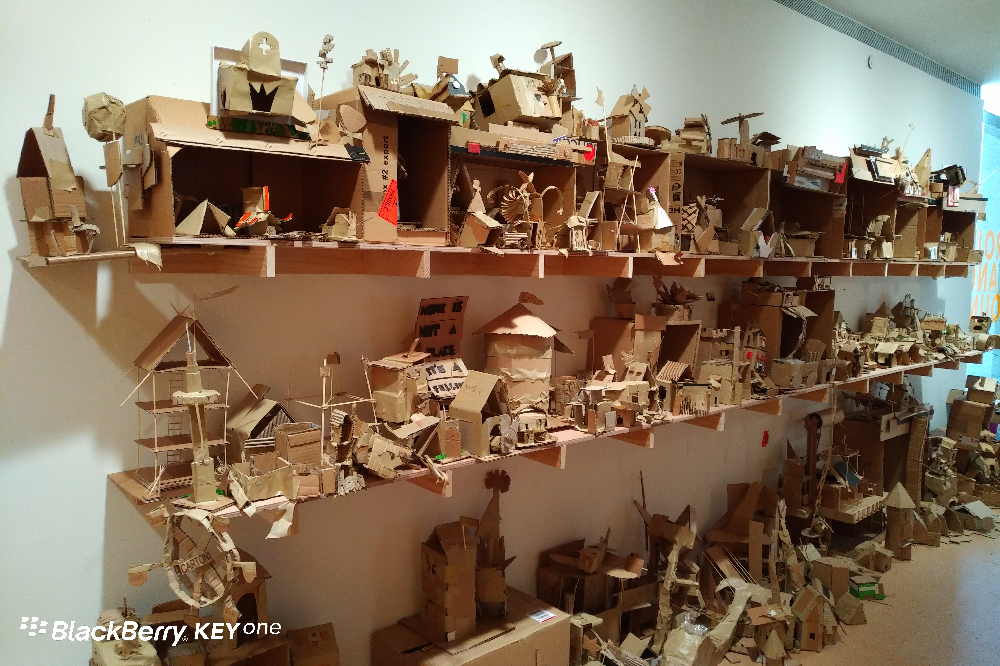

**Day172-173（2018年7月12日-7月13日，周五、周六）**

这周语言学校又来了一批韩国学生，应该是游学，学两周就走。貌似昨天，课堂上你一言我一语，提起要在奥克兰市内游玩。  
PETER提议去奥克兰艺术馆参观——他的夫人在那里工作。PETER问我的意思，我说我不介意。3月底，学校组织我们去过一次。我想艺术馆又不是博物馆，时隔这么久，一定更换了展览主题。我并不是喜欢艺术，对我来说，周五下午不上课，总是极好的。  
心动不如行动，吃过中饭，大家就一起向奥克兰艺术馆进发。如我所料，这次又有了新的展览主题。  
当然，看不懂的依旧看不懂，我也不会装懂。比如下面这两幅作品：  





这些是艺术馆提供废纸盒，让小朋友们当场自行裁剪组装的作品，堆了整整一屋子。是为培养大家废物利用的环保意识？


