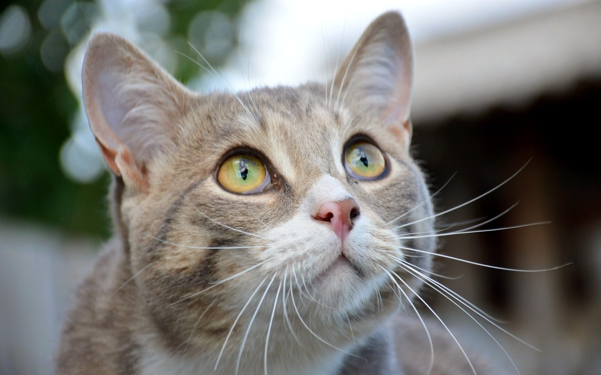
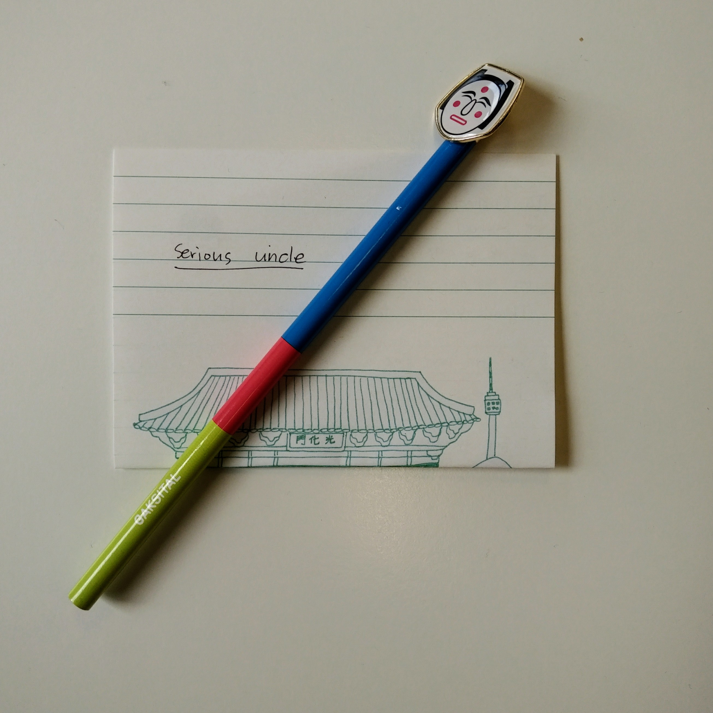
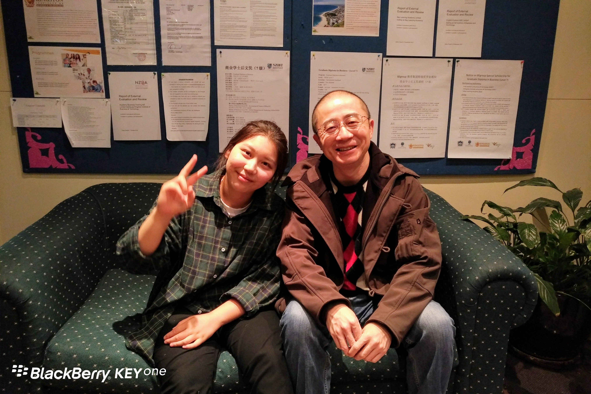
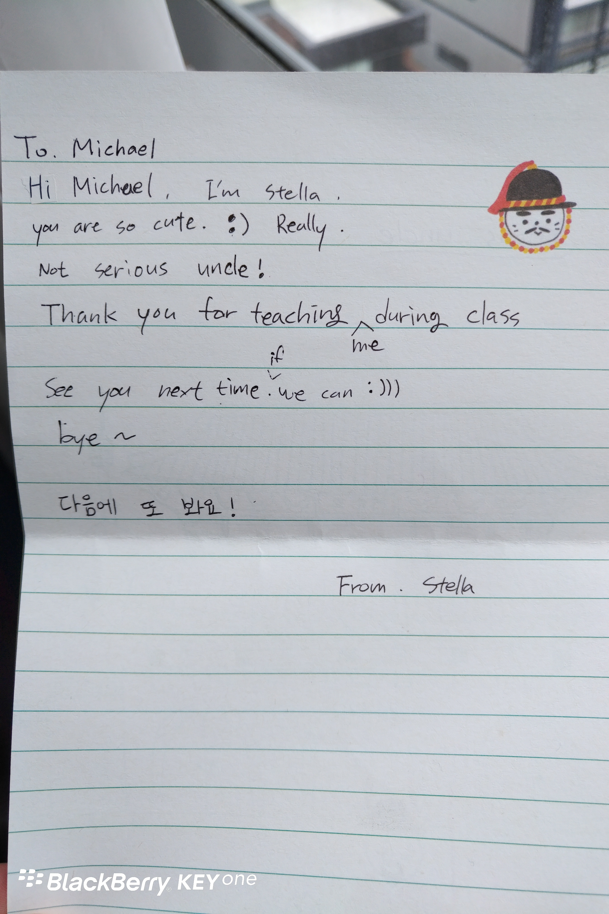

**Day180-181（2018年7月20日-7月21日，周五、周六）**

来游学两周的韩国小朋友们下周一就要离开了。  
有意思的是，其中一个英文名叫Stella的小朋友，送给我们每个人一份小礼物并且留了一张字条，还不许我们当场打开……  
嗯，情商高的小朋友，总是讨人喜欢，前途不可限量哪！







cute（可爱的），在中国人的英语思维里，一般用于小孩子或“美眉”。大叔一把年纪怎么会cute，Stella是不是用错词了？  
外事不决问谷歌：  
cute kitten，cute dog，cute baby，它表示“小巧”，“惹人爱的”，“可爱的”意思  
cute girl，cute guy 它表示“迷人，好看，有魅力”的意思。  
不过，美语里夸赞某男生长得帅，常说：He's so cute. 不用handsome.  
经过一番严密的考证，这个cute，大叔我坦然受用了。
