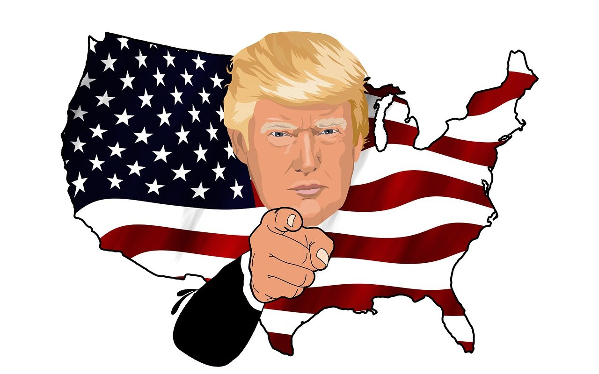

**Day184-185（2018年7月24日-7月25日，周二、周三）**

疫苗事件最新的交代是：【推特网传】孩子打疫苗的记录本本上不再写上疫苗来源。（意思是下回再遇到同类问题，你翻烂记录本本都不知道是谁家生产的疫苗。我没孩子，暂时无法核实此信息）。  
不过，大一统国发生任何丧尽天良的事情，都不足为奇。不要忘记，国民从食品中学到的化学知识，比从课堂中学到的要多得多。这不，国民又开始学习医药知识了。至少，我懂得了什么叫做“效价”。  

7月24日，一名不愿具名的中国疾控中心相关人士对经济观察网记者表示，所谓的效价，可以从字面上去理解，“效”是指效果，“价”就是高低，也就是疫苗对人体产生的保护性免疫效果的能力指标。  
他打了一个比方，就好比有个别假药，是用淀粉做的，里面完全没有药。他说：“最后只能说药效没有达到，效价比是零，你吃了药片不会中毒，正常情况下含淀粉的东西你也吃了，虽然达不到保护效果，但是对人体无害。这是一个道理。  

某著名的洗地专家晃着他的带鱼脑袋，照例得出那个结论：“疫苗事件是亡我之心不死的帝国主义一手泡制的阴谋，目的是打击并摧毁国产疫苗产业，使其疫苗霸占中国市场。”  
某不知名洗地专家更是独辟蹊径，扬言（发达国家平价提供的、捐赠的）进口疫苗暗藏杀机，之前中国生育率下降全拜帝国主义所赐。你的观点如此清奇，置计生办的同志们于何地？  

见过无耻的，从没见过这么无耻的。自家孩子被打了问题疫苗，做父母的不去问责生产单位和监管机构，却要八杆子打不着的“帝国主义”来背锅——思路如同尿路。
