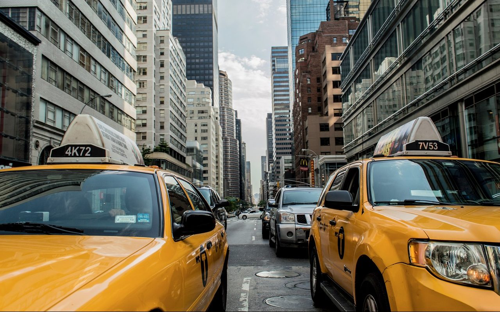

**Day218-219（2018年8月27日-8月28日，周一、周二）**

滴滴顺风车业务暂时下线了。我在上一篇文章里说过，滴滴顺风车实际是滴滴拼“黑车”。顺风车不回归其本质，乘客的人身安全系数不可能提高。

> 有 37 万活跃用户的美国共享出行平台 Waze 明确说明，顺风车服务是不盈利的，乘客支付价格不高于每英里 54 美分。而且，车主每天只能有两个行程：去程和回程。这样可以有效杜绝全职顺风车司机的出现。  
> 此外，该平台本身不从车费中抽成，盈利完全靠广告。  
> 这些成功的拼车软件都抓住了非营利这一点，把拼车价格定的极低，基本只计算了油钱和部分车折旧费用。  
> 虽然限制收取的费用会降低司机加入顺风车平台的热情，但是也把那些居心叵测的“黑车司机”拦在了门外。  
> 此外，这些拼车平台都有非常严格的准入制度。北美拼车平台 Ridesharing.com 不仅收录身份证件，还会和车主的单位或学校取得联系，进一步验证车主身份，确保车主背景清白。

以下内容是什么并不重要，我的观点也不重要，我只是想给大家展示一下什么叫做理性的辩论。  

高大上的IT群有人转发了《张维迎：后发国家的怨恨情结》（点击[【阅读原文】](http://finance.sina.com.cn/zl/china/2018-08-07/zl-ihhkuskt0520043.shtml)可阅读此文）

> 自鸦片战争以来，中国人对西方世界一直有一种怨恨情结。理解这一点，对理解当今的中美关系非常重要。  
> 当然，怨恨情结，并非中国人特有。在世界近代史上，许多后起民族都对先发达起来的国家产生过怨恨。

某人马上不乐意了。  
他说：为什么不谈谈特朗普对中国的怨恨？  
我说：  
一、美国对中国并无怨恨：这篇文章谈的怨恨是国民的一种普遍情绪，你到美国随便拉个人，问他中国在哪里，他未必答得上来。而在中国，十有七八的中国人都在骂小日本，这就是普遍情绪。  
二、即使美国对中国有怨恨：这篇文章的主题是后发国家的怨恨情结，美国之于中国不是后发国家，因此美国对中国的怨恨不在这篇文章的讨论范围之内。如果作者写了，那就完全跑题了。

他说：嗯，两百年前，美国相对于任何一个国家都是后发国家。不知道那时它有没有怨恨？难道就没有恨过英国、法国、墨西哥啥的？  
我说：美国对英国有怨恨啊，所以就独立了。你去看看美国的《独立宣言》，全是对英国的怨恨。

他说：好像张维迎所有的话都可以归结为两个凡是，即凡是西方的都是好的，凡是中国的都是不好的。  
我说：我就这篇文章，我个人无法推出你说的“凡是”的结论。张维迎“所有的话”，我没看过，不发表意见。
