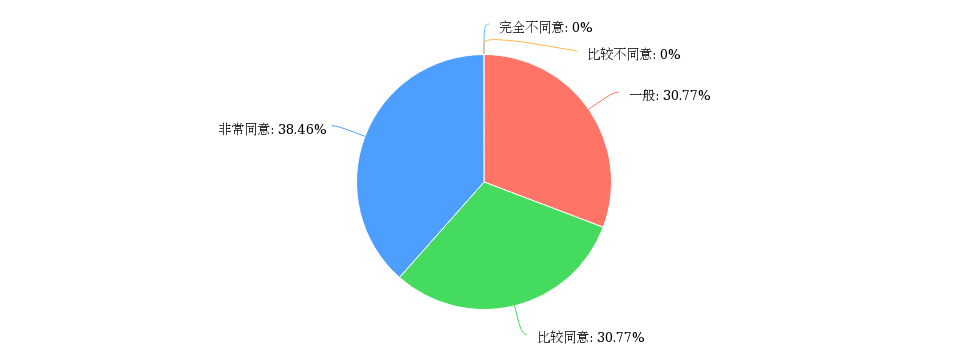
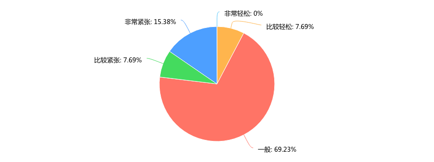
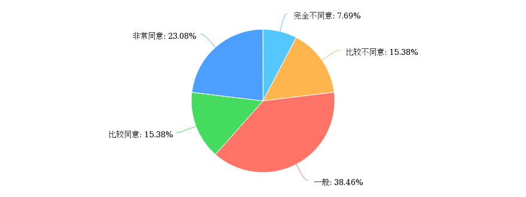
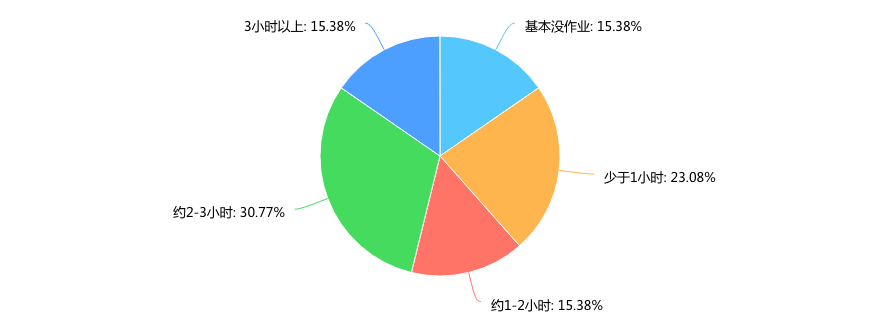
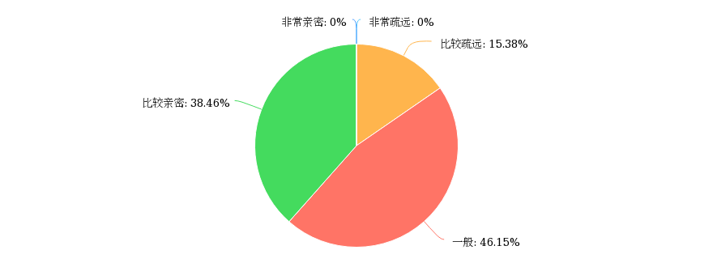
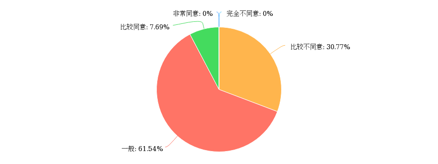
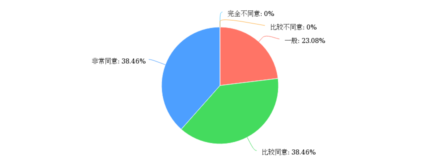
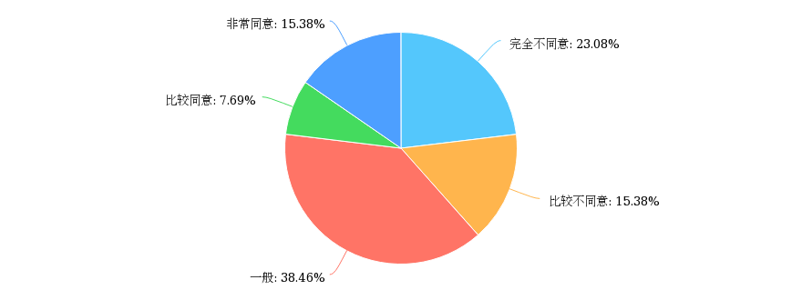
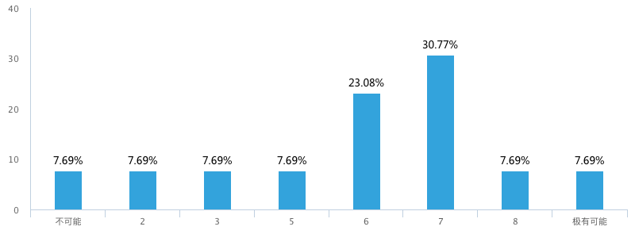

**Day252-253（2018年9月30日-10月1日，周日、周一）**

中国孩子在新西兰读高中又是一种什么样的体验？  
前些日子，我向David公司监护的一些高中生发放了调查问卷。由于样本数量较少（17个），且不属于完全随机抽样，可能在代表性方面会有减弱。不过，有数据肯定比没有数据要好，调查结果多少还是有价值的。  
今天我们先来看看关于学校部分，孩子们是怎么回答的。  

老师给予您很多帮助　  
  
在国人的印象中，外国老师总是自由散漫，没有什么责任心的样子。现在看来并非如此。

您感觉现在的学习状态……  
  
我想孩子们在回答这道题目的时候，应该是没有和国内的同龄人相比。

整个班级学习氛围浓郁  
  
也许家长对“浓郁”的要求会更高，或者刚好遇到了20%学习氛围不浓郁的班级，否则无法解释家长的焦虑。

平时花在回家作业上的时间……  
  
这里的家长肯定不用晚上十二点在微信群里怼老师（见下图），最后被老师踢出群。



您与新西兰本地同学的关系……  
  
和母语为英语的同学相处，近40%的孩子能做到比较亲密，已经非常不错了。

您与新西兰本地同学之间的沟通，存在语言或者文化的障碍……  
  
我在后台对将这题与上一题做了一次交叉分析，选择“比较同意”的正是与本地同学比较亲密的，这说明语言或者文化的障碍确实影响沟通。

您对进入新西兰八所大学充满信心……  
  
现在的孩子自信心还是蛮强的。

这里的学校教育，比您出国前的预期要差  
  
大约38%的同学认为这里的高中教育水平高于其出国前的预期。大约23%的同学则认为低于其出国前的预期。

如果您在国内有同学想来新西兰留学，您向他们推荐这所学校的可能性有多大？  
  
这是一道NPS量表题。46.15%的孩子给出7-10分，对当前学校表示满意。而53.85%的孩子对当前学校是不满意的。需要注意的是，上学和日常消费（购买商品或服务）不一样，除非转学，我们通常没有机会横向比较。孩子遇到一个不喜欢的老师，就会影响他对整所学校的判断。

净推荐值（NPS）又称净促进者得分，是一种计量某个客户将会向其他人推荐某个企业或服务可能性的指数。它是最流行的顾客忠诚度分析指标，专注于顾客口碑如何影响企业成长。通过密切跟踪净推荐值，企业可以让自己更加成功。  
确定您的净推荐值是直接了当的：问您的客户一个问题－“您是否会愿意将“公司名字”推荐给您的朋友或者同事？”  
根据愿意推荐的程度让客户在0－10之间来打分，然后你根据得分情况来建立客户忠诚度的3个范畴：

- 推荐者（得分在9－10之间）：是具有狂热忠诚度的人，他们会继续购买并引见给其他人。
- 被动者（得分在7－8之间）：总体满意但并不狂热，将会考虑其他竞争对手的产品。
- 批评者（得分在0－6之间）：使用并不满意或者对你的公司没有忠诚度。
