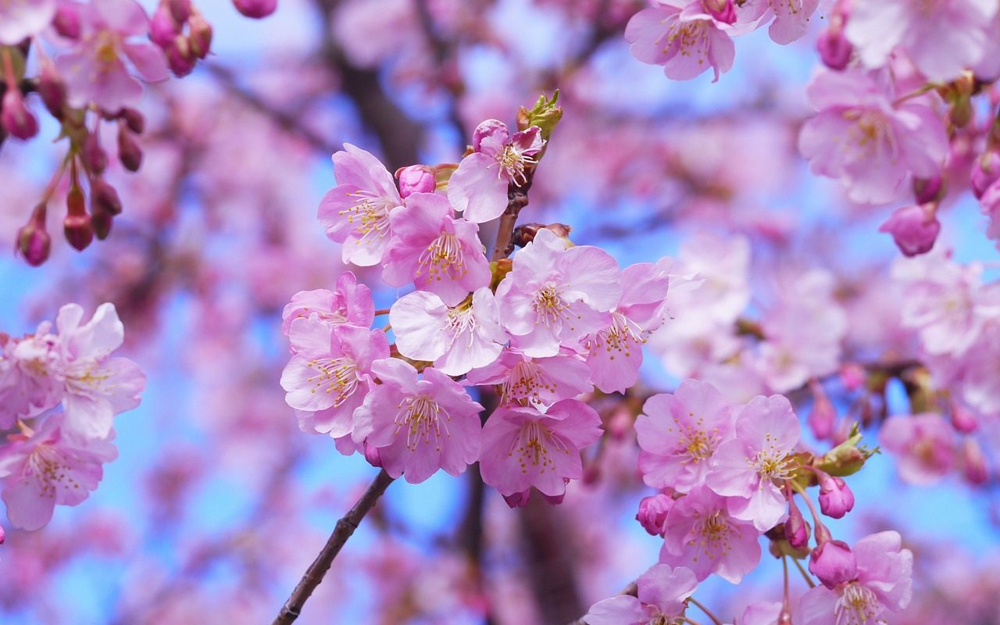
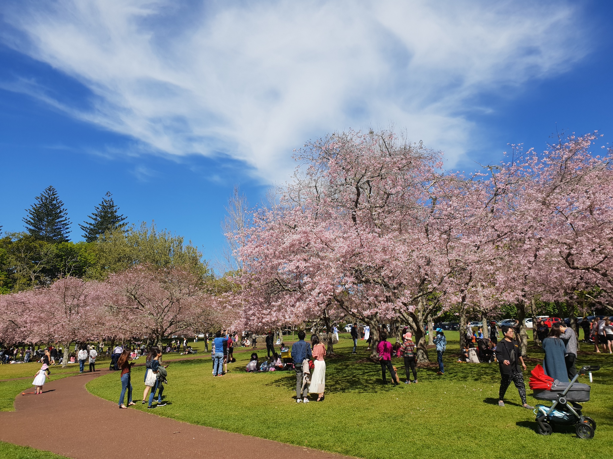
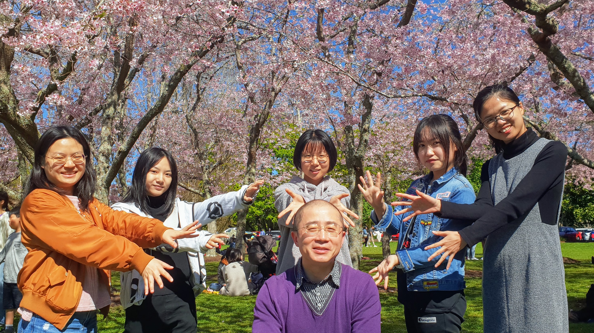
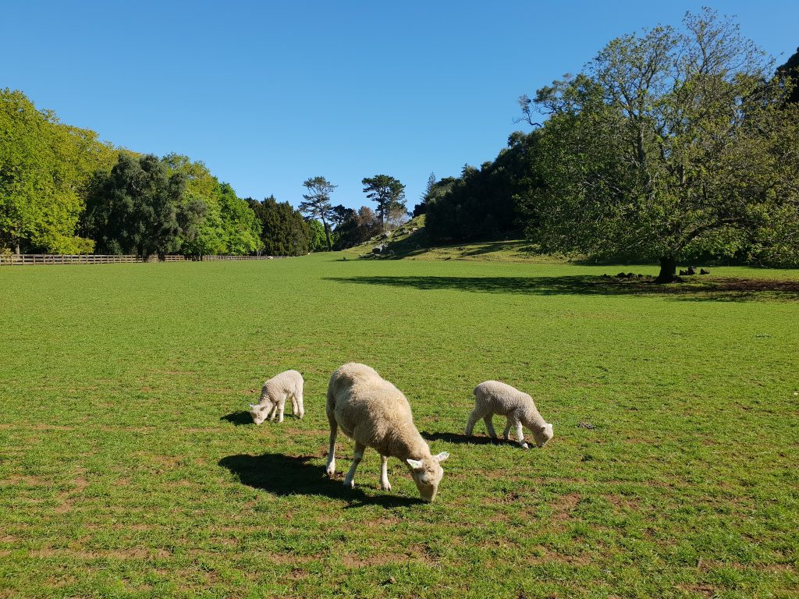

**Day260-261（2018年10月8日-10月9日，周一、周二）**

上周五放学，我又作为“党代表”，带领娘子军去Cornwall Park赏樱，今天挑出三张照片与大家分享。  

周五下午的游客就这么多，可以想见周六周日的人要比樱花树还要多。  
  

说好合影留念的，万万没想到娘子军在背后摆了这么个POSE，对我的脑袋发功，真的是无法无天。  


在公园内瞎逛，遇到羊妈妈带着两只小羊吃草，我们遂站在边上观察了会儿。发现羊吃草时非常非常专心，而它咬断草而不带出草根，我们也不知道它是如何做到的，看来是个技术活儿——请原谅城里人的无知。  

