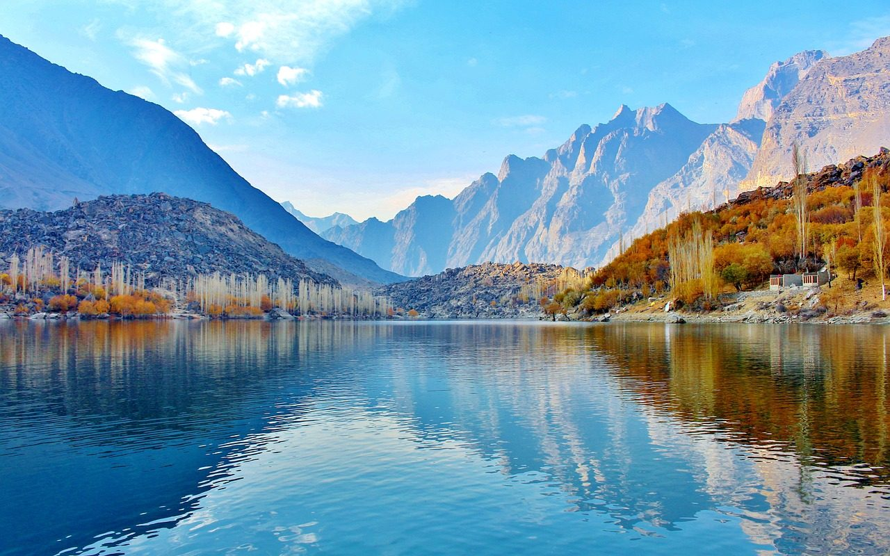

**Day270-271（2018年10月18日-10月19日，周四、周五）**

今早在朋友圈读到一个难以置信的故事“喝一口水就被判死刑，再搭上两条政府官员的性命”，哎，我都不相信自己活在21世纪。为核实此事，我查阅了维基百科，根据时间线，整编如下：

Aasiya Noreen在巴基斯坦旁遮普省Sheikhupura区的一个小村庄Ittan Wali出生并长大。  
该地区以及巴基斯坦其他地方的基督徒通常都有较低级别的职业，如清洁工和清扫工。  
Noreen是罗马天主教徒，从事农场工作以养家糊口。Noreen和她的家人是村里唯一的基督徒。在她被监禁之前，她的同事一再敦促她皈依伊斯兰教。

2009年6月，Noreen和一些工人一起在地里干活。她被派去从附近的井里取水，打水回来时她用一个在床旁边找到的旧金属杯喝了一杯。一个曾与Noreen有点过节的邻居看见这一情形，愤怒地告诉她：禁止基督徒从同一个器具中喝水。随后双方发生了一些争论。  
Noreen回忆说，当他们对她的宗教做出贬损性陈述时，她回答说：“我相信我的宗教和耶稣基督，他们为了人类的罪而死在十字架上。你的先知穆罕默德曾做过什么来拯救人类？” （指证她亵渎穆罕默德的工人在法庭上说的不是这个版本）  
在Noreen被警方救出之前，一群暴徒来到她家，殴打她和她的家人。警方对她的言论进行了调查，结果根据“巴基斯坦刑法”第295 C条将她逮捕。她随后被监禁超过一年，然后被正式指控。

2010年6月，少数民族事务部长Shahbaz Bhatti首次受到死亡威胁，当时他被告知如果他试图改变亵渎法，他将被斩首。作为回应，他告诉记者，他“致力于为巴基斯坦人民伸张正义的原则”，并愿意为Noreen的释放而战斗。  
2010年11月，Sheikhupura区法官判处Noreen死刑。  
2011年1月4日，在伊斯兰堡的Kohsar市场，旁遮普省省长Salmaan Taseer被他的安全团队成员——26岁的Malik Mumtaz Hussein Qadrir所暗杀。因为省长为Noreen辩护并反对亵渎神明法。（Mumtaz Qadri因暗杀被判处死刑并于2016年2月29日被绞死。）  
2011年3月2日，少数民族事务部长Shahbaz Bhatti在伊斯兰堡的住所附近被枪杀，可能是因为他对亵渎法律的立场。他是巴基斯坦内阁中唯一的基督徒成员。  
2011年8月，那位被暗杀的旁遮普省省长Taseer的28岁儿子Shahbaz被绑架。Shahbahz后来于2016年3月被发现释放，于3月9日返回拉合尔，他被囚禁了五年。　  
2014年10月16日，Noreen的上诉被上级法院驳回，维持死刑判决。  
2014年11月20日，Noreen的丈夫呼吁巴基斯坦总统宽大处理。  
2014年11月24日，Noreen的律师向最高法院提出上诉。  
2015年7月22日，巴基斯坦最高法院在上诉程序期间暂停了对Noreen的死刑判决。  
2015年11月，Noreen的首席律师Naeem Shakir宣布，在2015年两次推迟后，拉合尔高等法院将于2016年3月26日听取上诉。听证会被重新安排2016年10月13日，可是三名法官中的一名宣布辞职。【听证会不了了之，我想法官是怕被暗杀】  
2017年4月26日，巴基斯坦首席大法官Mian Saqib Nisar拒绝了Noreen的穆斯林律师Saiful Malook在6月的第一周听取案件的请求。

到目前为止，此事依旧悬而未决。大家可以想到：巴基斯坦若坚持宣判Noreen死刑，全世界人民不答应。若不判Noreen死刑，穆斯林狂热分子不答应，政府官员和法官都会面临死亡威胁。  
这时候，难道你还支持“主权大于人权”？我们是不是希望有一个世界警察站出来主持公道——立即释放Noreen，谁敢动Noreen一根汗毛，我就打得他们满地找牙。
