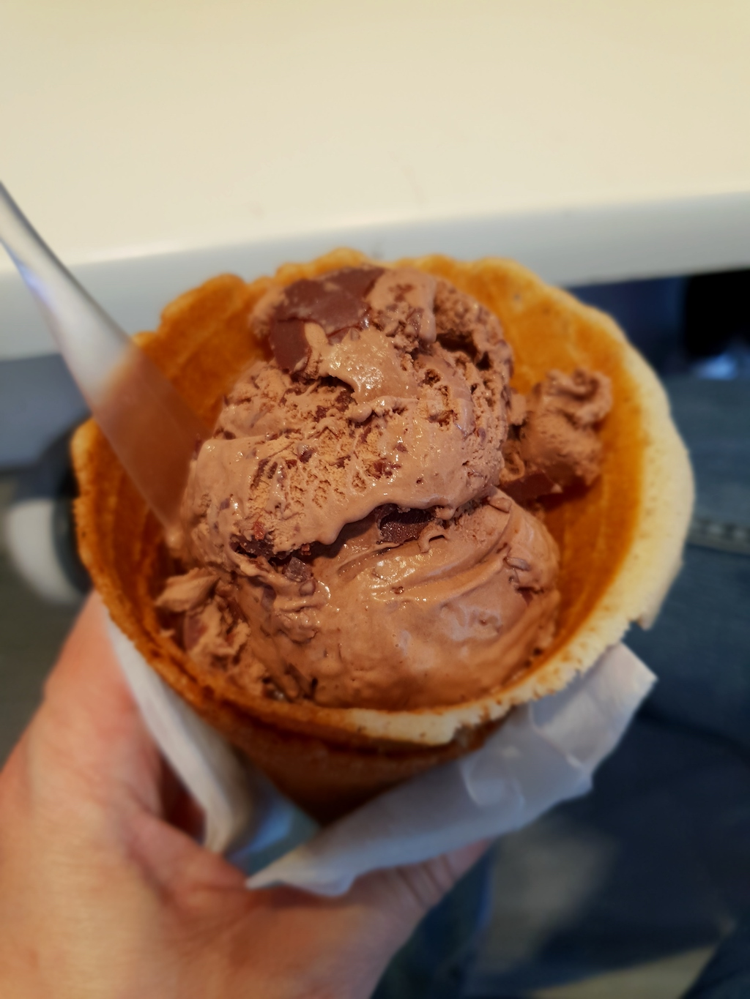

**Day282-283（2018年10月30日-10月31日，周二、周三）**

江湖还在，金庸已逝。  
有时候，我感到很幸运——生在这个时代。我相信两百年后，人们回顾这个时代的的各种经典（电影、歌曲、文学作品），他们的心情将一如我们仰望唐诗宋词与元曲。  
武侠作品，金庸的《书剑恩仇录》、梁羽生的《萍踪侠影》是我的启蒙读物。我上初一时，我奶奶家的邻居，不知道从哪里搞来一些武侠小说，包括还珠楼主的《蜀山剑侠传》，每逢假期，我就跑去他家借阅。现在想起来，这些书很有可能是盗版。  
那时信息闭塞，我不知道这两位是香港著名的武侠小说家，已经出版了很多作品。待到上初二时，《射雕英雄传》小说引进内地，录像厅开始播放《射雕英雄传》电视连续剧（也就是现在说的83版），于是痴迷于武侠小说，到处借书看。  
看多了，我还模仿着撰写武侠小说，经常是立下雄心壮志，拉开架式，像模像样开了一个头，然后……然后就没有然后了。而我突发奇想编写的以同班同学为主人公的武侠段子，尽管没什么故事情节，无非是张三打李四、李四打张三，因为读者有代入感，于是深受同学们的欢迎，引发传阅。

今天“期中考试”，我的口语发挥有点失常，其他应该都没什么问题。考完试，与几个同学一起Misson Bay Beach转了转，享受资本主义的阳光沙滩海浪。噢，还有冰淇淋。传说这是奥克兰最好吃的冰淇淋之一。

  


