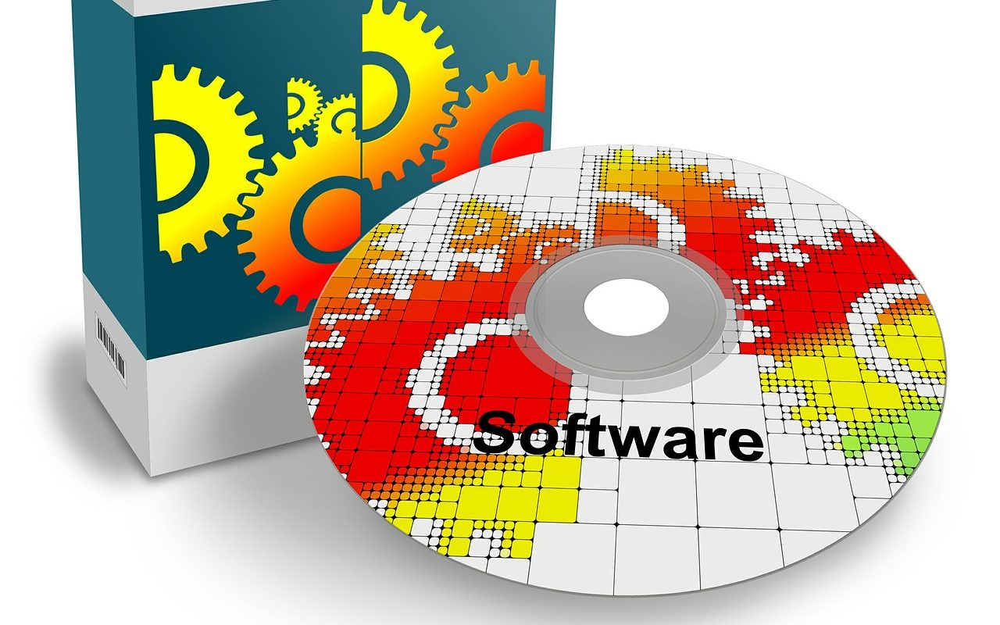

**Day110（2018年4月27日，周五）**

很早以前，我加入了一个IT的微信群。群主是以挑战微软霸权起家的方兴东，他曾创建“博客中国”。必须承认，是他把博客的概念带入中国。不过当几大门户为个人开通博客功能后，他的“博客中国”就死了——他不幸成为“先烈”。但是，咱们这位群主成名早，面子大，群里大佬不少，柳传志、余承东、李开复、雷军、薛蛮子……大佬们有时候还冒冒泡，冷不丁发个红包啥的。  
   
 这个群几乎天天有话题，而且还有争论，有时候争论激烈程度能达到面红耳赤（如果看得见）……我看再差一步就是线下约架。所以民主国家的议员们争论不休，发展到拍桌子、扔杯子或者掐架，也不足为奇了。  
   
 像倪光南院士这种“放任盗版让国产软件起不来”在我眼中明显是谬误的观点，群里居然也会分成各派开始互怼。别的群也就罢了，要知道咱们这个是IT群，保护知识产权难道不应该是IT行业的共识吗？

> 【倪光南院士怼微软：放任盗版让国产软件起不来】4月24日，中国工程院倪光南院士称，从win7开始，微软允许装盗版，谁装盗版，谁没装盗版，微软都清楚。微软就是用盗版策略，免费让你用软件，使中国人没机会发展自己的操作系统，还反过来说中国人盗版，说中国人小偷。

显然，倪光南院士也是一个阴谋论的支持者，微软在下一盘很大的棋，目的就是不让中国人发展自己的操作系统。  
   
 就技术角度而言，除非像在线网游一样不断地与服务器发生连接和数据交换，否则，操作系统不可能防止盗版。再说了，假如微软真的建立了面向全球WINDOWS操作系统的（反盗版）认证服务器，WINDOWS每次启动需要通过服务器认证，那么有一天服务器或者网络瘫痪，将会给全球造成无法估量的损失，情况要多糟糕就有多糟糕：病人上了手术台，手术用电脑蓝屏；飞机飞在天上，塔台用电脑蓝屏……

我相信微软不是没有权衡过，强化反盗版措施，最终容易误伤正版用户。微软即使能免除自己误伤正版用户的法律责任，可是他肯定无法承担起由此带来的各种损失的道义上的责任。  
   
 微软这种体量的公司，对全球的策略都是一致的，不会针对中国市场特别制订什么放任盗版的策略来打压国产操作系统。微软旗下的即时通讯软件MSN，一度与QQ分庭抗礼，可最终惜败，正是微软全球策略统一，不适应中国市场变化的后果。

综上所述，“微软放任盗版让国产软件起不来”的阴谋论可以休矣。
