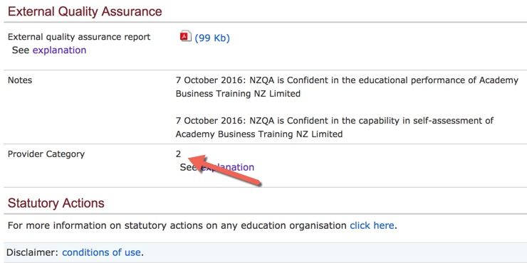

**Day228-229（2018年9月6日-9月7日，周四、周五）**

一所名为Abacus Institute of Studies的院校被NZQA（新西兰学历认证局）近期取消了New Zealand Diploma In Business Level 5 & Level 6的资格。  
 NZQA官网显示，这是一所一类院校（Category 1），应该说是一所好学校。虽然这次不是关院校，但对院校来说，负面影响不会小（新西兰圈子很小）。  
 David告诉我，他曾经监护的一个学生，在解除监护关系之后，跑去上了这所院校的这个专业。他在她选择这所院校的时候，就对她做出了善意提醒，她还是坚持要去，估计她现在就很尴尬了。

一直听David说Category、Category，我从未真正搞明白。今天上NZQA官网查了一番，算是弄清楚了。  
 NZQA根据外部评估和审查（EER）将非大学教育机构分为四类，确切地说是四个等级。非大学教育机构包括技术和理工学院，私人培训机构和政府培训机构。  
 四个等级的英文解释如下，对普通人来说，知道1是最好，4是最差就行了。  
   
 Category 1: two Highly Confident judgements, or a Highly Confident judgement for educational performance and a Highly Confident/Confident judgement for self-assessment capability  
 Category 2: two Confident judgements, or a Highly Confident judgement in self-assessment and a Confident judgment in educational performance  
 Category 3: any Not Yet Confident judgement  
 Category 4: any Not Confident judgement.



上图为我现在就读的KingSton语言学校在NZQA官网上显示的Category，它是2级，说明是个相对靠谱的学校。以我这8个月的学习体验来看，的确如此，尽管有很长一段时间师资力量不稳定。

[上一篇文章](https://chenyifeng.voyagelink.cn/?p=5658)提到了社保的事，今天看到一则对企业利好的消息，我真心希望社保费率能大幅度降低，别弄到最后只是降1个百分点，装装样子。

> 9月6日召开的国务院常务会议强调，目前全国养老金累计结余较多，可以确保按时足额发放，在社保征收机构改革到位前，各地要一律保持现有征收政策不变，同时抓紧研究适当降低社保费率，确保总体上不增加企业负担，以激发市场活力，引导社会预期向好。
