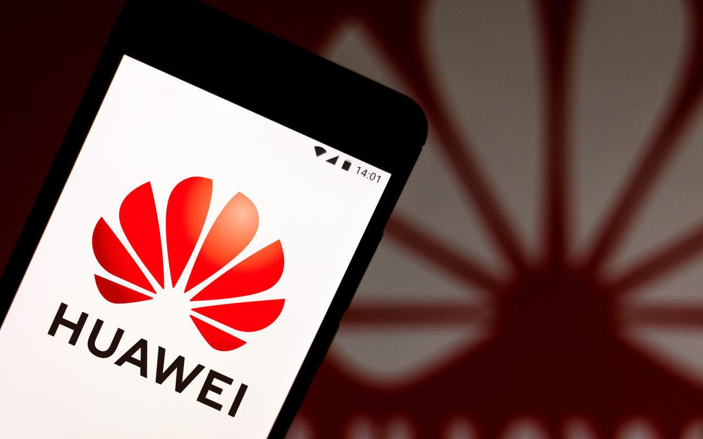

昨晚一不小心蹭了一个热点，有人私自将IT老友群里聊天记录传遍互联网，其中含有华为主管余承东转发“至道学宫”文章，不经意间捎带上了我“西塞山人”的头像和发言。
在此，强烈谴责个别人未经许可私自转出聊天记录的行为！ 
话说回来，我认为：华为高管余承东先生的转发是不合时宜的，不管转的是哪种文章，都会被视为华为的一种间接表态。尽管事实是余承东先生是以私人身份，在一个半公开的场合转发的，并且他没有加上任何评论。

在三问华为之前，我得先骂骂一部分人：总有一部分人，永远不分事实和观点，脑子里塞着的是一堆浆糊，我称之为泼妇骂街思维。辩论一展开，三言两语，就能归因到“李洪元的人品恶劣，抹黑华为是美帝国主义的阴谋”，然后振臂一呼，群情激愤，邪恶势力便统统被打倒，人类命运共同体的前景一片光明。我呸！ 接下来我复述一下李洪元事件的事实： 

1. 李洪元是被华为公司举报，送进看守所。至于说哪个人发起举报，他是HR，还是部门经理，不重要，因为这是华为公司的行为，不是员工个人行为。
2. 李洪元因犯罪事实不清、证据不足，被释放，并且获得了国家赔偿。这个事实证明了另一个事实：之前华为公司的举报是错误的，讲白了没有实锤。

而华为公司作出了这样的回应：“我们尊重司法机关，包括公安、检察院和法院的决定。如果李洪元认为他的权益受到了损害，我们支持他运用法律武器维护自己的权益，包括起诉华为。这也体现了法律面前人人平等的法治精神。”
企业和员工的关系，再恶劣，一般不会发展到深仇大恨不共戴天的地步。最坏的结果通常就是劳动纠纷对簿公堂。
企业主动把员工送往看守所，是毁人一生的事，本来就应该慎之又慎。更不能说举报完了，后面的事跟企业无关——明明是你把员工送进看守所的，员工被白白关了251天，权益受损是明摆着的，将来他很可能在华为所在的行业找不到工作，你说这事和你无关？
现在员工乃至全国人民和你讲情理的时候，你倒板起面孔讲起了法律，**你有没有同理心啊？** 
其实当初员工在跟你谈2N赔偿的时候，你明明应该跟员工讲法律——想2N赔偿来告我啊！那时你倒选择了讲情理，居然给出了2N赔偿。万万没想到，时隔半年后又反悔，**你有没有契约精神啊？** 

到今天，面对汹涌的舆情，华为还是龟缩在“法律”的保护伞下默不作声，承认自己举报错了，主动积极联系当事人道歉赔偿，有那么难吗？**你到底是不是一个负责任的大公司啊？**
