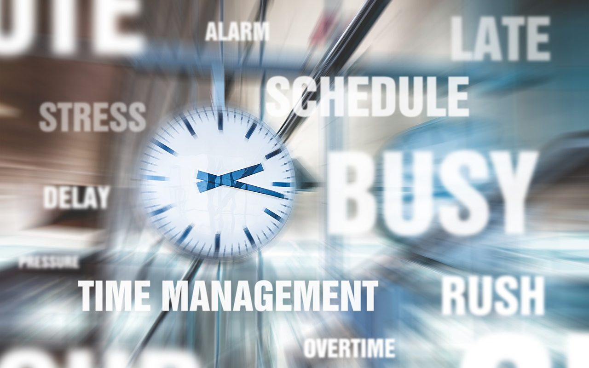

*最新修订于2020年2月7日*

   

*疫情当前，谈996并不应景。但要不是疫情逼迫我在家“坐月子”，我也没有大把的时间来完成这篇万字长文。为什么写得这么长？是因为我想站在更高的层面，把这事分析得透彻一点，能引发各方思考，作出一些力所能及的改变。单纯批判996的小文章，网上随处可见，多的是情绪发泄。  
 疫情对一直埋头前行的互联网企业，或许也是好事，正好停下脚步看看天：少做点事，天会不会塌下来？倘若您读完后有此感想，我便心满意足了。*

   

## 背景

   

996工作制，简称996，指的是早上9点上班、晚上9点下班，中午和傍晚休息1小时（或不到），一天总计工作10小时以上，并且每周工作6天的工作制度，代表着中国互联网企业盛行的加班文化。

   

2019年4月11日，阿里内部的交流活动上，阿里巴巴集团董事长马云发表了自己对于最近爆火的“996”话题的看法。他表示，能做“996”是一种巨大的福气，能在BAT里从事“996”工作，是前世修来的福报。  
   
而当时，互联网行业员工声讨996的行动已经是如火如荼，马云讲话爆出，无异于火上浇油。一时间，群情汹涌。以致于次日晚，马云不得不发微博回应996话题。他表示：“不为996辩护，但向奋斗者致敬”。  
马云称：“任何公司不应该，也不能强制员工996”，而“阿里巴巴从来也都提倡，认真生活，快乐工作！但是年轻人自己要明白，幸福是奋斗出来的！”

   

## 观点

   

都说屁股决定脑袋，我作为一个从基层员工成长起来的职业经理人、一个连续创业的小老板，屁股坐过了员工、经理、老板三个位置，也是996的亲历者，窃以为对996的话题还是可以说三道四的。  
 在此，我先亮明我观点：

   

- 知识工作本不应以工作时长论英雄
- 常态化996不会带来福气，只会引发多重伤害

   

然后，我再慢慢道来——

   

## 马云为什么这么说？

   

> 能做“996”是一种巨大的福气，能在BAT里从事“996”工作，是前世修来的福报。

   

马云的屁股决定了他必须得这么说。难道他能说：能做“996”是一种巨大的噩运？能在BAT里从事“996”是你前世作孽的恶报不成？  
提倡“勤劳”是一种道德正确，我们总不可能提倡“懒惰”吧？也不可能赞同大家游手好闲无所事事吧？  
“天将降大任于斯人也，必先苦其心志，劳其筋骨，饿其体肤”、“业精于勤荒于嬉”、“一分耕耘、一分收获”……，不计其数的名人名言在提醒我们，人生在世，必须勤劳，要不怎么有“勤劳致富”的成语呢？我们从小到大受到的成功学教育不都是这样的吗？　  
让员工相信“勤劳致富”也是企业管理的需要。把勤劳和“升职加薪、当上总经理、出任CEO、迎娶白富美、走上人生巅峰”联系起来，员工是不是感觉更有奔头？个人愿景与公司愿景高度统一了？员工一旦有了这种感觉，不勤劳也难。

   

那么问题来了，100个事业有大成功者，100个人都说自己996，我们是不是可以就此得出996是成功的充分且必要条件呢？  
当然不能。谁都知道，成功需要天时、地利、人和等多个条件。假如996是事业成功的充分且必要条件，那咱们在大街上随便扔一块砖头，就能砸到一个成功人士的脑袋。　　  
马云鼓吹996，自我标谤12（小时）X12（个月），是他的“幸存者偏差”意识在作祟。幸存者偏差，就是忽略了筛选条件，把经过筛选的结果当成随机结果。  
   
举一个我从“知乎”看来的例子帮助大家理解“幸存者偏差”：

   

> 一名记者来到火车站台上，随机询问：“请问你买到火车票了吗？” 一位大妈微微一愣，回答：“买到了” 。  
> 记者又转向一位精瘦精瘦的年轻人，问：“请问你买到火车票了吗？” 年轻人回答：“买到了”   
> 随后记者又问了5个人，大家都回答：“买到了”   
> 最后记者对着镜头说：“今年虽然火车票难买，但是通过采访我们发现，大家都买到了火车票，现在正满怀希望地赶回家乡，过个团圆年！”

   

## 马云这么说是数典忘祖

   

马云这么说，“幸存者偏差”意识作祟是一方面，另一方面，马云忘本了！  
我相信他创办阿里是996乃至12X12，可是他下海之前，有7年时间是脚踩两只船！  
公开资料显示，1988年，马云在杭州电子工业学院当老师，1995年正式辞职创业。这当中有7年的时间，马老师做了什么呢？

   

- 任教期间，马云是英语和国际贸易专业的讲师。他在西湖边发起了一个“英语角”，在翻译界慢慢的有了一些名气。
- 1992年，马老师跟同事一起成立了海博翻译社；翻译社入不敷出，为生存，马老师卖过鲜花和医药用品，还背着麻袋到义乌进货，甚至做过一年多的药品和医疗器材销售员；
- 1994年，海博翻译社营收持平。此时，马老师结识了来自西雅图的外教比尔，他给马云做了互联网的启蒙。
- 1995年，海博翻译社开始盈利。马老师向学校提出辞职，寻找新的创业机会。

   

我不禁要问，假如马老师在杭州电子工业学院的工作是996或者12X12，7年时间都无法像上面所说的那样“不务正业”，那么他还会不会有新的创造？会不会达到今天这样的成就？  
依我看，马老师的第一份工作，没有遇到996，才是他巨大的福气，才是他前世修来的福报。

   

## 知识工作本不应以工作时长论英雄

   

我们知道，996仅仅是一个人投入的工作时长。  
体力劳动者，比如工地上搬砖的工人，他的工作时间越长，搬的砖肯定越多，虽然加班阶段体力下降会带来搬砖效率的下降，但是工作12个小时搬砖的总数量绝对大于8个小时的搬砖总数量。体力劳动者的工作成果是具象化的，数量或质量肉眼可见，容易评估。  
**知识工作者和体力劳动者不同，他的工作时长与工作成果并不一定呈正比关系，有时候会呈反比关系。**知识工作者的工作成果是抽象化的，数量或质量肉眼不可见，不容易评估。  
以自嘲为“码农”的程序员为例，8小时产出100行代码，加班4小时产出50行代码。表面上代码数量增加了，开发进度加快了。可后50行代码，因程序员头脑不清醒，在代码中留下的缺陷（Bug）数量也许会高于前100行代码，最坏时会引发系统崩溃——以至于更高级别的“码农”不得不停下手头的工作来解决，拖累到整个开发进度。  
以我个人写作为例，我的打字速度是每分钟60-100个汉字，按每分钟60个汉字算，8小时打28800字，12小时打42300字，以此类推，我早应该是史上最高产作家了。实际呢？我有感而发思如泉涌时，码上千字成一篇文章需要个把小时。若是杂志约稿命题作文，坐一天最多只能憋出5000字。  
2019年8月，微软日本在2300名正式员工中做了一项缩短工作时长的试验，即“上四天班休息三天”。试验结果显示，当月“劳动生产率”（即月销售额除以雇员人数）与去年8月相比提高了39.9％。此外，在不到30分钟的时间内结束的会议增加了46％，用电量和纸张打印量减少了。微软日本计划在2020年8月继续这项试验。　　  
工作时间少，产出未必少，质量未必差。所以，知识工作本不应以工作时长论英雄。

   

我们退一万步说，若堆工作时长对知识工作真的有很大帮助，那么你不觉得面对BAT这些巨无霸公司，所有的创业公司都应该洗洗睡了，还谈个屁梦想啊！  
我们来做个简单的数学题，一个创业公司有50个人，每人工作8小时算一个人天，如果这50个人拼命干活，拼到不睡觉，那么每日拥有的工作能力是150人天。  
那他的竞争对手呢？比如说所有创业公司都绕不开的腾讯——投资人看项目时总会多问一句：“要是腾讯做了这个项目，你们怎么办？”财报显示，2019年三季度末，腾讯有6万名雇员，即6万人天。  
 50人天和6万人天之间的竞争……请问，创业公司堆工作时长还有什么希望？

   

## 粉碎另一类老板心里的“小九九”

   

有一类老板，认识不到知识工作的本质，以为利用996可以从员工身上榨取更多剩余价值，他们属于有小聪明而没有大智慧。我不能说他蠢，蠢货是当不了老板的，哪怕是小老板。而另一类老板，有着自己的盘算。  
只需要上过小学就能明白，在工作效率（有质量的产出/单位时间）恒定的前提下，增加工作时长，产出将同步增长。假设有一个收入和工时既定的软件开发项目，或者有一个（理论上）只要上线就能赚钱的游戏项目，采用不支付或少支付团队加班工资的996，尽早完工的话，老板的收益自然会最大化。  
然而，现实不是小学生的数学应用题，越是依赖团队协作的项目，情况就越复杂。  
   
“木桶理论”指出：一只木桶盛水的多少，并不取决于桶壁上最高的那块木块，而恰恰取决于桶壁上最短的那块。团队好比一个木桶，每个人好比桶壁上的木板，每个人工作效率的高低好比木板的长短。  
答案是秃子头上的虱子——明摆着，简单粗暴地让每个人堆工作时长，木桶里能盛装的水量，并不会如老板们所愿。  
或许有老板在想：我从BAT高薪挖人行不行？我只招985、211大学生行不行？将一帮聪明人汇集在一个团队，打造的木桶岂不可以装更多的水？  
理论上讲是的，实际则不一定。  
优秀团队的成因很复杂，不仅仅取决于成员的智商，也就是我们传统意义上的“聪明”。一项研究表明：个体智商和集体智商的正相关性不强，也没有发现呈负相关性。研究前科学家曾经以为集体智商是所有成员智商的平均值，研究后发现集体智商和个人智商毫无关系。

   

> 卡内基梅隆大学组织行为和理论学助理教授安妮塔·伍利、麻省理工斯隆管理学院Patrick J. McGovern管理学教席教授托马斯·马龙，以及克里斯托弗·查布利斯（Christopher Chabris）、桑迪·彭特兰（Sandy Pentland）和娜达·哈什米（Nada Hashmi），对年龄在18-60岁间的一组实验对象进行了智商测试，并将他们随机分成不同小组。每个小组都要完成指定任务，包括头脑风暴、制定决策以及视觉谜题，还要解决一个复杂问题。最后，研究者根据团队表现给团队的智商打分。  
> 结果发现，集体智商和成员智商间没有关联。那些成员智商较高的团队并未得到更高分数，而拥有更多女性成员的团队得分更高。研究者由此得出结论：女性成员越多，集体智商越高。　　  
>  优秀的团队，并非每个成员都非常聪明，而是懂得彼此倾听。他们会给彼此提建设性的批评意见，思想开放，拒绝独裁。在研究中，我们看到有些聪明的人主宰了整个团队的讨论，这样的团队并不是高智商团队。

   

一个人写出WPS软件的求伯君早已成为程序员中的传奇，如今任何一个互联网项目的成功都必须依赖于良好的团队协作。因此，老板若懒于战略思考，惰于团队建设和管理，只是一味地让全体员工996，那么即便是清一色聪明绝顶的员工拼命工作，对企业的成功也不会有太大的帮助。

   

## 常态化996伤害身体健康

   

**毫无疑问，常态化996会伤害身体健康。**  
时间对每个人都是公平的。一天24小时，减去8小时睡眠，4小时上下班、吃饭上厕所时间，用于工作最多也就12个小时。 通过压榨每天的睡眠、正常的生理休息间隙获得的时间，早晚要到医院还回去。“工作 996，生病 ICU”绝不是一句玩笑话。  
   
 有一天我下班回家，我老婆告诉我她表姐的孩子病危住院。孩子三十不到，是一个软件公司的主力程序员，加班加点习以为常。  
我大吃一惊，连忙问：“病危？出什么意外了？”“肺梗塞”。肺梗塞，什么鬼？我只听说过心肌梗塞、脑梗塞，从未听过肺梗塞。  
上网一查，这病的成因还跟久坐不动大有干系。

   

> 肺栓塞是在医学中，是一种临床表现，由于病人的血管在的肺循环的部分，因为身体其他部位的血块、肿瘤、脂肪、空气、组织碎片或其他异物，导致部分肺血管阻塞的现象。依照病程发展又可分为急性肺栓塞和慢性肺栓塞。患者会因呼吸困难而感到不适，可透过心电图、抽血或放射影像来诊断。  
> 专家告诉我们：肺栓塞是因为长期坐着不动，而这正是很多白领的工作状态，每天一坐可能就是几个小时。这样就会导致下肢血液回流减慢，血栓逐渐聚集形成。而且引发肺栓塞的深静脉血栓十分隐匿，常常在毫无觉察中随血流堵塞肺动脉，严重的肺栓塞能在几分钟内要人命，患者中约有10%发生猝死。久坐真的不仅可以损害健康，甚至还可以危及生命。

   

幸运的是，他与死神擦肩而过，最终得以康复。由于不能再996，他的公司毫不留情地将他列入了待裁人员名单。为了健康，他毅然选择了脱离这个行业。

   

我的前同事浩辰，一个牛逼的程序员，正当壮年，工作起来不分白天黑夜，去年同样是得了这个病，差点挂掉。

   

冰冻三尺非一日之寒，996对身体的伤害是逐步累积的，一旦爆发，可能就是“过劳死”。  
**调查显示，IT行业是对身体健康危害第二大的行业，第一大是矿工及建筑行业。IT行业“过劳死”年龄最低，平均只有37.9岁。**  
2016年10月5日，提供健康服务的“春雨医生”创始人张锐突发心肌梗塞去世，享年44岁。一个致力提供健康服务的人自己居然都保不住一个健康的身体，令人扼腕叹息之余，我们不应当吸取点教训吗？

   

盛大联合创始人陈大年在哈佛演讲时提到了他的“濒死体验”：某天晚上10点，他躺在浦东的一座立交桥下面，路灯冷冷清清地照着，他仰面望天，等待救护车。他的内心确信：过几分钟他将会死去。他的身体从此垮掉了，休养到今天也无法承受正常的工作强度。

   

## 常态化996伤害企业发展

   

在盛大，陈天桥、陈大年两兄弟一直是身先士卒，平均每天工作时间接近15小时，一年大概只休息七天。一是他们信奉创业要拼命的逻辑，二是有危机感，觉得假如不努力，错过了一个机会也许就会满盘皆输。  
   
我2003年11月，在盛大上市前半年进入盛大。2005年负责“盛大盒子”（后改为易宝）内容运营，有半年时间，我和我的团队过着朝10晚12的日子——上午10点上班，晚上12点下班。  
至今我还记得某天下班，下楼出电梯，跟等电梯上楼的陈大年和凌海副总裁打了个照面。凌总问：“咦，这么早下班了啊？”我被他一问，倒是一愣，低头看了下手机，额，“10点啦！”。夜里10点下班还算早，这就是盛大的工作氛围。  
盛大内部还有一个“夜总会”的梗，意思是：夜里总开会。有的副总裁非常喜欢通过会议来了解项目进度，解决各种问题，所以从早到晚，会议一个接一个。有提前通知的会议，也有临时召集的会议。  
我印象最深的一次，我参加一个副总裁临时召集的会议，坐下来发现需要公关部一个员工参与，副总裁拎起电话把已经下班的公关部员工叫回公司参加会议。我们一边开会，一边等她回来，会议因此延长了一个多小时。  
你说当时有多累吧，我倒也没太多感觉，但是生命浪费在很多次无意义的等待中，那种挫折感特别令人沮丧。我好不容易招进来的一个员工，呆了一周，就被“夜总会”直接吓跑了。  
   
在陈氏两兄弟的拼命驱使下，盛大成为一台狂奔的战车。“小步快跑，跑错了再纠正”、“别人出一拳的时间，我出两拳，快拳打死老师傅”、“森林资源有限，磨刀耽误砍柴工”这类思想大行其道。潜意识是：时间太宝贵了，咱们不能把时间浪费在思考上。  
   
这是996带出的又一个伤害——**压榨掉所有人的思考时间，对企业的发展造成伤害**。陈大年在反思中指出：

   

> 为了赶进度，越来越失去思考的习惯。越做，发现你前置考虑的时间越短；越做，停下思考的时间越短。然后失败概率逐步增加，每一次失败都会引起很多员工士气的低落，整个事情就会变得越来越糟糕。  
> 创始人为什么更认同拼命创业？是因为拼命创业能够带给你肉眼可见的成就感。比如说你今天有一个项目，正常需要10天完成，老板挽着袖子拼命上，5天就做完了，这就特别有成就感。然而为了这压缩的5天，我们放弃了什么？首先是每个员工的学习时间。若干年之后，你会发现我们的同事，从行业最前沿的人，变成了落伍的人，不知道最新的趋势，因为他们没时间学习。

   

经历了濒死体验之后，陈大年开始反思：创业需要拼命才能成功这件事情，到底对不对？最后他发现，拼命创业是个伪命题，拼命对创业其实没什么帮助。  
他发现决定阿里、腾讯这些公司成就的，往往就是其中的几件事，而其他大部分的工作都是锦上添花。只要做对了这几件事、又不太在意短期利益的话，这些公司一样能够达到今天的成就。  
**做正确的事，比正确地做事更加重要。**  
比如说像盛大，盛大运营过的游戏有60到70个，做过的领域也有很多，但对盛大所达到的最高点来说，只做对了两件事情：代理《热血传奇》和自主研发《传奇世界》。前者是盛大租来的印钞机，后者是盛大制造的印钞机。  
我跟一帮创业失败的小伙伴们交流的时候，大家从来没有后悔说当初要是能每天工作更长时间、干更多的活就好了，通常检讨的是：自己对项目的方向判断错误，找不到商业模式。南辕北辙，累死马儿也跑不到目的地呀，作为领导人，为什么不在辩明方向上多花点时间呢？一将无能，累死三军。

   

## 常态化996伤害个人发展更甚

   

**常态化996对个人发展的伤害更甚于对企业发展的伤害**。毕竟，企业的抗风险能力强于个人。  
企业管理和个人发展的关系是矛盾的统一体：企业的发展离不开个人的发展，只有个人发展了，企业才能发展。个人发展到一定地步，会让个人变得不可被他人替代，而企业管理又要求企业离了谁都能照常运转。  
原本的8小时工作制，其实是一个发展双赢的平衡点。对一个自带内驱力、上进心的人来说，8小时以外，他会主动去思考、学习，不断地进行自我提升，反过来让企业受益。当年马老师创办英语角和翻译社，提升个人英语水平，对他的教学工作不可能没有一点帮助吧？据说马老师是一个非常受学生欢迎的老师呢。  
1990-1994年（20岁-24岁），我在国企工作，利用8小时之外的时间，自学计算机编程，开发了很多实用的程序，大幅度提升了财务部门的工作效率。我辞职后很长一段时间，财务部门依然在使用我开发的程序。而这段编程的经历，让我受益一生，至今，50岁的我还能写写代码或修改代码，解决一点小问题。  
相比较而言，2003-2007年（33岁-37岁），我在盛大网络工作的4年，累计工作时长可能是国企4年的1.5倍。但是论个人成长收益，远不如国企的4年，更不如之后创业的那几年。  
 2012年，我受原盛大副总裁凌海之邀加入他的一个创业项目，于是再次遇见996：每天上午10点到公司，晚上10点到家。不到4个月，我就辞职不干了。我是职业经理人，有需要当然可以996，但我拒绝接受常态化996。常态化996会让一个知识工作者变得没有思考习惯、没有时间学习、没有创造力，让人变得和流水线上的一颗螺丝钉没什么分别。   
谁都清楚，流水线上的一颗螺丝钉，其可被替代性是显而易见的，这正是职场人士中年危机的由来。

   

华为大批裁掉35岁以上的员工，引发一片哗然。仔细一想，假如这些员工都是不可被替代的，大批裁掉有价值的员工对华为来说无异于自杀。任正非疯了吗？当然没有，既然华为能在劳动力市场找到性价比更好的替代者，那华为为什么不裁呢？  
表面上看，被裁者是因为年龄大、体力下降，无法胜任996，实际是他们被996榨干了，接下来能创造的价值与其收入不匹配。  
我经常挂在嘴边的一句话就是，一个岗位的工资不是由老板决定的，而是劳动力市场决定的，即胜任这个岗位的人所愿意接受的最低工资。换句话说，老板能用这个工资水平找到胜任这个岗位的人——你不干，自有人愿意干。  
不过，我相信华为还有不少35岁的员工因其不可被替代性能留在岗位上，甚至获得升迁。  
  
马云老师则把裁员这件事说得清新脱俗：“未来每年将会向社会输出1000名在阿里工作10年以上的人才。”  
请问马老师，各家以您为榜样的企业都在裁掉35岁以上的“人才”，您这些“人才”，又到哪里就业呢？也许，他们在阿里挣到的钱已经够（正常生活消费）花一辈子了，可他们还有几十年的人生啊，但凡有点理想，谁都不愿意混吃等死，而那点钱经得起**九十九死一生的创业**的折腾吗？人到中年，上有老下有小，还栽得起跟斗吗？

   

## “狠毒”的谷歌“20%自由时间”

   

Google（谷歌）在90年代创立之初，曾在企业管理与个人发展关系方面做出了有益的探索：谷歌员工每周可以利用20%规定的工作时间（如5天工作日中的1天），去做非官方立项的项目，大开脑洞、放手尝试。  
  
“20%自由时间”制度为谷歌成功孵化了许多“计划之外”的神级产品。比如：

   

- 全球月活用户超过1.5亿的Google Maps
- Email服务界霸主Gmail
- 和Chrome完美契合的新闻搜索Google News
- 最受欢迎的流量变现工具Adsense
- ……

   

尽管今天的谷歌正在慢慢成长为一个早年他自己所抵触的“常规”公司，“20%自由时间”制度已经名存实亡，不过它终究为谷歌的创新发展做出过巨大的贡献，帮助谷歌击败了强大的竞争对手Yahoo（雅虎）。  
要知道，当年雅虎的江湖地位，如同现在谷歌的江湖地位，谁都以为无人能挑战。我们旁观谷歌挑战雅虎，跟我们旁观唐吉诃德挑战风车的感觉没啥两样。  
中国的互联网企业，难道不应该从谷歌的发展历程中学习点什么吗？ 　　2018年，人人网、美团创始人王兴发表了一番对于谷歌“20%自由时间”的看法：

   

> 谷歌著名的所谓“20%自由时间”，我最初也觉得令人向往，后来了解了真相后觉得是虚伪的，又过了三四年我觉得是狠毒的。

   

王兴没有解释为什么要用“狠毒”来形容这项制度，也许他看懂了谷歌用这项制度大幅调动员工的工作积极性，用知乎上谷歌员工的话说：**他们不是在加班，他们是在为自己创业。**王兴知道，为自己创业的人眼中，从来没有什么996。

   

## 996这个局怎么破

   

996这个局怎么破？我试着解答这个问题之前，先提出三个问题：

   

1. 政府是否应该依法治国？
2. 互联网企业是否应该遵守法律？
3. 个人在工作之余是否应该享受生活？

   

对这三个问题，我相信各方的答案都是肯定的，而对照现实，各方又都会说出不得已的苦衷，好像都很有道理的样子。

   

- 政府会说：互联网企业创造了大量的就业机会和税收，消灭996怕影响企业发展。
- 互联网企业会说：竞争激烈，必须要靠996增加个人产出，占领市场或赢利。
- 个人会说：生计所迫，环境使然，不得不服从996，否则找不到工作。

   

政府、互联网企业、个人，这三者到底谁应该是996的破局者呢？   
我们来设想一个场景：

   

> 一个剧场，大家都在看戏。每个人都有座位，大家都能看到演员的演出。忽然，有一个观众站起来看戏（可能是为了看的更清楚，也可能因为身高较矮），周围的人劝他坐下，他置若罔闻，求助剧场管理员，管理员却不在岗位。于是，周围的人为了看到演出，也被迫站起来看戏。最后全场的观众都从坐着看戏变成了站着看戏。

   

理所当然，我们应当先批评那个破坏秩序，先站起来的观众。而作为剧场的管理员，不在岗位，就不应该批评了吗？毕竟，他是秩序维护者。  
最后，我们还应当注意到，所有的观众都站着看戏，没有观众会认为这是一次良好的观剧体验。说白了，没有人从中受益。  
场景里的观众是互联网企业，剧场管理员是政府。  
**当某个市场主体（企业）丧失自律、试图践踏劳动法时，政府就必须在第一时间发挥维护作用。**政府不应该寻找任何借口，逃避维护市场竞争秩序的责任。对破坏市场竞争秩序者的纵容，只会导致市场竞争环境的恶化。

   

政府切入秩序维护的点，只需要一个，那就是企业每月提供给员工的“工资单”。  
**政府应立法规定企业每月必须提供给员工记载有工时的规定格式的“工资单”，不提供“工资单”或提供的“工资单”不符合规定格式即违法。**  
“工资单”中必须如实记录所有员工每日开工和收工时间，工作时长。这样超过8小时的加班工资自然就会体现在“工资单”上。如果没有工作时长相应的记录，或者工作时长超过8小时没有体现加班工资，则视为不合法“工资单”。  
员工持不合法“工资单”即可向劳动局申诉，企业必须为不合法“工资单”向该员工支付赔偿。劳动局也应据此对企业做出罚款。  
赔偿和罚款的金额，多到足以让企业心痛但不伤筋骨。企业屡教不改，劳动局再加大处罚力度。企业是经济动物，权衡利弊，最终自然会放弃996，认真钻研在有限的时间里如何提高生产力。  
去年，我听说某个追求上市的互联网企业开始安排程序员三班倒工作，消息属实的话，我倒认为这才是互联网企业的可持续发展之道——从粗放式管理走向精细化管理。谁都明白，让知识工作者能够像富士康生产线上的工人保证持续稳定高质量的产出，其实是非常不容易的。

   

剧场里，大家都老老实实坐着看戏，不好吗？

   

## 结语

   

### 致个人：

   

1. 你能做996不是巨大的福气，而是晦气，只有管理不善的企业，才会堆工作时长，强制员工996。
2. 你能在BAT里从事996工作，只能说明你的确是一个“人才”。通过996从BAT拿到高额的回报，并不是你前世的福报，而是你拼上命换的，你该得的。
3. 财富不是人生的终极目标，幸福才是，工作是追求幸福的必经过程。追求幸福的过程本应是幸福的，一个从没有“自觉自愿”地废寝忘食、夜以继日投入过工作的人，是不会懂得这种幸福的。如果你还没有找到奋斗的幸福感，那请继续思考、不停寻找……千万不要错把被迫参与996当成自己在奋斗。

   

### 致互联网企业：

   

1. 以为996是互联网企业成功的充分且必要条件，老板非蠢即坏。
2. 一个没有创造力的互联网企业，仅仅为社会贡献一堆996的工作机会，那它不值得被歌颂。
3. 互联网不是法外之地，互联网企业同样必须遵守劳动法，强制996并且不发加班工资是违法行为，违法是可耻的。

   

### 致政府：

   

1. 《联合国人权宣言》第二十四条：人人有享有休息和闲暇的权利，包括工作时间有合理限制和定期给薪休假的权利。保护人权是政府的天职，也是政权合法性的基础。
2. 依法治国不是空喊口号，劳动法更不是放在那里供人观赏的标本。政府不出面维护市场竞争秩序，该出手不出手，就是行政不作为。
3. 假如你们不知道怎么破996这个局，我已将答案放在你们面前：工资单。
