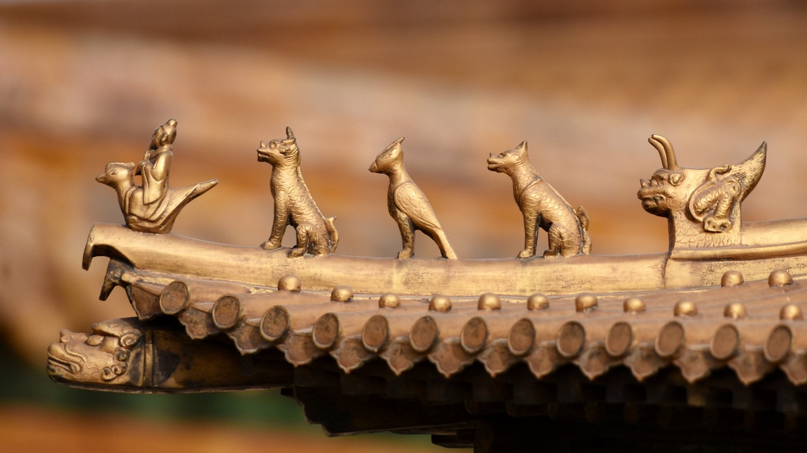

沈从文先生说：哪有什么民族劣根性，都是无良的社会制度逼的。  
我相信沈从文先生说这句话的时候，更多的是反思他所处年代的社会问题。  
其实，站在人类进化史角度看，无良的社会制度确实会塑造“民族劣根性”。  
讲难听点：祖上没有点劣根性，基因传不到今天。
  
## 进化造就人类的双重天性
乔纳森·海特在《正义之心：为什么人们总是坚持“我对你错”》一书中指出人类的双重天性：“我们在90%的意义上是黑猩猩，10%是蜜蜂”。  
众所周知，蜜蜂（还有蚂蚁和白蚁）是团队精神的极致：个体为集体，集体为个体，无时无刻，就算为了保护蜂巢要被外来入侵者杀死。  
他提出了“蜂巢假说”：假定人类是有条件的蜂巢式生物。（在特殊情况下）我们拥有着一种能力，即在比自身更大的群体中，放弃自我利益并且忘却自我（暂时且沉迷）。  
而法西斯主义将蜂巢心理发展到了一个诡异的高度。该教义将国家视为超个体，而个体不再有任何价值。
   
90%与10%并不是确切的数字。  
乔纳森·海特只是在强调：大部分人类天性的塑造与黑猩猩天性的塑造是由同样的个体层次过程决定的，而实际上只有很小一部分人类天性是由群体层次选择决定的，这些群体选择与蜜蜂、蚂蚁以及其他社会性生物密切相关。（了解论证过程，请阅读原著。）  
我的理解是：100%自私的人，在数万年的自然选择过程中，被淘汰了。恶劣的自然环境中，只能结成群体的人类，才能存活，繁衍后代。群体中如果有谁“出工不出力”，一旦被发现，那么他会被其他人弄死，直接断子绝孙。所以，人类不但有自私的基因，还有群体主义的基因。

与此同时，人类创造发展出文化，比如宗教，来强化群体归属特性。文化又强化了群体主义的基因。  
基因与文化的共同进化给予了我们一系列的「部落本能」：我们乐于将自己标记为群体的一员来体现归属性，我们会优先选择与群体内成员进行合作。  
每逢国庆，不少人把自己微信头像改成五星红旗背景；发源于电商的“中国人不骗中国人”；有些中国人到了海外爱祖国……这些都是我们的「部落本能」。
   
## 秦制2000年塑造民族劣根性
物竞天择，适者生存。对于人类而言，天择的结果就是“黑猩猩加蜜蜂”双重天性的人代代相传。  
天性，即根性。根性的优劣是比较出来的。华夏部落领先于世界的时候，我们所有的根性都是“优”的，至少自己觉得如此，华夏为中心，四海皆蛮夷。  
当华夏部落被船坚炮利的西方部落打败之后，华夏部落才发现，原来自以为的很多“优根性”，实际是“劣根性”。  
比如亡国、遭劫只歌颂忠臣烈女，翻译成今天的话，就叫丧事喜办、正能量满满。鲁迅先生就此总结出的是：“国民性的怯弱，懒惰，而又巧滑”。

> 中国人的不敢正视各方面，用瞒和骗，造出奇妙的逃路来，而自以为正路。  
> 在这路上，就证明著国民性的怯弱，懒惰，而又巧滑。……  
> 在事实上，亡国一次，即添加几个殉难的忠臣，后来每不想光复旧物，而只去赞美那几个忠臣；遭劫一次，即造成一群不辱的烈女，事过之后，也每每不思惩凶，自卫，却只顾歌咏那一群烈女。  
> 彷佛亡国遭劫的事，反而给中国人发挥“两间正气”的机会，增高价值，即在此一举，应该一任其至，不足忧悲似的。自然，此上也无可为，因为我们已经借死人获得最上的光荣了。  
> ——鲁迅《论睁了眼看》

“国民性的怯弱，懒惰，而又巧滑”从何而来？答案自然不在民国。  
自秦朝至清末，从政治层面讲，中国历史基本上就是一段秦制不断强化的历史。  
皇权使用官僚集团而非封建贵族作为政权统治的基础，普天之下，莫非王土，率土之滨，莫非王臣。皇权与官僚集团尽可能使民贫、使民愚，使民为一盘散沙，稳定其政权统治。  
不难想象，在这样的生存环境之下，只有性格怯弱、思想懒惰、心机巧滑的人才能生存下来传宗接代。  
这个过程中，基因与文化共同“进化”，国民性和秦制相互“养成”。  
有人怀疑2000年是不是足够让基因产生变异，你们看看最近专家对病毒观点的变异速度就知道了。没有基因变异的人，观点的转变怎么可能有迅雷不及掩耳盗铃之势？  
20世纪50年代，苏联科学家驯化狐狸，只经过6代就得到了非常温顺的狐狸。秦制用2000年来“驯化”人，足够了。

## 小结
本文的重点不是探究我们的民族到底有哪些“劣根性”，而是尝试阐述“民族劣根性”从基因层面的客观存在。  
“民族劣根性”的被发现，其实是与其他民族相比较的结果。倘若地球上只有华夏民族，那就不会有什么“民族劣根性”作为谈资了。
