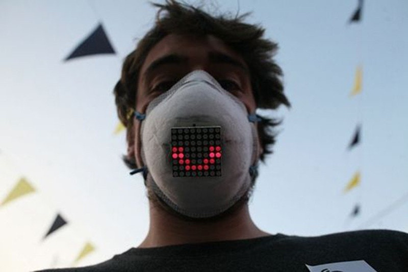
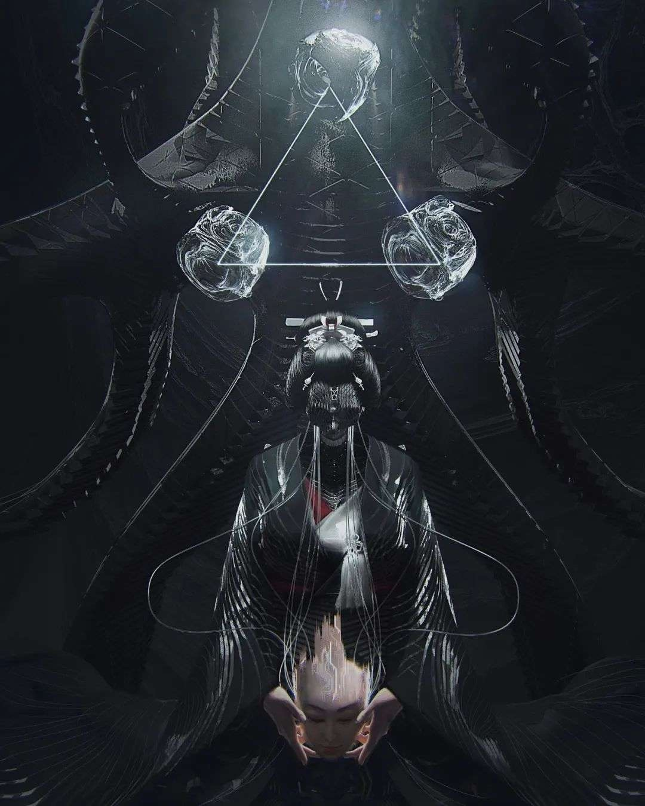

遥远的未来，2532年，三体人的使者来到了地球。  
他们发现地球上有一块特殊的区域，被大家称之为“诺亚方舱”。“诺亚方舱”的居民，自认为处于文明社会，他们称方舱以外其他区域为“蛮夷之地”。

三体人对此感到好奇，他们经过申请，最终获准参观“诺亚方舱”。当然，进入之前，一周的隔离检测是少不了的。  
三体人观察到：“诺亚方舱”的居民一年四季戴着智能口罩，口罩上有一块显示屏，显示着一种叫做“健康码”的东西。官员非常自豪地介绍，这种智能口罩可以实时检测出513年前的COVID病毒以及之后的任何变种，甚至未来没有出现的变种。

三体人有些困惑：先生，据我们所知，地球上病毒种类有成千上万，为什么你们对COVID病毒这么关心？我们研究过，这个病毒从开始至今，已经演化了513年，对人类基本没有什么危害了。

官员压低了声音说道：

> 不瞒各位，这个事情在科学界不是什么秘密，我们的科学家都知道。  
> 问题是在新冠纪元50年的时候，也就是2069年，政府试图取消口罩。  
> 但是万万没想到，竟然遭遇了绝大多数居民的激烈抵抗。显然，他们已经忘记了隔离，爱上了隔离，并从中受益。有的居民甚至喊出了「不戴口罩毋宁死」的口号，并且主动要求以方舱为家。  
> 政府考虑到居民如果长期居住在方舱不从事劳动生产将影响到经济的发展，所以在有识之士的建议下，索性把整个区域都改名为“诺亚方舱”。改名后，居民的安全感获得了大幅度提升，社会运行的稳定性完全可以与监狱相媲美。

三体人若有所悟：照你这么说，“诺亚方舱”的存在，是居民的精神需求，而不是社会的健康管理需要？  
官员苦笑着说：今天我们的存在，也是因“诺亚方舱”而存在。

当天晚上，三体人的使者向总部传去了关于“诺亚方舱”的信息。  
三体人领袖看到报告，脸上浮出了得意的笑容，**看来我们在513年前向地球发射的智子，已经成功锁死了地球人的智商。**
